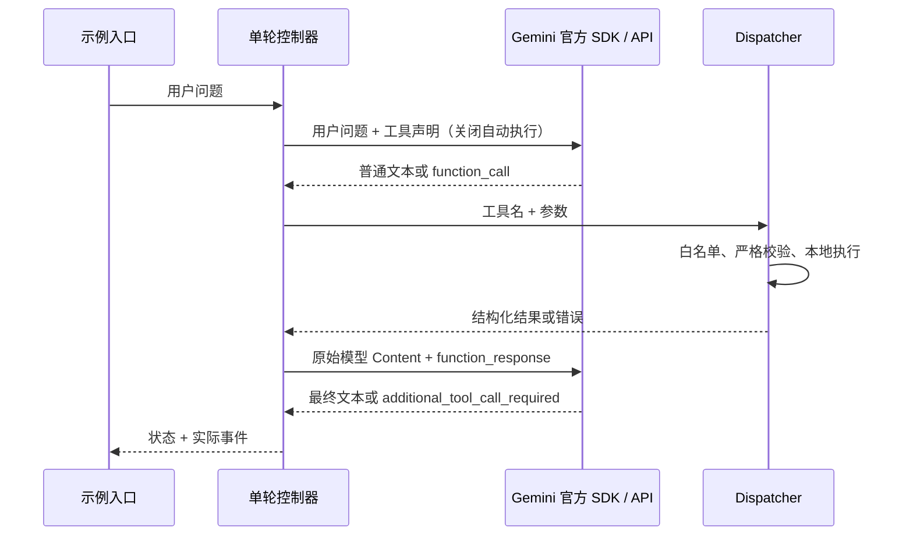

# Phase 1：原生 Tool Calling 实现与验证

日期：2026-10-10。技术验收通过；DOING（待授权本地提交）。当前交付状态以[路线图](../AGENT_LEARNING_ROADMAP.md)为准。

## 1. 当前实现的数据流程



若第一次直接回答，跳过 Dispatcher 和第二次请求。模型在同一响应内可提出最多四个调用，按原顺序执行；结果回传后的新调用不执行。这是一个有条件分支的单轮流程，没有持续 Agent Loop。

| 文件 | 作用 |
|---|---|
| [tools/__init__.py](../src/agent_demo/tools/__init__.py) | 两个业务函数、JSON Schema、白名单、严格校验、分发与错误结构 |
| [agents/tool_calling.py](../src/agent_demo/agents/tool_calling.py) | 最多两次模型请求、事件记录、状态与终止边界 |
| [integrations/gemini.py](../src/agent_demo/integrations/gemini.py) | 官方 SDK 协议适配，保留原始上下文和调用关联 |
| [config.py](../src/agent_demo/config.py) | 复用 Phase 0 设置，新增安全的模型环境配置 |
| [phase01_tool_calling.py](../examples/phase01_tool_calling.py) | 真实模型入口及明确标记的固定 Mock 轨迹 |
| [test_phase01.py](../tests/test_phase01.py) | 无密钥的业务、故障、流程和真实 SDK 类型协议测试 |

## 2. 十个学习问题

### 2.1 什么是 Tool Calling？

模型读到问题后，可以返回“请调用某工具，参数是这些”的结构化消息。我们的程序决定是否允许并实际执行，再把结果交回模型组织答案。例如模型提出 `add(a=15,b=27)`，Python 算出 42，模型再解释这个结果。

### 2.2 LLM 怎么知道有哪些工具？

每次请求附带工具名称、说明和参数定义。`TOOL_DEFINITIONS` 就是我们给模型看的菜单；不是把本机所有函数开放出去。工具说明明确告诉模型：规格数据是 MOCK。

### 2.3 JSON Schema 怎样约束参数？

`add` 的参数必须是包含 `a`、`b` 的对象，值是 number；必填项列在 `required`，额外字段被禁止。这是给模型的接口约定，但不能代替 Python 校验：模型可能产生错误参数，Python 的 `bool` 还是 `int` 子类，需要显式拒绝。

```python
"parameters": {
    "type": "object",
    "properties": {"a": {"type": "number"}, "b": {"type": "number"}},
    "required": ["a", "b"],
    "additionalProperties": False,
}
```

本地再次检查类型、字段集合、有限数值；字符串形式 JSON 还拒绝重复键、NaN、Infinity、数组等。规格型号必须满足 `MOCK-SW-<1～3位数字>`；合法但没有数据的型号返回 `not_found`，路径或命令属于无效参数。

### 2.4 为什么返回工具名后，函数不会自动执行？

模型响应只是数据，不是 Python 调用指令。`GeminiClient` 只把它解析成 `ToolCall`。应用调用 `dispatch()` 才会执行。我们向 SDK 提供声明对象，不提供 Python 函数，并显式设置：

```python
automatic_function_calling = types.AutomaticFunctionCallingConfig(disable=True)
```

SDK 的自动执行与模型是否可以提出调用是两件事；`AUTO` 保留模型直接回答的能力。[官方 SDK 文档](https://googleapis.github.io/python-genai/)提供手动回传与关闭自动执行的接口说明。

### 2.5 Dispatcher 为什么需要白名单与参数校验？

工具名来自模型，不应拿它查找全局函数、导入模块或执行代码。白名单只允许两项，参数必须通过校验才执行：

```python
TOOL_REGISTRY = {"add": add, "lookup_product_spec": lookup_product_spec}
# dispatch 中先确认允许的名称，再调用 validate_arguments。
result = TOOL_REGISTRY[name](**validated)
```

未知名称返回 `unknown_tool`，参数错误返回 `invalid_arguments`，业务异常返回 `tool_execution_failed`。工具异常详情可能包含敏感信息，因此只记录异常类型。没有 `eval()` / `exec()`。

### 2.6 Tool Call ID 有什么作用？

它把某次调用请求与对应结果连接起来，尤其一次返回多个调用时。Gemini SDK 的 `FunctionCall.id` 可以缺省：有 ID 时逐项复制到 `FunctionResponse.id`；缺省时保持 `None`，按原始调用顺序与名称返回，不虚构供应商 ID。应用另有 `run_id`，表示整次执行，不能冒充工具调用 ID。

控制器拒绝重复非空 ID，并用 `zip(..., strict=True)` 保证调用与结果数目一致。适配器测试检查实际 SDK 类型、ID 有无两个场景及原始 Content 对象。模型内容携带的 opaque thought signature 原样回传，既不解码也不打印。它不是可供展示的内部推理。

供应商协议不能混用。例如 [OpenAI Function Calling 文档](https://developers.openai.com/api/docs/guides/function-calling)使用自己的结果关联格式；本项目这一阶段实际实现的是 Gemini 协议。

### 2.7 为什么执行结果还要交给模型？

模型不知道本地函数实际运行出了什么。第二次请求同时保留原始用户内容、原始模型 Content 和工具结果，使模型能依据事实解释。返回错误也要让它知道失败，而不是猜一个成功结果。

### 2.8 和传统 Python 调用有什么区别？

传统调用由代码确定函数与参数，例如 `add(15,27)`。Tool Calling 的工具选择和参数最先由模型提出，然后同样由 Python 执行，但要经过安全边界。这个区别不代表模型能突破白名单执行任意程序。

### 2.9 和 Agent Loop 有什么区别？

本阶段固定为“请求 → 一轮工具 → 回传 → 答案”，最多两次模型请求。Agent Loop 会继续根据结果选择下一步工具，需要轮数、时间、调用数、重试和预算等限制。第二次模型响应仍请求工具时，本阶段返回 `additional_tool_call_required`，没有最终成功答案。

### 2.10 为什么不用 LangChain？

目前需要亲眼看到工具声明、响应解析、Dispatcher 和结果回传。官方 SDK 加少量 Python 已足够完成这个目标。后续框架可以复用业务函数，但这阶段引入框架会遮住正在学习的边界。

## 3. 模型配置与运行

环境：Windows 10 x64 / CPython 3.11.0 / `google-genai==2.29.0`。配置读取 `GEMINI_API_KEY`，否则读取 `GOOGLE_API_KEY`；模型由 `GEMINI_MODEL` 指定，默认 `gemini-3.5-flash-lite`，已实际验收。事件记录响应 `model_version`，模型可以显式更换，但新组合应重新验收。

SDK 安装、实际类型字段与接口均已核实。声明用 `parameters_json_schema`；结果用 `FunctionResponse`，有 ID 时显式保留。`Part.from_function_response()` 在安装版本中不接收 ID，因此没有用它虚构统一接口。参考：[Gemini Function Calling](https://ai.google.dev/gemini-api/docs/function-calling)、[官方 SDK](https://googleapis.github.io/python-genai/)、[当前模型目录](https://ai.google.dev/gemini-api/docs/models)。

不自动加载 `.env`，不自动读取旧工程。真实验收经用户明确授权，仅只读读取旧工程 Gemini 密钥，并通过进程环境运行新工程示例；没有复制密钥到项目文件。SDK 单请求超时 30 秒，attempts=1，输出上限 2048 tokens。超时只说明客户端调用失败，不承诺取消服务端计算或计费。

```powershell
.\.venv\Scripts\python.exe examples\phase01_tool_calling.py --mock
# 真实运行前，安全地配置进程 GEMINI_API_KEY。
.\.venv\Scripts\python.exe examples\phase01_tool_calling.py "What is 15 + 27?"
.\.venv\Scripts\python.exe examples\phase01_tool_calling.py "Please look up the specifications of MOCK-SW-48."
.\.venv\Scripts\python.exe examples\phase01_tool_calling.py "Hello!"
```

Mock 模式固定输出加法调用，不理解任意 prompt，不是 Python 意图路由，也不是实际 API 验收。真实模式由模型决定工具调用，应用只做协议解析和白名单执行。

## 4. 实际验证命令与结果

```powershell
# 本次新增运行依赖的实际解析和安装
.\.venv\Scripts\python.exe -m pip --isolated install --index-url https://pypi.org/simple --timeout 15 --retries 1 --disable-pip-version-check --no-cache-dir google-genai
.\.venv\Scripts\python.exe -m pip --isolated install --disable-pip-version-check --no-cache-dir --no-build-isolation --no-deps -e .
.\.venv\Scripts\python.exe -m pytest -q
.\.venv\Scripts\python.exe -m ruff check .
.\.venv\Scripts\python.exe -m ruff format --check .
.\.venv\Scripts\python.exe -m pip check
.\.venv\Scripts\python.exe examples\phase00_hello.py
.\.venv\Scripts\python.exe examples\phase01_tool_calling.py --mock

# 已通过 Python subprocess 导出下列输出到 requirements-lock.txt（保留原头部）
.\.venv\Scripts\python.exe -m pip list --format=freeze --exclude-editable

# 独立新环境复现，保留原主环境和 Phase 0 验证环境
.\.venv\Scripts\python.exe -m venv .venv-phase1-check
.\.venv-phase1-check\Scripts\python.exe -m pip --isolated install --index-url https://pypi.org/simple --timeout 15 --retries 1 --disable-pip-version-check --no-cache-dir -r requirements-lock.txt
.\.venv-phase1-check\Scripts\python.exe -m pip --isolated install --disable-pip-version-check --no-cache-dir --no-build-isolation --no-deps -e .
.\.venv-phase1-check\Scripts\python.exe -m pytest -q
.\.venv-phase1-check\Scripts\python.exe -m ruff check .
.\.venv-phase1-check\Scripts\python.exe -m ruff format --check .
.\.venv-phase1-check\Scripts\python.exe -m pip check
.\.venv-phase1-check\Scripts\python.exe examples\phase00_hello.py
.\.venv-phase1-check\Scripts\python.exe examples\phase01_tool_calling.py --mock
```

主环境 42 passed（包含原 Phase 0 的 6 项），新环境 42 passed in 0.80s；两套 Ruff check、format check、pip check、Phase 0 示例、Phase 1 Mock 示例均通过。锁定 35 个外部包，适用上述 Windows/Python 环境，其他平台未验。

首次测试 39 passed；随后增强响应类型校验，增加三个畸形适配器返回值用例，最终 42 passed。首次 Ruff 发现长行和未使用导入，通过定向修复与格式化后通过。没有覆盖或改写旧测试，也没有把失败记录抹掉。

覆盖用户要求的前九项离线检查：正常加法/规格/未找到型号、未知工具、无效 JSON 与参数、执行异常、模型直接回答、调用关联、完整离线闭环；另覆盖第二轮请求的终止、错误类型脱敏、SDK 自动执行关闭、签名上下文保留和不完整响应拒绝。

无凭据运行真实示例也已验证：退出 1，`configuration_error / ValueError`；不会误报成功或输出密钥。

## 5. 真实 API 验收记录

真实验收已通过，供应商 Google Gemini，模型与响应版本均为 `gemini-3.5-flash-lite`，SDK `google-genai==2.29.0`。通过官方模型目录确认其为支持 Function Calling 的稳定模型：[型号说明](https://ai.google.dev/gemini-api/docs/models/gemini-3.5-flash-lite)。

首个真实加法请求返回 `api_error / ServerError`，未发生工具执行。失败轨迹保存在忽略目录 `outputs/phase01_real_add.json`，不提交。随后 `client.models.get('gemini-flash-latest')` 成功，确认模型元数据可访问，支持 `generateContent`；这只能证明元数据请求成功，不能代替闭环验收。

再次请求该别名仍返回 ServerError，保存 `outputs/phase01_real_add_retry.json`，没有擅自无限重试。改用稳定 `gemini-3.5-flash-lite` 后模型确实返回加法调用，Dispatcher 得到 42，但最初回传角色为 `tool`，服务端返回 HTTP 400。诊断只输出错误类型、状态码和固定分类，没有打印异常正文或密钥。

这揭示官方 SDK 主页示例与当前协议的差异：SDK 示例写 `role='tool'`，但已安装 SDK 的 `Content.role` 说明只支持 `user/model`；真实 400 指向 role 校验。改用 `role='user'` 发送 FunctionResponse，原始模型 Content、签名与实际调用 ID 仍保留；补上角色断言后闭环通过。失败轨迹 `outputs/phase01_real_add_stable.json` 保留。不能仅凭 Mock 或示例文档判定真实协议可用。

真实示例由临时验收脚本使用 Python `subprocess.run` 调用，配置只在进程环境；实际入口与参数如下：

| 实际执行入口与参数 | 结果 | 模型请求/工具次数 | 证据 |
|---|---|---|---|
| `.venv\Scripts\python.exe examples/phase01_tool_calling.py "What is 15 + 27?"` | completed，`15 + 27 = 42`，退出 0 | 2 / 1 | `outputs/phase01_real_add_fixed.json` |
| 同入口，`"Please look up the specifications of MOCK-SW-48."` | completed，48×1Gbps、4×10Gbps，明确 Mock，退出 0 | 2 / 1 | `outputs/phase01_real_spec.json` |
| 同入口，`"Hello!"` | completed，直接问候，退出 0 | 1 / 0 | `outputs/phase01_real_greeting.json` |

以上 JSON 位于忽略目录，含实际结构化事件，不纳入 Git；下面的摘录保留在文档中便于追踪。

```text
run_id: bfff1900fe34464d8f0869823e2318dc
MODEL_REQUEST → MODEL_RESPONSE (gemini-3.5-flash-lite)
TOOL_CALL: call_97714 / add
VALIDATION: {a: 15.0, b: 27.0} accepted
TOOL_EXECUTION: completed, 0.016 ms
TOOL_RESULT: {status: ok, result: 42.0}
MODEL_REQUEST: 保留原始模型 Content，回传同一调用的 FunctionResponse
MODEL_RESPONSE → FINAL_RESPONSE: "15 + 27 = 42"
status: completed
```

规格轨迹：`run_id=e975b43b971d4f619298373c0bd626cf`，`tool_call_id=call_42746`，`lookup_product_spec(model='MOCK-SW-48')`，结果 `source_type=mock`，最终答复标明 Simulated data。问候轨迹 `run_id=6b0cd8bb1f7a4bca92dbdd15b57e6d13`，无 TOOL_CALL，最终 `Hello! How can I help you today?`。

## 6. 可观测性与限制

事件按实际分支产生：`MODEL_REQUEST → MODEL_RESPONSE → TOOL_CALL → VALIDATION → TOOL_EXECUTION → TOOL_RESULT → MODEL_REQUEST → MODEL_RESPONSE → FINAL_RESPONSE`。直接回答无工具事件；校验拒绝无执行事件；API 失败只有请求和错误事件。

公共字段包括 `run_id / tool_call_id / tool_name / validated_arguments / execution_status / elapsed_ms / error_type`。参数只在白名单校验通过后展示，不记录无效参数原文、请求正文、API Key、SDK 原始响应或异常消息。记录的是实际动作和结果，不声称获取模型内部推理。

`not_found` 是业务结果；`tool_error` 是执行失败，两者不能互换。未实现持久日志、usage/成本累计、复杂工具超时取消、重试策略或持续循环；这两个工具为本地短时纯函数。模型最终措辞仍需结合工具事件核对，不能仅凭答案文字判定已执行。

## 7. Git 与后续

当前 `phase-1` 分支基于 `c3e5f2e`；远端只读查询已成功，`main` 与 `phase-1` 均指向同一提交。旧工程只读 Git 状态为空。本阶段未执行 git add、commit、push，不沿用 Phase 0 的一次性提交授权。

最终核查：15 个源码/配置/文档交付文件；`git ls-files` 未包含密钥文件、venv、runtime、outputs 或运行数据库；`git check-ignore` 确认相关路径忽略。用实际 Gemini 密钥在内存中比对交付文件，无匹配；未输出密钥。新旧验证环境的外部包版本完全一致。文档本地链接及 `git diff --check` 通过；Git 的 LF/CRLF 提示是行尾转换提示，不是差异错误。最初简易链接正则误把代码 `TOOL_REGISTRY[name](**validated)` 当链接，排除代码块后复核通过，文件链接实际无缺失。

建议提交：`feat: implement manual Gemini tool calling with validated local tools`。技术验收已通过，本地提交仍需本阶段授权。下一阶段再实现有明确终止、预算和故障处理的 Agent Loop，复用现有工具及适配器。
