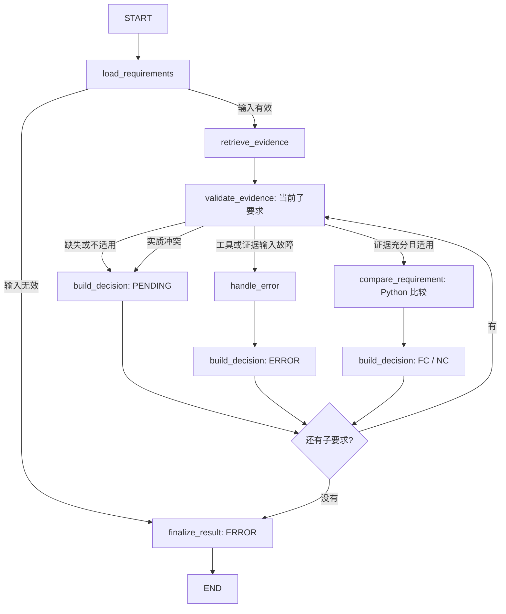

# Phase 4：LangGraph 显式工作流与业务模型

验证日期：2026-10-10～2026-10-11。技术验收通过；代码尚未提交，阶段按路线图统一标准暂记 DOING。本阶段完全离线，没有调用 LLM、真实 RAG 或真实设备。

## 1. 实际实现及入口

```powershell
.\.venv\Scripts\python.exe examples\phase04_langgraph_workflow.py
.\.venv\Scripts\python.exe -m pytest
.\.venv\Scripts\python.exe -m ruff check .
```

Windows 10 x64 / Python 3.11.0；实际安装版本 `langgraph==1.2.14`、`pydantic==2.14.0`。它们原先已作为间接依赖安装，本阶段在 pyproject.toml 中明确声明直接依赖，不重复安装新的框架。`requirements-lock.txt` 的版本保持不变，补充复核说明。

关键文件：

| 文件 | 职责 |
|---|---|
| [requirements.py](../src/agent_demo/domain/requirements.py) | Requirement、手工拆分标志、必要性、运算符与有限数值校验 |
| [evidence.py](../src/agent_demo/domain/evidence.py) | Evidence，强制 MOCK，缺失值显式为 null |
| [decisions.py](../src/agent_demo/domain/decisions.py) | Decision 与完整 WorkflowResult |
| [mock_cases.py](../src/agent_demo/domain/mock_cases.py) | 人工整理条款、补充 MOCK 电口证据、五类场景 |
| [compliance_graph.py](../src/agent_demo/graphs/compliance_graph.py) | State、节点、条件路由、单位转换、比较与汇总 |
| [Demo](../examples/phase04_langgraph_workflow.py) | 输出五个完整 JSON 结果 |
| [离线测试](../tests/test_phase04_langgraph_workflow.py) | 真正运行编译后的 StateGraph，验证业务和状态更新 |

原有 Phase 1–3 业务工具和 Agent 实现没有替换。查询继续复用 Phase 1 `lookup_product_spec` / Dispatcher；数值比较直接使用 Python，不用计算工具代替比较规则。

## 2. 数据模型和证据边界

Requirement 记录原始条款、来源位置、型号、属性、运算符、期望值、单位及适用条件。`kind=composite` 的父条款没有直接比较字段；人工提供 `kind=atomic` 的子要求并保留 `parent_id`，`mandatory` 明确是否必要。输入校验拒绝重复 ID、空父条款、未知父节点、循环父子关系、型号不一致，以及不支持的运算符。

示例条款“至少 48 个 GE 电口和 4 个 10GE 上联接口”拆为五项：下联数量、下联速率、下联介质、上联数量、上联速率。不能只检查数量，忽略 GE、10GE 或电口限定。这是人工拆分，不是自动自然语言解析器。

Evidence 保存实际值和单位、原文、文件、版本、位置、条件及 `source_type=mock`。原工具只提供数量和速率，不提供介质和资料版本。因此：

- 默认检索只映射工具真正返回的四个字段，`source_version=null` 表示未知，不补造产品资料版本。
- 完全满足 Demo 的“电口”来自单独人工 MOCK 假设，来源为 `mock_cases.py`，版本 `mock-v1` 只标识此模拟夹具。
- 未补充介质证据时，默认完整条款结果为 PENDING；单独查询已有数量字段可正常 FC。
- `evidence_input=None` 使用 Dispatcher 检索；显式传入列表时用该列表作为本次完整证据集，`[]` 表示没有证据。不会再混入默认证据，使模块条件或冲突被掩盖。
- MOCK 来源必须有非空原文、文档和位置才参与比较；未知版本仍明确保留。此宽度只适合离线教学，真实业务的版本/哈希要求需在 Phase 6 单独确认。

Decision 记录建议状态、原因、引用证据 ID、校验结果、缺项、冲突项和 `review_status=not_reviewed`。这个标记不表示实施了人工审核。最终 WorkflowResult 同时携带 requirements、evidences 和 validation_results，能够从决定中的证据 ID 回查实际值、原文与来源。

## 3. 图与条件分支



实际节点只有一个 `build_decision`，图中的三个框用于展示不同结果路径。`build_compliance_graph()` 使用 `StateGraph`、`START`、`END`、`add_node`、`add_edge` 与 `add_conditional_edges`，编译后才执行。

检索按不同型号各执行一次；游标遍历所有原子子要求。最后自底向上汇总父条款，包括嵌套父条款。不会处理第一条后就结束。图的步数上限按输入数量设置，仅作为程序流程保护，不代表模型轮数或工具预算。

## 4. State 与增量更新

业务 Pydantic 模型负责“数据是否合法”；TypedDict State 负责“本次流程走到了哪里、各节点得到什么”。State 保存 requirements、evidences、validation_results、comparisons、decisions、errors、cursor、workflow_status 与最终 result。

节点收到全量 State，只返回改变的字段。例如：

```python
return {"validation_results": {**state["validation_results"], req.id: validation}}
```

返回值是 State Update，不是整个 State，也不是对入参字典原地修改。本图顺序执行，无并发写同字段需求，因此使用默认 reducer：新字段值替换旧字段值。需要逐项保存的结果由节点复制字典并按稳定 ID 覆盖；不使用列表追加 reducer，也不引入聊天消息 `add_messages`。

开始新运行时 `load_requirements` 重置输出字典。重复相同运行、重复校验更新不会累积 Evidence 或 Decision。测试还将上次完整 State 作为输入，再更换要求，确认旧结论不会污染新运行。这不等于实现了 checkpoint 恢复或外部写入幂等，后者属于 Phase 5。

## 5. 确定性规则与复合条款政策

`validate_evidence` 检查型号、属性、来源、单位维度与配置条件。证据中的模块条件必须在 `configuration` 中确认；未确认或不匹配的证据不参与比较。相同当前配置下，多个适用证据经单位归一化后不同即视为冲突；不会凭版本字符串挑一个来源。

`normalize()` 使用 Decimal，将 bps/Kbps/Mbps/Gbps/Tbps 转换到 bps；数量使用 count；介质等类别值使用 kind，且仅允许 `==`。不能跨维度比较，未知单位进入 PENDING。数值拒绝 bool、NaN 和无穷值；不使用 eval/exec。

`compare_requirement()` 从允许的运算符字典取 Python 比较函数：

```python
actual = normalize(evidence.actual_value, evidence.unit)[1]
expected = normalize(req.expected_value, req.unit)[1]
passed = OPS[req.operator](actual, expected)
```

只对证据充分的子项运行比较。FC/NC 的原因包含实际值、期望值、运算符和单位；父条款原因列出子项状态，所有子项结果保留。

MOCK 汇总政策按以下顺序执行：

1. 子项有执行故障 → ERROR，工作流 failed。
2. 子项存在未知或冲突 → PENDING，保留其他已知 FC/NC。
3. 必要子项已明确 NC → NC。
4. 已明确部分满足且存在可选项不满足/已知 PC → PC。
5. 全部子项 FC → FC。
6. 只有可选项失败、没有足够信息形成部分满足政策 → PENDING，不据此推断必要要求不满足。

此政策是教学默认值，不替代正式 RFP 的业务确认。PENDING、FC、PC、NC 都可表示流程正常完成；ERROR 表示执行失败。缺证据只能说明无法核实，不能证明设备不足；工具失败说明系统没完成查询，同样不能判断为业务 NC。

## 6. 与 Phase 3 的关系

`create_agent` 管理“模型决定下一步工具”的 Agent Loop；`StateGraph` 让开发者明确规定节点、数据和路由。LangChain 的 Agent 底层使用 LangGraph，但本阶段直接构建业务图，没有模型决策环节。[官方概览](https://docs.langchain.com/oss/python/langgraph/overview)、[Graph API](https://docs.langchain.com/oss/python/langgraph/graph-api) 已核对。

复杂业务需要显式图，是因为缺失、冲突、配置不明和失败的处理方式必须固定并能分别测试。LLM 可以在未来辅助整理要求，但输出必须通过 Pydantic 校验；它不能代替数值比较或直接给出最终 FC/PC/NC。复合要求拆开后，才能准确保留每个缺口和证据，而不是用一句“基本满足”掩盖未知。

## 7. 实际验证记录

以下命令均在项目根目录使用 `.venv\Scripts\python.exe`。

| 命令 / 范围 | 实际结果 |
|---|---|
| `-m pip --disable-pip-version-check install --no-index --no-build-isolation --no-deps -e .` | editable 安装成功，退出 0 |
| `-m pip check` | 无依赖冲突，退出 0 |
| `-m pytest` | 98 passed，0 failed；原有 49 + Phase 4 新增 49 |
| `-m ruff check .` | 通过 |
| `examples/phase04_langgraph_workflow.py` | 五个 MOCK 场景正常输出，退出 0 |
| Phase 0 示例、Phase 1 `--mock`、Phase 2 `--mock` | 均退出 0，原生多轮流程 completed |

五个主要场景依次为 FC、NC、PENDING、PENDING、PENDING。额外覆盖所有数值运算符、单位换算及等值证据不冲突、错误型号/属性/来源、模块配置确认、复合及嵌套汇总、PC、未知优先、非法输入、工具故障、状态更新和重复运行。流式节点更新断言确认冲突子项不执行比较，其他四项继续。

失败与修复记录：初次回归 91 passed / 1 failed，发现顶层汇总把 PC 变成 NC，已修复并保留测试；初次 Ruff 指出一处超长行，已修复。最初未禁用网络的 pip 命令长时间未返回，因此不将其记录为成功；改用上述离线命令完成安装。读取 Windows 进程诊断的 CIM 命令被拒绝，未据此终止不明进程。补充完整要求/证据返回后，Demo 曾出现 cp1252 中文输出异常；改用标准 JSON Unicode 转义，并新增 ASCII 控制台、无凭据子进程回归，中文原文可无损还原。

CI 的旧安装步骤仅安装 google-genai，遗漏现有 LangChain/LangGraph 依赖；改为 `pip install -e ".[dev]"`。GitHub Actions runner 本次没有实际运行，不声称 CI 远端通过。Windows 锁文件不保证 Linux 可直接复现。

## 8. 已知限制与下一步

没有自动拆分自然语言、真实资料、真实合规认证、持久化恢复、人工审核或并发工作流。MOCK 推断只证明流程规则。异常记录只保留类别和故障范围，不输出原始异常正文或凭据。

前阶段核对发现：Phase 3 当前只有三项离线测试，`run_langchain_agent` 的 timeout 参数未实际执行，recursion_limit 也不能代替工具次数和预算控制；旧记录中的“技术验收完成”覆盖声明过宽。本阶段保留历史记录，并在路线图增加纠正说明；不为实施确定性 Phase 4 重构原有 Agent。真实模型历史结果本次未重新调用核验。

Phase 4 技术验收通过；按照路线图第 15 节，仍需经授权形成本地提交才正式收尾为 DONE。本次不 add、commit、push，也不改变用户已暂存的文件。建议提交：`feat: add explicit LangGraph MOCK compliance workflow`。下一阶段先区分消息上下文、checkpoint、跨 thread store 与业务数据库，再实施内存 checkpoint 的最小示例。
