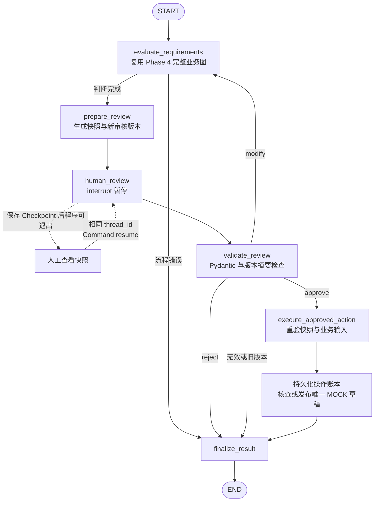

# Phase 5：Checkpoint、重启恢复与人工审核

实施及验证日期：2026-10-13。技术验收通过；代码版本尚未获授权提交，按路线图统一标准暂记 DOING。本阶段只处理本地 MOCK 数据，不调用 LLM、真实 RAG 或设备。

## 1. 实际实现与数据边界

Phase 4 的 `run_workflow()` 仍负责证据校验、数值比较和复合条款汇总。新的审核图调用它获得完整 `WorkflowResult`，不复制业务判断规则，也不改变 Phase 4 原有入口。

审核快照包含 `run_id`、`thread_id`、`review_id`、`review_version`、完整 Requirement / Evidence / Decision、配置、拟执行操作、受控目标路径和 `operation_id`。`snapshot_digest` 绑定这些内容；它用于发现旧版本和意外改动，不是身份凭据或数字签名。

本阶段的受保护操作只有一项：在授权项目的 `outputs/phase05/` 中生成 MOCK SOC **JSON 草稿**。文件始终带 `document_status=DRAFT`、`source_type=mock`。人工批准写入 NC 或 PENDING 结果，也不会将业务结论变成 FC；文件成功生成也不意味着设备能力已获确认。

| 概念 | 本工程保存什么 | 生命周期与权限边界 |
|---|---|---|
| Message Context | 前阶段 Agent 的模型消息 | 本阶段确定性工作流不需要模型消息 |
| Graph State | 当前输入、业务结果、审核快照、回复、审核历史、执行状态 | 本次图执行的业务对象；节点返回增量字段更新 |
| Checkpoint | State、待执行节点及中断信息 | 由 Saver 保存，是恢复图执行的依据 |
| Thread | 用 `thread_id` 选择的一条执行历史 | 实现状态隔离；不能替代用户认证或授权 |
| Cross-thread Store | 显式 namespace 中共享的 MOCK 便签 | 演示使用 InMemoryStore；调用方必须提供允许的 namespace |
| 业务操作数据库 | `operation_id`、目标路径、内容 SHA-256、prepared/completed 状态 | 持久化执行账本，专门核查副作用；不是 Checkpoint |

默认运行文件：

- `runtime/phase05/checkpoints.sqlite`：LangGraph SQLite Checkpoint。
- `runtime/phase05/operations.sqlite`：操作账本。
- `outputs/phase05/<operation_id>.json`：已经批准生成的 MOCK 草稿。

运行数据库、生成文件和运行日志由 Git 忽略。测试使用 pytest 临时目录和独立数据库；不共享正常 Demo 的任务数据。

## 2. 显式审核图与关键源码



`modify` 不是绕过批准的入口：替换指定的要求、完整证据集或配置后，重新运行 Phase 4，生成新的审核版本并再次中断。未确认模块配置可由 PENDING 变为 FC；修改接口数量要求也可能从 FC 变为 NC。两种变化都需要重新批准。

| 文件和函数 | 职责 |
|---|---|
| [reviews.py](../src/agent_demo/domain/reviews.py)：`Modification`、`ReviewResponse`、`ReviewSnapshot` | 校验审核动作、严格整数版本、修改内容和快照模型 |
| [review_graph.py](../src/agent_demo/graphs/review_graph.py)：`ReviewState`、`evaluate_requirements` | 保存结构化审核状态并复用 Phase 4 |
| 同文件：`build_review_graph` 内六个节点 | 拆开快照、暂停、校验、执行与收尾；条件边控制审核分支 |
| 同文件：`check_response`、`start_review`、`resume_review` | 绑定当前审核，拒绝重复创建 Thread，处理重复回复及执行恢复 |
| [operations.py](../src/agent_demo/persistence/operations.py)：`OperationLedger.execute`、`_publish` | SQLite 唯一约束、路径校验、校验和、受控文件发布及恢复 |
| [store_demo.py](../src/agent_demo/graphs/store_demo.py)：`namespace_access`、`run_store_demo` | 同 Thread 延续、Thread 隔离和显式授权 namespace 共享 |
| [CLI](../examples/phase05_checkpoint_hitl.py)：`main` | start/status/resume/store-demo，命令结束时关闭数据库连接 |
| [审核图测试](../tests/test_phase05_checkpoint_hitl.py)、[操作账本测试](../tests/test_phase05_operations.py) | 真实图、SQLite、文件系统及独立 Python 子进程验证 |

最小暂停与恢复代码，直接对应审核节点和入口：

```python
from copy import deepcopy

from langgraph.types import Command, interrupt


def human_review(state):
    response = interrupt(deepcopy(state["review_snapshot"]))
    return {"review_response": response}


graph.invoke(Command(resume=validated_response), thread_config(thread_id))
```

CLI 使用 `SqliteSaver.from_conn_string(...)` 的上下文管理器并调用 `setup()`；`ExitStack` 同时管理 Saver 和 `OperationLedger` 的连接，命令返回时关闭资源。内存测试直接将 `InMemorySaver()` 传给同一个 `build_review_graph()`。

## 3. 可以直接运行的 CLI

以下命令在项目根目录用虚拟环境 Python 执行。每次 start/status/resume 都是独立 Python 进程；start 返回 `awaiting_review` 后进程退出，而不是持续后台等待。

### 创建、退出与查看

```powershell
$phase05Python = '.\.venv\Scripts\python.exe'
$phase05Thread = 'learn-' + [guid]::NewGuid().ToString('N')
& $phase05Python examples\phase05_checkpoint_hitl.py start --thread-id $phase05Thread

# 可关闭当前 Python 进程或终端；重新打开终端后填入实际 thread_id。
$phase05State = & $phase05Python examples\phase05_checkpoint_hitl.py status --thread-id $phase05Thread | ConvertFrom-Json
$phase05State.review_snapshot | ConvertTo-Json -Depth 30
$phase05State.pending_nodes
```

`status` 同时返回实际 Checkpoint 的下一节点和对应操作账本记录。待审核阶段尚无操作记录，也没有业务 JSON 产物。查看完毕后，批准必须引用当前快照中的实际标识，不要把示例 ID 当成有效审核请求。

### 批准或拒绝

```powershell
$phase05Review = $phase05State.review_snapshot
& $phase05Python examples\phase05_checkpoint_hitl.py resume --thread-id $phase05Thread `
  --action approve --review-id $phase05Review.review_id `
  --review-version $phase05Review.review_version --snapshot-digest $phase05Review.snapshot_digest
& $phase05Python examples\phase05_checkpoint_hitl.py status --thread-id $phase05Thread
```

需要拒绝时，在首次回复中把 `--action approve` 改为 `--action reject`。拒绝保留业务结论及审核历史，但不生成受保护文件。已批准的同一请求重复提交会返回已有执行结果；不能再用不同动作或不同评论改写已经提交的回复。

### 修改、重新校验并审核新版

下面创建“上联模块配置未知”的独立 MOCK 任务，并确认模拟模块已安装。示例写入无 BOM 的 UTF-8；CLI 使用 `utf-8-sig`，也兼容 Windows PowerShell 生成的带 BOM UTF-8 文件。

```powershell
$phase05ModifyThread = 'modify-' + [guid]::NewGuid().ToString('N')
& $phase05Python examples\phase05_checkpoint_hitl.py start `
  --thread-id $phase05ModifyThread --scenario optional_module_unconfirmed
$phase05State = & $phase05Python examples\phase05_checkpoint_hitl.py status --thread-id $phase05ModifyThread | ConvertFrom-Json
$phase05Review = $phase05State.review_snapshot
$phase05ModificationFile = Join-Path (Get-Location) ('runtime\phase05\modification-' + $phase05ModifyThread + '.json')
[System.IO.File]::WriteAllText($phase05ModificationFile, '{"configuration":{"uplink_module":"installed"}}', [System.Text.UTF8Encoding]::new($false))
& $phase05Python examples\phase05_checkpoint_hitl.py resume --thread-id $phase05ModifyThread `
  --action modify --review-id $phase05Review.review_id `
  --review-version $phase05Review.review_version --snapshot-digest $phase05Review.snapshot_digest `
  --modification-json $phase05ModificationFile

# 新版仍然暂停；查看新结果后才能批准，旧 review_id/version/digest 已无效。
$phase05State = & $phase05Python examples\phase05_checkpoint_hitl.py status --thread-id $phase05ModifyThread | ConvertFrom-Json
$phase05State.review_snapshot | ConvertTo-Json -Depth 30
$phase05Review = $phase05State.review_snapshot
& $phase05Python examples\phase05_checkpoint_hitl.py resume --thread-id $phase05ModifyThread `
  --action approve --review-id $phase05Review.review_id `
  --review-version $phase05Review.review_version --snapshot-digest $phase05Review.snapshot_digest
```

修改 JSON 支持 `requirements`、`evidences`、`configuration`。只替换明确提供的字段；提供列表时替换完整列表，不追加条目。`null`、空修改对象、额外字段、无效业务数据会被拒绝。

Store 演示：

```powershell
& $phase05Python examples\phase05_checkpoint_hitl.py store-demo
```

它展示 A 延续自己的便签、B Checkpoint 隔离、显式 namespace 共享及无 grant 时拒绝访问。重新创建 `InMemorySaver` 后，原 Thread 状态为空。

## 4. 持久化副作用如何避免重复

`operation_id` 是 run、Thread、审核版本、业务结果、配置及目标根目录的稳定摘要。相同审核的重试保持相同 ID；修改后生成新版本和新 ID。批准时再次核验当前 ID、版本、摘要、run/Thread，并重算业务对象，确保实际执行内容与被审核内容一致。

`OperationLedger` 将 ID、目标路径和输出字节 SHA-256 绑定，SQLite 对 ID 和目标路径设置唯一约束。执行分为：

1. 提交 `prepared` 意图记录。
2. 在目标目录创建临时文件，写完整 JSON 并 `flush()` / `fsync()`。
3. 在同一文件系统用 `os.link()` 原子发布固定文件名。目标已存在时不覆盖，转为校验内容。
4. 核对文件 SHA-256 后提交 `completed`。

| 再次执行时的实际状态 | 处理 |
|---|---|
| completed 且文件 SHA-256 一致 | 返回既有结果，不重写文件 |
| prepared 且目标不存在 | 按已记录意图发布，再完成账本 |
| prepared 且目标内容一致 | 核查已发布文件，补记 completed |
| 目标存在但无可信意图记录 | 拒绝；不猜测文件归属、不覆盖 |
| 相同 ID 的目标或内容变化 | 拒绝，不产生新业务产物 |
| 文件内容被改动、链接路径或越界路径 | 明确失败，不能盲目重试 |

允许路径严格为 `outputs/phase05/<operation_id>.json`；拒绝 `..`、其他目录、symlink 和 Windows junction。文件系统必须支持同目录原子硬链接；不支持时失败，不退化为覆盖写入。

这提供本地可信进程在异常退出后的可核查恢复。并不承诺断电时文件目录元数据必然持久化，也不为外部 API、分布式副作用或恶意本地用户提供 Exactly-once。Checkpoint 和业务文件无法组成单个跨资源事务，因此必须保留独立账本并在恢复时校验。

完成任务后，`resume_review()` 的重复批准入口和 CLI `status` 仍调用 `verify_completed_operation()`，重新核查已批准业务对象及账本中的文件摘要。已完成文件被删除或篡改时会明确失败，不重新生成文件。直接调用底层 SDK 的 `get_state()` 或对终止图重复 `Command` 只会获得历史快照；其返回 `completed` 不能证明外部文件当前仍完好，应用必须使用上述入口或显式完整性检查。

## 5. 十二个学习问题

1. **Checkpoint 与普通变量有什么区别？** 普通变量随进程消失；Checkpoint 还记录图当前状态和下一步。`status` 用 `graph.get_state(thread_config(...))` 读到实际保存的信息。是否跨进程保留取决于 Saver。
2. **Checkpoint 与数据库有什么关系？** Checkpoint 是图执行快照；SQLite 是本次保存快照的媒介。`checkpoints.sqlite` 保存 LangGraph 执行历史，`operations.sqlite` 保存业务副作用意图，两者职责不同。
3. **为什么需要 thread_id？** 它帮助 Saver 选中一个任务的状态和历史。`start_review()` 防止重用已有 Thread 创建新任务；`resume_review()` 只恢复存在且符合当前审核的任务。知道 ID 不等于有审核权限。
4. **InMemorySaver 和 SqliteSaver 有何区别？** 前者保存在当前进程内；新 Saver 或新进程看不到之前的状态。后者保存到 SQLite 文件，关闭连接后另一个进程可以用同一 Thread 继续。本项目真正通过子进程退出再启动验证后者。
5. **interrupt() 如何暂停？** `human_review()` 返回快照给调用方，并把中断位置保存到 Checkpoint。`graph.invoke()` 返回后 CLI 可以退出，受保护节点还没有执行。
6. **Command(resume=...) 如何继续？** 恢复数据作为 `interrupt()` 的返回值进入节点。随后 `validate_review()` 校验动作、版本和摘要，再由条件边决定批准、拒绝、修改或失败。
7. **为什么恢复时节点可能重新执行？** LangGraph 会从包含中断的节点开头重新进入。因此 `human_review()` 在 `interrupt()` 前只读取和复制快照，不写文件、不新增操作记录。不能把“中断之前代码已运行”当成“只运行一次”。
8. **为什么审核与执行要拆开？** 暂停节点负责等待，校验节点负责判定回复有效，执行节点才接触文件账本。旧版本、拒绝或无效回复不会走到写入路径；执行前还要重新核对业务对象。
9. **Idempotency 与 Exactly-once 有何区别？** 幂等性允许同一操作被尝试多次，最终产物保持一致。本工程靠稳定 ID、唯一记录和内容校验实现本地重试去重；这不表示代码只执行了一次，也不代表任意外部系统具有 Exactly-once。
10. **Checkpoint 与长期 Store 有何区别？** Checkpoint 按 Thread 保存运行过程；Store 按 namespace/key 保存可被显式共享的数据。`namespace_access()` 先检查调用方 grants。当前 InMemoryStore 是短小机制演示，退出进程即消失，没有长期数据库或向量记忆。
11. **State 与业务数据库各保存什么？** `ReviewState` 保存输入、判断、审核版本和执行结果；账本只保存受保护操作的 ID、路径、摘要和执行状态。State 中的“准备执行”不能代替账本中的“实际完成”。
12. **为什么它是 RFP → SOC 的关键基础？** 正式 SOC 生成会带来有业务后果的文件输出。先把证据判断、人工确认、重启恢复、重复生成保护分开，后续才能在保持审核对象一致的条件下接入真实证据。当前 MOCK 规则和本地 CLI 仍不能直接作为正式审批系统。

官方协议依据：[LangGraph Persistence](https://docs.langchain.com/oss/python/langgraph/persistence)、[Interrupts](https://docs.langchain.com/oss/python/langgraph/interrupts)。实现以已安装版本和实际运行结果为准，不把文档中的其他存储后端描述为本项目已有功能。

## 6. 实际验证记录

实际安装版本：LangGraph `1.2.14`、langgraph-checkpoint `4.3.0`、langgraph-checkpoint-sqlite `3.1.2`、Pydantic `2.14.0`、aiosqlite `0.22.1`、sqlite-vec `0.1.9`。运行于现有 Windows / Python 3.11 环境。

| 实际命令或验证 | 结果 |
|---|---|
| `.\.venv\Scripts\python.exe -m pytest` | 164 passed，0 failed，0 skipped，35.86 秒；另一轮独立复核 37.74 秒 |
| `.\.venv\Scripts\python.exe -m ruff check .` | 通过 |
| `examples/phase05_checkpoint_hitl.py` 的 start → status → modify → approve → 重复 approve | 各命令独立 Python 进程，保存/恢复相同 Thread；新版通过后唯一文件保持不变 |
| 独立拒绝任务的 resume reject | rejected，无受保护业务文件 |
| 独立进程 SQLite 保存、退出、读取、恢复 | 真实测试通过，不同 PID 恢复快照并执行，同一文件内容和修改时间保持不变 |
| 两个独立进程的 InMemorySaver | 新进程无法读取旧进程的状态，真实测试通过 |
| os._exit 模拟文件发布后、账本完成前退出及恢复 | 操作账本与完整审核图两个层面均通过；prepared 记录恢复为 completed，未重复写文件 |
| Phase 4 Demo 与 Phase 0–4 回归 | 五类原有业务场景正常；既有 98 项测试全部通过 |

164 项由既有 98 项、Phase 5 审核图/HITL 38 项和操作账本 28 项组成。路径测试在 Windows 无普通 symlink 权限时使用临时目录内 NTFS junction，实际验证通过，没有将该分支跳过。

CLI 实际验收 Thread：`phase05-validation-20261013-d63b2cb0`。轨迹是：

```text
start: PENDING / awaiting_review
独立进程 status: 恢复同一待审核快照
modify uplink_module=installed: 第 2 版 / FC / awaiting_review
approve: completed
重复 approve: completed，仍为同一产物
独立 reject Thread: rejected，无产物
```

验收摘要保存在 [runtime/phase05/validation-20261013-d63b2cb0.json](../runtime/phase05/validation-20261013-d63b2cb0.json)，已批准的 MOCK 草稿为 `outputs/phase05/ecd711964a642dc9106836df8f967785af81c0a2caa9c899d6e6c1464be38062.json`。这些本地运行证据由 Git 忽略；pytest 的数据库与文件在独立临时目录中。

测试覆盖的真实持久化路径见 `test_real_independent_processes_restore_and_resume_sqlite_checkpoint`、`test_process_exit_after_publish_recovers_real_file_and_unfinished_ledger`、`test_graph_process_crash_after_publish_restores_approved_execution`。它们使用独立临时数据库、真实文件、不同 Python PID 和实际 `os._exit()`，不是 Mock Saver 或同进程重建图替代跨进程恢复。

其余测试验证批准、拒绝、修改与重新校验、旧版本、无效回复、快照篡改、业务对象意外改动、重复 Resume、重复批准、同 ID 重试、未知文件不覆盖、路径越界、Thread 隔离、Store grant 和前阶段兼容。新增 `test_memory_checkpoint_is_lost_in_a_new_independent_process` 专门验证内存 Saver 的进程边界；`test_repeated_approval_rejects_damaged_completed_artifact` 验证历史 completed 状态不会掩盖缺失或损坏的文件。

实施中补充了两个关键防护：LangGraph 节点可能使用工作线程，因此账本连接允许跨线程并以 `RLock` 串行保护事务；重复提交或查看 completed 任务必须再次核查产物，不能只返回历史状态。最初 Modify 回复序列化把未修改字段变成显式 null，导致三个测试失败；统一省略 null 后重新验证通过。CLI 的修改文件改用 `utf-8-sig` 读取，兼容 Windows UTF-8 BOM；额外实际 CLI 任务 `phase05-bom-20261013-6a663405` 成功生成审核第 2 版，随后拒绝，无文件产物。最终回归包含这些修复。

## 7. 限制与下一阶段

当前入口是受信任的本地 CLI，未建设多用户身份认证、网络服务或业务授权系统。直接控制 SQLite、图对象、grants 或项目目录的本地调用方属于可信边界；`thread_id` 和快照摘要不提供身份认证。未建设持久化 Store、用户画像、Embedding Memory、FastAPI、Docker 或 MCP。

Phase 3 既有执行限制的验收缺口继续保留，本阶段未重构或替它补报通过。Phase 4 的 FC/PC/NC/PENDING 规则继续适用于 MOCK 教学，不是正式 RFP 的已确认政策。

Phase 6 的真实 RAG 进入条件仍未全部满足：[接口契约调查](rag_contract.md)是静态源码证据；实际服务可用性、授权知识库、凭据、固定文档版本和可核验样本尚待确认。下一步先核对这些条件，再将原始证据转换为现有 Evidence，不允许把问答结果或 MOCK 草稿当成真实合规证据。
