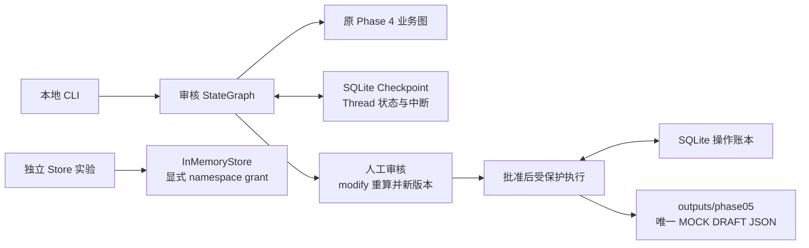

# Phase 5 总结：Checkpoint、重启恢复与人工审核

实施及验收日期：2026-10-13。状态：技术验收通过；待授权保存本地代码版本，阶段暂记 DOING。环境：Windows / Python 3.11，LangGraph 1.2.14、SQLite Checkpointer 3.1.2、Pydantic 2.14.0。

本文记录本阶段工程快照。当前进度以[路线图](../AGENT_LEARNING_ROADMAP.md)为准，完整说明和验证命令见[Phase 5 技术文档](phase05_checkpoint_hitl.md)。

## 1. 这一阶段做了什么

在 Phase 4 确定性业务图外增加审核图，复用已有 Requirement、Evidence、Decision、MOCK 数据和判断规则。新增内存与 SQLite Checkpoint、Thread 状态隔离、跨进程恢复、批准/拒绝/修改、审核版本和摘要校验，以及受保护 MOCK JSON 草稿生成。

新增 SQLite 操作账本，记录文件发布意图和完成状态，使程序在文件生成后异常退出时能够核查内容并安全恢复。另用 InMemoryStore 实验显式 namespace 共享。没有调用真实模型或 RAG，没有引入服务、向量长期记忆或正式 SOC 输出。

## 2. 最重要的是什么

**可恢复的流程，也必须能安全重复执行；保存状态并不能保证副作用只发生一次。**

- Checkpoint 像“任务书签”，保存当前数据和下一步；SQLite 让书签在 Python 退出后仍然存在，内存 Saver 则只保留在当前进程。
- 人工审核批准的是“这一版内容和这一个操作”。修改要求、证据或配置后，要重算结论并再次审核，不能沿用旧批准。
- 幂等性像“同一订单号只产出同一份结果”。稳定 operation_id、唯一账本和内容校验防止重试生成多个文件，但不声称任意外部系统 Exactly-once。

## 3. 当前大致框架

主要源码：

- [reviews.py](../src/agent_demo/domain/reviews.py)：审核输入、修改数据、操作和快照模型。
- [review_graph.py](../src/agent_demo/graphs/review_graph.py)：业务重算、快照、interrupt、回复校验、受保护执行、恢复入口。
- [operations.py](../src/agent_demo/persistence/operations.py)：prepared/completed 账本、目标路径和文件内容绑定、异常恢复。
- [store_demo.py](../src/agent_demo/graphs/store_demo.py)：Thread 与 Store 的最小实验。
- [CLI](../examples/phase05_checkpoint_hitl.py)：start/status/resume/store-demo。
- [审核图测试](../tests/test_phase05_checkpoint_hitl.py)、[账本测试](../tests/test_phase05_operations.py)：实际图执行、数据库、文件和进程退出恢复。

相比 Phase 4，新图增加了暂停、恢复和写入权限边界，原有 Phase 4 Demo 保持直接离线判断。

## 4. 怎么证明它完成了

实际执行 `.\.venv\Scripts\python.exe -m pytest`：**164 passed，0 failed，0 skipped**；Ruff 通过。164 项包括原有 98 项、Phase 5 审核图 38 项和账本 28 项。Phase 4 原有五场景 Demo 通过，旧功能无测试回归。

Phase 5 CLI 每条命令都在独立 Python 进程中执行：start 得到模块配置未知的 PENDING；status 恢复原快照；modify 确认模拟模块配置后生成第 2 版 FC 并再次暂停；approve 后 completed；重复 approve 不新增或重写文件；另一个 Thread reject 后无产物。真实进程异常退出测试还验证了文件已发布而账本尚未完成时的恢复。

命令及细节见[验证章节](phase05_checkpoint_hitl.md#6-实际验证记录)。实际 CLI 证据为 [validation-20261013-d63b2cb0.json](../runtime/phase05/validation-20261013-d63b2cb0.json)，处于 Git 忽略目录。测试使用独立临时目录、数据库与文件，真实 LLM/RAG 和部署验证未执行。

Phase 4 已有提交 `9e4a8f3`。本阶段未自动提交或推送；真实 LLM、真实 RAG 和部署验证不在本阶段范围内。

## 5. 问题、限制与容易误解的地方

本地受信任调用方掌握 Graph、Checkpoint 和 grant，尚无多用户认证系统；thread_id 不是身份或批准凭据。草稿标注 DRAFT/MOCK，批准文件生成不改变 FC/NC/PENDING 等业务结论。

发布使用同目录临时文件和非覆盖的原子硬链接，需要支持硬链接的文件系统。恢复保障针对本地进程异常退出；没有声明断电、恶意文件系统修改或分布式服务副作用的 Exactly-once。Store 目前仅驻留内存，退出即丢失。

实现时给 SQLite 账本连接增加跨工作线程支持和事务锁；在已完成任务的重复 resume/status 中增加文件完整性核查，防止历史成功状态掩盖文件损坏或删除；CLI 修改文件兼容 UTF-8 BOM。最终测试包含这些修复。

历史 Phase 3 执行限制缺口继续保留，未因本阶段完成而被掩盖。

## 6. 下一阶段怎么接着做

先形成授权的 Phase 5 可追踪代码版本，再核对 Phase 6 的真实 RAG 地址、可用性、授权、固定资料版本及样本证据。当前[静态接口契约](rag_contract.md)不代表服务真实请求已验证，进入条件尚未全部满足。

之后可复用现有 Evidence、确定性业务规则、审核快照与操作账本，把真实检索片段映射到证据模型，继续保留来源、版本、位置和适用条件；缺证据仍不得直接判 NC。
