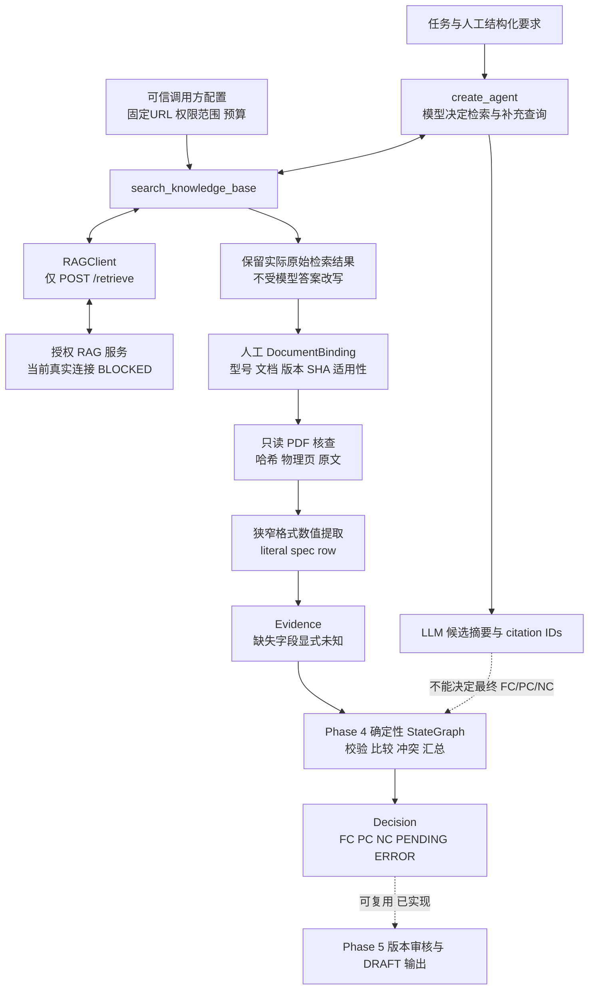
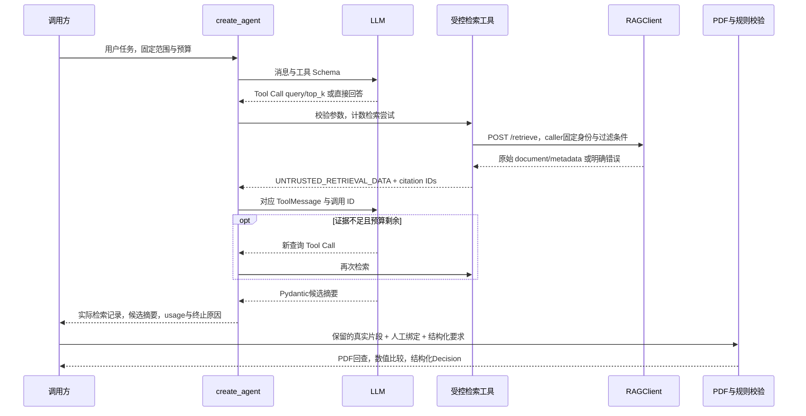

# Phase 6：受控 HTTP Agentic RAG 与可核验证据

实施及离线验证日期：2026-10-14。**状态 BLOCKED：离线开发与回归通过，但真实模型、真实 RAG 和真实设备 PDF 的端到端验收尚无可用环境。** 本文把实际代码能力、offline_mock 验证与真实未验证项分开记录。

## 1. 实际结构：模型检索，代码验证，业务图判断

Phase 6 不复制旧项目的向量库、Embedding 或索引流程。`RAGClient` 只适配 V3 `POST /retrieve`；模型只获得 `search_knowledge_base(query, top_k)`，不能选择服务 URL、Bearer 凭据、知识库、文档版本或调用其他接口。



LLM 的 `RAGAgentAnswer` 包含候选 `answer`、实际引用 ID 和 `needs_more_evidence`，没有最终合规状态字段。`AgentResult.status=completed` 只说明检索循环结束，不能作为设备合规或人工审核通过的证据。

设备任务由调用方明确选择 `require_evidence=True`，不能靠 Python 判断问题中是否包含“设备”来模拟模型决策。普通聊天可显式选择 `require_evidence=False`，模型直接回答时不会被迫检索。设备结论仍走 `run_rag_workflow()` 的独立确定性业务路径。

## 2. 消息流与执行边界



工具结果里的原文和 metadata 是外部数据，不是新的 system prompt。消息仍是 `ToolMessage`，调用 ID 与模型请求对应。业务执行工具白名单仅包含受控检索；模型请求写文件、运行命令或访问其他 URL 都不会执行。`RAGAgentAnswer` 是框架的结构化答复通道，不是任意 Python 执行入口。

`ToolStrategy(RAGAgentAnswer)` 采用已安装 LangChain 1.x 的结构化输出机制。普通直接文本问候可在调用方明确允许无证据时，由应用验证为 `RAGAgentAnswer`；这不是伪称供应商已经返回结构化结果。

## 3. 源码职责与真实响应映射

| 文件与关键函数 | 实际职责 |
|---|---|
| [rag_client.py](../src/agent_demo/integrations/rag_client.py)：`RAGSettings`、`RAGClient.retrieve` | 固定 HTTP origin、Bearer、知识库、超时、有限重试、响应上限和字段校验 |
| [rag_search.py](../src/agent_demo/tools/rag_search.py)：`SearchArguments`、`SearchSession`、`citation_id` | 工具参数允许列表、caller 固定过滤范围、保存实际片段、检索预算和来源绑定 ID |
| [agentic_rag.py](../src/agent_demo/agents/agentic_rag.py)：`BoundedRAGMiddleware`、`run_agentic_rag` | 实际模型调用次数、token、重试和等待期限；框架维护多轮工具消息 |
| [citation_verifier.py](../src/agent_demo/integrations/citation_verifier.py)：`verify_citation` | 只读给定 PDF，验证全文件 SHA、明确物理页和原文存在性 |
| [rag_evidence.py](../src/agent_demo/integrations/rag_evidence.py)：`DocumentBinding`、`map_search_evidence`、`extract_spec_values` | 保留原文，人工绑定适用对象，受验证的有限格式提取和 Evidence 映射 |
| 同文件：`run_rag_workflow` | 使用 Phase 4 比较规则，把检索故障传入 ERROR 路径 |
| [compliance_graph.py](../src/agent_demo/graphs/compliance_graph.py)：`validate_evidence`、`run_workflow` | real_rag 模式拒绝 MOCK 回退，检查来源与提取依据，Python 数值/单位比较 |
| [review_graph.py](../src/agent_demo/graphs/review_graph.py)：`start_review` | 延续 Phase 5 审核与幂等草稿，新增显式 evidence_mode |
| [接口契约](rag_contract.md) | 旧项目只读调查、HTTP 副作用、真实未知项、PDF 测试范围 |

V3 响应中的 `documents[].document` 映射为 `RAGHit.original_text`，不是 `/chat` 的生成答案。`version_id` 映射为 `document_version`，再保存到 Evidence 的 `source_version`。`source`、`page`、`chunk_id`、`document_id`、`chunk_uid`、原始 metadata 和可获得的哈希/分数保留；未返回的字段是 `None`，不补造型号、原文、页码或文档版本。

`vector_distance`、`fusion_score`、`rerank_score` 只是检索指标。距离、融合分和重排分不是同一含义，不能统一当成“设备满足概率”，也不会直接决定 FC。

缺少原文的 hit 仍可保存在实际响应记录中，但不可产生可用引用。`citation_id()` 对原文、source、页码、chunk、document/version/hash 做稳定摘要；只验证模型引用了本次取得的片段，不证明模型摘要的每个断言都正确。

## 4. 原始 PDF 与数值证据的校验规则

`DocumentBinding` 必须由可信调用方人工整理并确认，包含：型号、document ID、version、整份授权 PDF 的 SHA-256、允许目录内 PDF 路径、适用条件，以及 `applicability_confirmed=True`。这些不能由模型、相似度分数或检索片段自行赋权。

`verify_citation()` 同时检查：

1. PDF 路径在允许目录内，实际文件存在且不超上限。
2. 整份实际 PDF 字节 SHA-256 与人工绑定一致。
3. 页码语义明确为 `pdf_physical_1_based`，而非自动猜测印刷页偏移。
4. PDF 实际页面可提取文字，原文片段在对应物理页存在。

原文匹配只合并空白，不改数字、大小写或标点。无文本层、加密 PDF、解析错误、哈希不符、页码未知或越界、原文不匹配都保留未验证原因。没有 OCR，没有下载接口，也不执行 PDF 脚本。

PDF 匹配只能证明“这段文字在这个文件的这个物理页”。source 标签的身份、文档授权、型号适用性，以及片段外的模块/配置限制仍需人工确认完整上下文。不能把文件哈希匹配说成厂商真实性认证。

验证通过后，`extract_spec_values()` 只接受明确的完整行，例如：

```text
Downlink ports: 48 count
Downlink speed: 1 Gbps
Downlink medium: electrical kind
Uplink ports: 4 count
Uplink speed: 10 Gbps
```

这些是支持的 TEST 格式示例，不是实际设备资料。任意中文说明、复杂表格、否定句、“最大支持”、省略主语或跨页条件不属于已实现解析能力，保守保留未知。LLM 不得猜测 `actual_value`；业务图还会重新检查数值确实来自支持的原文行。

所有未绑定型号/版本、未确认适用性、未通过来源检查或无法提取的证据都会使必要要求保持 PENDING。接口故障走 ERROR；不会把服务不可用解释成设备 NC。相同适用条件下冲突的来源也不能产生 FC。

验证后把原文 SHA 保存为 `metadata.verified_chunk_sha256`，业务校验时重新计算它，避免引用检查后原文被意外改动却继续使用旧验证标志。该摘要不是认证签名，也不能抵抗掌握 State 和所有校验字段的恶意本地调用方。

Phase 5 仍可复用：`evidence_mode="real_rag"` 不混入 MOCK 默认检索，审核快照与草稿的 `source_type` 按模式保存。产物仍是 DRAFT JSON，保留人工审核和幂等边界；未实现正式 Excel SOC。旧 Phase 5 Checkpoint 缺少新增的可选 Evidence 字段时，执行前只对比较对象做 Pydantic 默认值补齐，不改动原快照摘要或已经发布的文件字节。兼容性测试及 2026-10-13 已完成任务的真实 CLI 复查均通过。

## 5. 执行限制与日志

默认 `RAGAgentLimits`：模型最多 6 次实际尝试、检索工具最多 3 次尝试、总等待期限 30 秒、模型外层重试 0 次、每次输出最多 1024 token、已报告累计 usage 上限 8000 token。RAGClient 独立使用连接/读超时和有限 HTTP 重试，工具与客户端的边界不是同一种计数。

- Middleware 在调用模型前核查实际调用数和已知 token 使用量；SDK 的内部模型重试关闭，允许的外层重试次数固定。
- 检索工具进入 handler 前计数，无效参数也消耗工具尝试预算；SearchSession 再限制实际 HTTP 检索。并发调用不能竞态超过上限。
- HTTP 每次请求固定 `/retrieve`，拒绝跳转，不借模型选择外部 URL；限制结果数和响应字节数。
- timeout 表示应用停止等待并禁止继续发起工具动作。模型/HTTP worker 可能仍在结束之前的请求，不能声称线程、网络请求或远端任务已被强制取消。
- 只重试允许的临时模型异常或客户端约定的临时 HTTP 错误；次数和总期限均有边界，401/403 不反复尝试。
- usage 缺失时明确 `available=False`。失败/超时请求是否被供应商计费可能未知；无已核实价格时 cost 为 `None`，不构造费用数字。

累计 token 是按供应商实际返回值事后核查的：当前请求的输入 token 未知时，最后一次调用可能超过总上限，随后丢弃候选答案并停止后续调用。已经消耗的请求不能撤销；这个保护不能被表述为精确的预付费用封顶。

结构化事件记录 run ID、模型轮次、工具调用 ID、检索次数、结果数量、延迟、usage、错误类别和终止原因。事件不记录 API Key、Bearer、原文全文或异常消息里的敏感正文。供模型理解的 ToolMessage 必须包含片段，这与把全文输出到运行日志不同。

## 6. 十二个学习问题

1. **普通 RAG 和 Agentic RAG 的区别？** 固定基线先检索一次再使用结果；Agentic RAG 把检索作为工具，由模型决定是否调用、用什么查询、是否补充。这里复用旧服务的检索能力，不重新建库。
2. **模型如何决定继续检索或直接回答？** 模型根据问题、工具 Schema 和已有 ToolMessage 生成下一响应。调用方只指定设备任务必须有证据的权限规则，不用 Python `if/else` 匹配意图来替模型做决定。
3. **模型如何实际调用 HTTP？** 它返回工具请求；LangChain 调用被注册的 Python Tool，Tool 再调用 RAGClient。模型没有任意 HTTP 客户端或函数执行权限。
4. **为什么用 `/retrieve` 而不是 `/chat`？** 最终业务校验需要原始检索片段和来源，生成答案不是原文证据。旧服务 `/retrieve` 也可能改写查询、加载模型或写观测/缓存，不能仅凭接口名称宣称零副作用。
5. **为什么 Schema 校验后还有限制？** 类型正确不能代表拥有权限。query/top_k 的 Pydantic 校验负责数据形状；caller 固定 endpoint、Token、KB、文档范围、预算和工具白名单负责执行权限。
6. **为什么保存完整检索来源？** 文档 ID、版本、哈希、页码、chunk 和原文让人可以回查。Evidence 保存实际值和校验依据；空字段保留未知，不能由模型把缺失补成看似完整的证据。
7. **相似度高就说明型号适用吗？** 不说明。型号、版本和安装配置依赖人工确认的 DocumentBinding 与条件校验，不能因为出现相近产品名或得分高就跨型号使用。
8. **为什么 PDF 回查同时检查哈希、页码和原文？** 哈希绑定文件版本，物理页限定位置，原文匹配证明引用确实存在。三者都不能代替适用性和真实性的人工责任；未知页码语义不能猜。
9. **LLM 摘要、数值提取、Decision 有何区别？** 摘要是候选解释；数值来自验证后的限定格式原文；Decision 由 Phase 4 比较和汇总。即使候选摘要声称 FC 或引用真实 ID，也不能绕过实际单位、数量、条件和冲突校验。
10. **补充检索怎样避免无限循环？** 实际模型次数、工具尝试、token 和总期限分别设上限。耗尽时给出 budget_exceeded/timeout；未获足够证据时给出 PENDING，不能把“停止了”说成“成功证实了”。
11. **提示注入如何处理？** 检索正文始终是 UNTRUSTED 数据，不升格 system 消息；模型请求的非白名单操作不执行。离线攻击样例验证的是执行权限与业务门禁，不证明真实模型对所有恶意文档都有语义免疫。
12. **怎样判断 Agentic RAG 是否更好？** 同一任务比较固定基线与 Agent 的证据覆盖、最终判断、检索/模型次数、延迟和可得 usage。offline_mock 只验证流程和保护规则；真实环境未运行时，效果、延迟和费用指标不可报告为真实优势。

官方参考：[检索与 RAG 架构](https://docs.langchain.com/oss/python/deepagents/retrieval)、[LangChain Middleware](https://docs.langchain.com/oss/python/langchain/middleware/custom)、[Structured Output](https://docs.langchain.com/oss/python/langchain/structured-output)、[HTTPX 超时](https://www.python-httpx.org/advanced/timeouts/)、[pypdf 文本提取](https://pypdf.readthedocs.io/en/stable/user/extract-text.html)。项目仅使用本文实际列出的机制，没有实现文档中其他服务、工具或存储方案。

## 7. 运行与实际验证记录

实际版本：LangChain `1.4.4`、LangGraph `1.2.14`、Pydantic `2.14.0`、httpx `0.28.1`、pypdf `6.20.1`；模型 SDK 与前阶段保持兼容。本阶段 Fake Chat Model 是离线脚本消息，HTTP MockTransport 是模拟服务，PDF 是手工构造的 TEST 文件。

安装并核实 pypdf 后，锁定清单为 61 项依赖，其余既有版本保持兼容。离线 fixture 的 `source_type=real_rag` 表示测试正在走检索证据模型，不表示真实 RAG 调用成功；RAGClient 在本次注入 MockTransport 时记录 `retrieval_metadata.verification_mode=offline_mock`，Evidence 继续保留该标记。真实来源与模拟路径必须结合验证模式一起阅读。

环境变量以实际 `load_rag_settings()` 为准：`AGENT_DEMO_RAG_BASE_URL`、`AGENT_DEMO_RAG_TOKEN`、`AGENT_DEMO_RAG_KB`、`AGENT_DEMO_RAG_PAGE_SEMANTICS`。模型使用 `GEMINI_API_KEY` 或 `GOOGLE_API_KEY`，以及可选 `GEMINI_MODEL`。只读进程配置，不自动搜索或复用旧仓库凭据。

可直接在项目根目录运行的离线入口：

```powershell
.\.venv\Scripts\python.exe examples\phase06_agentic_rag.py --offline --mode benchmark
.\.venv\Scripts\python.exe examples\phase06_agentic_rag.py --offline --scenario supplement
.\.venv\Scripts\python.exe examples\phase06_agentic_rag.py --offline --scenario greeting --chat
.\.venv\Scripts\python.exe -m pytest
.\.venv\Scripts\python.exe -m ruff check .
```

默认模式是 agent。`--mode retrieve` 只检索；`--mode benchmark` 对比固定一次检索与有界 Agent。`--document-id`、`--version-id`、`--classification` 是调用方固定过滤参数，不进入模型工具 Schema。`--requirements FILE` 与 `--bindings FILE` 读取人工结构化要求和 DocumentBinding，再执行业务图；未提供时只报告检索与 Agent 状态，不伪造业务结论。

本次实际执行结果：

| 命令或项目 | 结果 |
|---|---|
| `.\.venv\Scripts\python.exe -m pytest` | **311 passed，0 failed，1 skipped，32.76 秒** |
| 最终完整 pytest 复核 | **311 passed，0 failed，1 skipped，30.09 秒** |
| Ruff check / format check | 通过 |
| `--offline --mode benchmark` | 六个脚本/Mock HTTP 场景通过，`verification_mode=offline_mock` |
| `--offline --scenario supplement` | 实际执行两次检索、三次模型轮次；原文不足后补查的离线轨迹通过 |
| `--offline --scenario greeting --chat` | 模型脚本直接回答，检索次数为 0 |
| 未设置安全确认变量时 `--mode retrieve` | 返回 BLOCKED / safe_service_confirmation_required，退出码 1，未发 HTTP 请求 |
| Phase 0–5 回归入口与旧 Checkpoint | 既有 164 项全部通过；新增兼容性测试通过，旧任务仍 completed |
| 真实 RAG + LLM + 设备 PDF | BLOCKED，未调用 |
| 真实效果、延迟、费用比较 | unavailable，不能从 Mock 数据推导 |

新增通过项为：客户端 58、Agent 34、PDF 引用 32、Evidence/业务门禁 19、基线评测 1、旧 Checkpoint 兼容 2，以及真实关闭的本地 TCP 端口网络故障 1。后者证明真实网络故障可诊断，不代表连接过可用 RAG 服务。唯一 skipped 是[真实集成测试](../tests/integration/test_phase06_live_rag.py)，原因是缺少确认安全的服务、授权配置及实际 PDF；这是明确的 BLOCKED 项，不是测试通过。

模拟基线证据保存在 [offline-benchmark-20261014-45261010.json](../outputs/phase06/offline-benchmark-20261014-45261010.json)，由 Git 忽略。六类结果如下：

| offline_mock 场景 | 固定基线检索次数 | Agent 检索次数 | Agent 运行状态 |
|---|---:|---:|---|
| greeting | 1 | 0 | completed |
| single | 1 | 1 | completed |
| supplement | 1 | 2 | completed |
| empty | 1 | 1 | PENDING |
| conflict | 1 | 1 | completed，仅表示检索循环结束 |
| service_error | 1 | 1 | failed |

两组平均检索次数均为 1；这不是真实服务效率结论。冲突场景的 completed 不等于通过业务校验，最终判断必须另行运行带授权 PDF 与绑定的业务图。当前基线是固定一次检索，没有额外 LLM 生成，不能把它的 retrieval_status 与 Agent 状态直接当成同一业务成功率。离线记录中 usage 的 `available=False`，不能把计数占位 0 当成真实 token 或费用为零。

真实评测入口支持 `--mode benchmark --case-file FILE`；清单需要实际 `live_cases`，每项包含 query、scope、requirements、bindings 及人工预期 expected_status。当前没有真实样本，不能计算真实成功率、PDF 引用准确率、时延和成本，也不能声明 Agentic RAG 更优。

启用真实入口还必须由可信操作者在核实独立服务及副作用后设置 `AGENT_DEMO_LIVE_RAG_CONFIRM_READONLY=1`。这个开关表示应用调用方的确认，不是旧仓库写入授权；不能用它绕过“不修改 RAG-DEMO”的约束。默认无 `--offline` 时保持安全确认门禁，不自动启动、登录或下载旧服务。

## 8. 真实验收阻碍与后续任务

本次只读调查没有发现可用的已配置服务与授权配置；RAG URL、Token、模型 API Key 均未可用。旧项目启动、检索和下载路径可能写目录、缓存、Catalog WAL 或观测日志。因此没有为本次验收启动旧服务、请求其检索/下载或修改旧项目；旧仓库只读检查 HEAD 为 `d72c329`，工作区保持干净。真实服务可访问性、正确权限、型号资料、原文和物理页对应关系未验证。

解除阻碍需要：

1. 已准备且有访问授权的独立 RAG 服务，以及对请求副作用的确认；不是默认启动旧仓库。
2. 进程环境中的有效服务 URL、Bearer、KB/文档/版本范围和模型凭据。
3. 明确授权的目标设备 PDF、完整文件 SHA、物理页语义，以及人工确认的型号/配置绑定。
4. 最小真实端到端运行、PDF 引用回查，以及同任务固定基线和 Agent 的真实比较。

代码与离线测试不能代替这些真实验收项，所以 Phase 6 保持 BLOCKED，不标记 DONE。既有 Phase 3 执行限制缺口继续保留。Phase 7 是可选的独立 MCP 实验，不要求改造本阶段稳定 HTTP 业务路径；Phase 10A 正式证据 SOC 的进入条件目前未满足。
