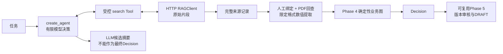

# Phase 6 总结：受控 Agentic RAG 与证据回查

实施及离线验证日期：2026-10-14。状态：**BLOCKED，离线实现和回归通过；真实 RAG/模型/设备资料验收环境未齐。** 当前进度以[路线图](../AGENT_LEARNING_ROADMAP.md)为准，详细原理和命令见[技术文档](phase06_agentic_rag.md)。

## 1. 这一阶段做了什么

新增固定地址、权限范围、超时和有限重试的 RAGClient，把旧 V3 `/retrieve` 的原始片段包装成 `search_knowledge_base`。使用 `create_agent` 支持模型自行检索、改写查询和补充检索；保留原文和来源，检查引用 ID 属于实际返回结果。

新增授权 PDF 的 SHA/物理页/原文回查、人工 DocumentBinding 和限定格式数值提取；结果复用 Phase 4 判断与 Phase 5 审核机制。真实证据模式不回退 MOCK，LLM 候选摘要不能直接决定 FC/PC/NC。

所有本次运行验证分为离线脚本模型、Mock HTTP 和 TEST PDF。未连接真实 RAG/模型，不修改旧工程，没有重建索引、正式 SOC Excel 或服务部署。

测试走 `source_type=real_rag` 的证据模型时，仍明确记录 `verification_mode=offline_mock`；类型名称不能被解释成真实服务已经验证。

## 2. 最重要的是什么

**模型可以帮我们找证据，但不能把它的回答直接当成证据或最终合规判断。**

- 原始检索片段是“引用材料”，模型摘要是“候选解释”；必须保存实际片段和出处，防止引用被改写或捏造。
- 哈希和物理页像“文件版本与页签”，证明引用在哪份 PDF 上；型号和配置是否适用仍由人工绑定与业务校验确认。
- 确定性判断像“核算规则”：用代码核对数值、单位、条件、冲突和复合条款。缺证据保持 PENDING，接口故障是 ERROR。

## 3. 当前大致框架

主要代码：[RAGClient](../src/agent_demo/integrations/rag_client.py)、[Tool 与 citation ID](../src/agent_demo/tools/rag_search.py)、[有界 Agent](../src/agent_demo/agents/agentic_rag.py)、[PDF 验证](../src/agent_demo/integrations/citation_verifier.py)、[Evidence 映射](../src/agent_demo/integrations/rag_evidence.py)。相较 Phase 5 增加了 HTTP 检索和来源核查层，没有替换业务比较、审核和操作账本。

## 4. 怎么证明它完成了

实际执行完整 pytest：**311 passed，0 failed，1 skipped，32.76 秒**；Ruff check 和格式检查通过。旧 Phase 0–5 的 164 项全部通过。新增客户端、Agent、PDF、Evidence、基线、Checkpoint 兼容与真实关闭 TCP 端口错误验证共 147 项。唯一 skipped 为缺少安全服务/授权/PDF 的真实集成测试，保持 BLOCKED。

最终完整回归再次得到 **311 passed，0 failed，1 skipped，30.09 秒**；Ruff、64 个 Python 文件格式检查、依赖一致性和文档链接检查通过。

实际运行 `examples/phase06_agentic_rag.py --offline --mode benchmark`，六类 offline_mock 场景覆盖问候、单次检索、补充检索、空结果、冲突和服务故障。补充检索执行两次工具/三次模型轮次；问候执行零次检索。基线与 Agent 平均检索次数均为 1，不表示真实效果或速度更优；冲突场景的 Agent completed 只表示检索结束，不是设备 FC。

验证命令与细节见[技术文档](phase06_agentic_rag.md#7-运行与实际验证记录)，离线证据为 [offline-benchmark-20261014-45261010.json](../outputs/phase06/offline-benchmark-20261014-45261010.json)。实际无安全确认的 live retrieve 返回 BLOCKED、退出 1，并未发出 HTTP 请求。

上一阶段本地提交 `9260a54` 已核实；本阶段未自动提交或推送。旧 RAG-DEMO 的 `d72c329` 只读检查保持干净。真实 RAG、真实模型、真实设备引用和部署均没有通过本次验证。

## 5. 问题、限制与容易误解的地方

原旧服务的启动、检索和下载可能写入缓存、目录或日志；不能因接口名称是“读取”就自动执行。当前没有可用服务、授权配置、模型 Key 和设备 PDF 绑定，真实验收被这些外部条件阻碍。

PDF 匹配不认证厂商身份，也不保证型号配置适用。当前数值解析只支持明确的完整规格行，不能理解所有自然语言、表格、否定句或模块限定。无来源、未知页码、文档/型号/版本不明、来源冲突、格式不支持都保守保留 PENDING。

超时是停止等待并阻止后续动作，不是强制取消 SDK/HTTP/远端任务。离线脚本模型能验证执行权限与业务门禁，不能证明真实模型对任意提示注入免疫；离线基线数据不能证明 Agentic RAG 的真实效果更优。

验证后的原文摘要防止来源意外改动，但不是授权签名。扩展 Evidence 新字段时，为旧 Checkpoint 的比较对象补默认值，保留原审核摘要与文件字节；原已完成 Phase 5 任务的实际 status 仍为 completed。

## 6. 下一阶段怎么接着做

用户已确认目前暂无独立 RAG 服务，先完成开发并保留真实验收 BLOCKED。本阶段开发与离线验证已完成，按此安排等待真实环境，不启动或修改旧工程。

先由用户或已授权环境准备独立 RAG 实例和只读调用范围、目标设备固定版本 PDF、完整哈希/物理页说明、人工型号和配置绑定，再进行最小真实端到端与固定基线对比。先解除 Phase 6 阻碍，再进入 Phase 10A 的真实证据 SOC 小闭环。

Phase 7 可作为独立 MCP 学习实验推进，不是强制改造现有 HTTP 路径。继续复用 Evidence、确定性业务图、Checkpoint、版本审核和幂等草稿机制；保持历史 Phase 3 覆盖缺口及阶段验证边界。
