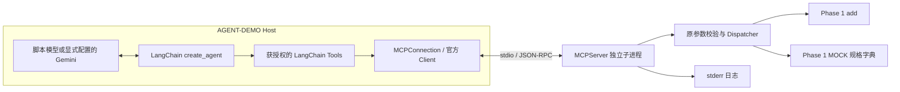
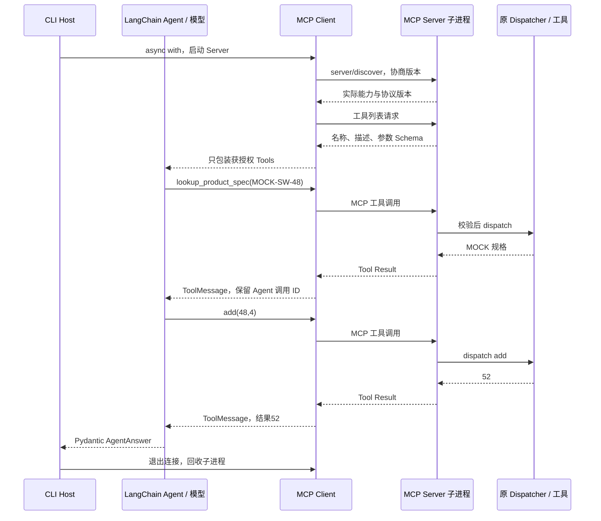

# Phase 7：MCP stdio 独立实验

日期：2026-10-17。当前实现使用官方 MCP Python SDK **2.3.0**，实际协商协议 **2026-07-28**。本地真实 stdio 与脚本模型 Agent 已运行；真实 LLM 未验证，因为进程没有模型 Key。Phase 6 真实 RAG 验收继续 BLOCKED。

本文件说明技术实现；[阶段总结](phase07_summary.md)提供学习快照，[路线图](../AGENT_LEARNING_ROADMAP.md)是唯一当前状态入口。阶段状态 **DONE**：用户已明确授权本地提交及完成记录，实现提交为 `2f6fd60`；没有推送。

## 1. MCP 解决什么问题

MCP 是应用与工具服务之间的协议，约定如何连接、发现工具、表达参数 Schema、调用和返回结果。它不是 LLM，不会替应用理解任务或自动形成 Agent Loop。

本阶段把 Phase 1 的 `add` 和 `lookup_product_spec` 放进独立进程，演示同一套业务函数既可以被 Python 直接调用，也可以经过 MCP 调用。没有接入 RAG，没有修改旧仓库，也没有把 Phase 6 HTTP 强制改成 MCP。

Host 是包含 Agent、模型与权限策略的应用；Client 是 Host 内负责协议通信的连接；Server 是提供工具的独立程序。本项目 CLI/Agent 是 Host，`MCPConnection` 包装官方 Client，`server.py` 是 Server。



## 2. SDK、协议与依赖选择

2026-10-17 通过 PyPI 元数据和官方文档核实当前稳定 `mcp==2.3.0`，不是把 v1 教程用于 v2。PyPI 包元数据声明 Python >=3.10，当前官方安装文档写 3.11+，两者存在差异；本项目实际使用 CPython **3.11.0 / Windows x64** 安装、运行和回归，未据此宣称其他解释器已经验证。

本次依赖：`mcp=2.3.0`、`mcp-types=2.3.0`、`pydantic=2.14.0`、`anyio=4.15.1`、`langchain=1.4.4`、`langchain-core=1.6.9`、`langgraph=1.2.14`；Windows 进程支持 `pywin32=312`。MCP 的传递依赖还会安装 HTTP 相关包，即便这里只启用 stdio。既有 RAG 仍使用 httpx 0.28.1；SDK 使用独立的 httpx2，不替换原客户端。

`pyproject.toml` 约束 `mcp>=2.3,<2.4`，固定清单记录实际安装的 76 个外部包。该清单包含 Windows 专用包，不是 Linux 锁文件；GitHub CI 使用项目依赖及平台标记安装，本次未运行远端 CI。

| 关注点 | v1 常用接口 | 本项目实际 v2 接口 |
|---|---|---|
| 高层 Server | FastMCP | `from mcp.server import MCPServer` |
| Client | ClientSession + 手动 transport/session 初始化 | `from mcp import Client, StdioServerParameters`，用 async with 管理 |
| 连接协商 | 常见 initialize 握手 | Client 默认 auto，实际 server/discover 后采用 2026-07-28 |
| 工具定义字段 | 常见 inputSchema | SDK Python 属性 `input_schema` |
| 执行结果字段 | 常见 structuredContent / isError | SDK Python 属性 `structured_content` / `is_error` |

SDK 版本和协议版本是两件事。没有伪造 `initialize` 日志：本次实际走的是现代协议的 discovery。旧协议回退由 SDK 提供，但本项目没有声称完成第三方 v1 服务兼容验收。

## 3. Server：复用业务，不复制计算

源码：[server.py](../src/agent_demo/mcp/server.py)。`create_server()` 只注册两个工具：

- `add(a, b)`：调用原 Dispatcher，结果为 `{"status":"ok","result":42.0}`。
- `lookup_product_spec(model)`：调用原 MOCK 工具；不存在的合法 MOCK 型号正常返回 `not_found`，并始终保留 `source_type=mock`。

输入 Schema 复用 Phase 1 的 `TOOL_DEFINITIONS`，名称、必填字段、类型、型号模式和 `additionalProperties=false` 保持一致。SDK 负责注册、消息编码和调用路由。

`ValidatedMCPServer.call_tool()` 在 SDK 参数转换前先调用原 `validate_arguments()`，防止布尔值被当成数字、字符串被转换为数值，以及多余参数被忽略。执行入口再次使用 `dispatch()`，业务异常只返回安全错误类型。`list_tools()` 只公开批准集合。

工具声明 `structured_output=True`，返回类型使用 `dict[str, Any]`；本次实测裸 `dict` 强制结构化输出会触发 SDK InvalidSignature，已修正。SDK 生成结构化结果，同时 Client 继续检查具体业务结构，不把任意字典都视为成功。

`read_only_hint` 等 annotations 是描述性提示，不是权限控制。真正的控制是固定工具集合、参数校验、原函数实现和 Client 的调用授权。Server 不暴露终端、文件读写、资源或 Prompt 内容；SDK 能力描述仍可能包含空的 resources/prompts 能力，实际列表为空。

运行时 stdin/stdout 专用于协议，应用日志写 stderr。单独启动 Server 后等待输入是正常现象；一般由 Client 自动启动，无需人工先打开一个 Server 窗口。

## 4. Client：连接、发现、调用、关闭

源码：[client.py](../src/agent_demo/mcp/client.py)。默认子进程命令固定为：

```text
当前 sys.executable -m agent_demo.mcp.server
```

从 `.venv\Scripts\python.exe` 启动 Client，就使用同一虚拟环境的 Python 启动 Server。模型和工具参数无权更改命令、URL 或环境变量。

`async with MCPConnection()` 进入官方 `Client` 生命周期，协商后保存实际协议、服务标识与能力；`discover()` 调用工具列表，校验并过滤为调用方获授权的集合；`call_tool()` 在发出请求前再检查名称和参数。

工具发现与授权分开。例如 Server 提供两个工具，而 Host 只授予 `allowed_tools={"add"}`，模型只能拿到 add，直接请求规格工具也会被拒绝。测试还使用额外工具的隔离服务证明：发现更多工具不会扩大授权集合。

返回值优先读取 `structured_content`，兼容合法 TextContent JSON 后备；检查成功信封、有限数值、MOCK 型号、规格字段及型号与请求一致。工具的 `is_error`、协议异常、无效业务返回分别处理。

| 错误类型 | 含义 |
|---|---|
| unauthorized_tool / invalid_arguments | 本地授权或参数检查拒绝，没有发送执行请求 |
| tool_error | Server 返回工具执行失败 |
| protocol_error + protocol_code | JSON-RPC/MCP 协议层错误 |
| invalid_response | 返回值结构或业务字段不符合约定 |
| connection_failed / connection_lost | 无法建立连接或运行中服务退出 |
| timeout | 连接或调用超时 |
| connection_unavailable | 已关闭，或超时/断连后不允许继续复用 |

应用不自动重试工具调用。超时并不证明远端函数从未执行；连接受损后停止复用，在退出 async with 时由 SDK 关闭 stdin、等待进程，必要时终止进程树。此处只提供只读工具，不能据此推断任意有副作用的 MCP 服务也可盲目重试。

连接期限 `connect_timeout` 用 `asyncio.timeout()` 控制，具体工具调用另用 `timeout` 设置 SDK read timeout，默认均为 10 秒。两者独立，短工具期限不会误杀 Python 冷启动。SDK auto 协商有自身探测默认值，第一次完整回归发现只设置 read timeout 时启动耗时超出预期，已增加整体连接期限。超时后还要完成清理，函数返回时间可能超过业务期限；不声称停止等待等于即时取消。

## 5. MCP 如何进入 LangChain Agent

源码：[tool_adapter.py](../src/agent_demo/mcp/tool_adapter.py)。它复用 Phase 3 的 `create_agent` 和 `AgentAnswer`，建立独立入口，原来的直接 Python Tools 保持不变。

`discover_langchain_tools()` 获取已授权定义，构建同名 `StructuredTool`，保留描述和 JSON 参数 Schema。Tool 的 async coroutine 调用连接，而不是本地函数。整个 Agent 运行期间保持同一个 async 连接，避免同步工具在其他事件循环中误用会话。

```python
async with MCPConnection() as connection:
    tools = await discover_langchain_tools(connection)
    # create_agent(model=model, tools=tools, response_format=ToolStrategy(AgentAnswer))
```

实际执行过程：



MCP 请求关联由 SDK 管理；Agent 的 Tool Call ID 由 LangChain ToolMessage 保留，两个层次没有被虚构成同一个 ID。事件只记录实际工具、参数、结果状态和耗时，不展示模型内部推理。

Agent 设置任务超时和 graph recursion_limit。后者限制图步骤，不等于精确模型轮数或工具次数；本阶段没有实现新的通用预算框架。若状态出现错误 ToolMessage，即便模型随后尝试给出最终答案，也返回失败；MCP 失败不能被包装成正常成功。

## 6. Python Tool、HTTP API、MCP 的实际比较

| 项目 | Python Tool | HTTP API | MCP（本次 stdio） |
|---|---|---|---|
| 调用方式 | 同进程函数调用 | 向固定路由发送请求 | 进程间 JSON-RPC，SDK 按协议发送工具调用 |
| 发现方式 | 代码显式注册 | API 文档/OpenAPI 或应用配置 | 标准工具列表及 Schema |
| 参数 Schema | 手写或由类型生成 | 请求模型或 OpenAPI | Server 暴露，Client 获取并包装 |
| Endpoint | 无 | 需要服务已有路由，例如 /retrieve | 本次无 HTTP Endpoint，使用 stdin/stdout |
| 开销 | 无网络/进程序列化开销 | 序列化、网络与服务开销 | 子进程启动与管道序列化开销 |
| 错误 | Python 异常或业务返回 | HTTP 状态、超时、响应结构与业务错误 | 协议错误、工具 is_error、传输故障和业务状态 |
| 安全 | 允许列表与参数/副作用控制 | 服务认证、固定地址、范围与业务授权 | 工具发现之外仍需授权；stdio 子进程具有本机权限 |
| 跨进程/语言 | 直接 Python 调用不提供 | 可以 | 协议支持；本次只验证 Python 两进程 |
| 维护 | 本项目内简单直接 | 适合已有独立服务 | 增加 SDK/生命周期成本，统一工具发现和调用契约 |
| 适用场景 | 项目内部的小工具 | 已有业务服务，如独立 RAG | 多种 Host 需要按共同协议使用工具服务 |

没有做三者的等负载性能基准，不能声称 MCP 更快或更可靠。本项目已有的 HTTP RAG 接口继续使用 HTTP；MCP 并不替它修复资料缺口或提供额外业务理解。

几个常见问题：

1. **为什么 MCP 不是模型？** 它传递能力和调用消息，不负责语言推理；本阶段 Server 不需要模型 Key。
2. **为什么 MCP 不等于函数？** 工具底层仍调用函数，但跨进程的发现、Schema、错误和生命周期由协议及 SDK 处理。
3. **有 HTTP 为什么还用 MCP？** MCP 为工具交互提供共同约定，减少每个 Host 各写一套工具发现/适配；已有 HTTP 本身也完全可以满足集成需求。
4. **与 LangChain Tool 什么关系？** LangChain Tool 是 Agent 内部接口，MCP 是获取并调用外部工具的协议，本项目用薄适配层连接两者。
5. **Server 必须用 LLM 吗？** 不必，这里只调用已有计算与模拟字典。
6. **会自动形成 Agent Loop 吗？** 不会；CLI Client 只按顺序调用，Agent Loop 由 create_agent 负责。
7. **发现为何不能替代授权？** Server 公开某工具不代表当前任务有权使用，Client/Host 仍需允许列表。
8. **与 Skill 什么区别？** 在本工程讨论的 Codex Skill 是指导执行方式的说明与配套资源；MCP 提供运行时能力协议。说明文档不会因为被读取就变成远端工具，也不能代替调用权限。

## 7. 运行与验证

在项目根目录 PowerShell 执行，使用现有虚拟环境：

```powershell
# 本次实际安装及 editable 安装命令。
.\.venv\Scripts\python.exe -m pip --isolated --disable-pip-version-check install --index-url https://pypi.org/simple --timeout 15 --retries 1 --no-cache-dir "mcp==2.3.0"
.\.venv\Scripts\python.exe -m pip --disable-pip-version-check install --no-index --no-build-isolation --no-deps -e .

# 自动启动/关闭真实 Server 子进程；无 LLM。
.\.venv\Scripts\python.exe examples\phase07_mcp_client.py

# 脚本模型 + 真正 stdio + 真正 LangChain Agent。
.\.venv\Scripts\python.exe examples\phase07_mcp_agent.py

# 已安全配置当前进程模型 Key 后才使用；本次没有真实运行。
.\.venv\Scripts\python.exe examples\phase07_mcp_agent.py --live

# 单独 Server 等待 MCP 输入；普通日志不会输出到 stdout。
.\.venv\Scripts\python.exe examples\phase07_mcp_server.py

.\.venv\Scripts\python.exe -m pytest tests\test_phase07_mcp.py -q
.\.venv\Scripts\python.exe -m pytest -q --tb=short --junitxml outputs\phase07\pytest-20261017.xml
.\.venv\Scripts\python.exe -m ruff check .
.\.venv\Scripts\python.exe -m ruff format --check .
.\.venv\Scripts\python.exe -m pip check
```

Client Demo 实际返回 add=42、MOCK-SW-48=48 个下联口/4 个上联口，`connection_closed=true`。Agent 实际轨迹：`phase07-1 lookup_product_spec` → MOCK 规格 → `phase07-2 add(48,4)` → 52 → `AgentAnswer`。这是预设模型响应，不理解任意任务；stdio、工具执行和框架循环是真实运行。

Demo 证据：[validation-20261017.json](../outputs/phase07/validation-20261017.json)。最终完整回归结果见 [pytest-20261017.xml](../outputs/phase07/pytest-20261017.xml)，运行产物保持 Git 忽略。

实际结果：Phase 7 专项 **50 passed / 0 failed / 0 skipped（30.68s）**；最终完整回归 **361 passed / 0 failed / 1 skipped（60.19s）**，包含原 Phase 0–6 的311项通过。唯一跳过是原 Phase 6 真实 RAG/PDF 验收。Ruff check、74个Python文件格式检查、pip check通过；34个README/本阶段文档本地链接有效，76项依赖锁定与安装一致。独立Server脚本入口也通过真实Client调用。

测试分层：

- SDK 内存连接：发现、Schema、Dispatcher 复用、业务异常、安全返回、授权过滤。
- 真正 stdio：正常调用、未知工具、原始 SDK 绕过尝试、参数错误、not_found、启动失败、启动等待超时、服务运行中退出、调用超时、协议错误、无效响应、日志分流。
- 脚本模型 + 真正 stdio：实际 create_agent 多步执行、调用 ID/顺序、未授权工具错误不伪装成功、MCP 故障、任务超时。
- 进程清理：测试观察 SDK 实际创建的进程句柄，在正常退出、故障和超时后检查 returncode 已确定；不使用可能有 Windows 副作用的 os.kill(pid,0)。观测 SDK 私有创建函数只用于测试，不成为生产调用入口。
- 兼容：Phase 3 直接 Python 工具仍正常，全套 Phase 0–6 回归；Phase 6 真正服务测试保持原条件跳过。

第一次测试使用了错误的 SDK 私有观测函数名，已按实际安装源码修正；输出类型、断连分类和连接整体期限的问题都记录并修复。没有跳过新 MCP 测试来通过验收。

## 8. 边界与后续

真实 LLM 不可用时，脚本模型不能冒充真实模型；本阶段强制要求的真实 MCP 连接已经独立验证。未使用 Inspector，未实现远程 MCP、OAuth、多服务器管理、资源或技能分发，不声称提供生产身份隔离或操作系统沙箱。

只有在需要跨机器访问、共享服务或独立部署时，再评估 Streamable HTTP，并设计认证、TLS、授权、Origin/网络范围和会话生命周期。这些是扩展任务，不改变现有 RAG HTTP 边界。

本阶段按用户授权完成本地实现提交 `2f6fd60`，完成记录另提交；不执行 push。之后按路线图处理既有 Phase 2/3 缺口与 Phase 6 真验收条件，或开展 Phase 8 汇总；Phase 10A 的真实证据进入条件仍未满足。

## 9. 官方参考（2026-10-17 核实）

- [安装及 v2 稳定版本线](https://py.sdk.modelcontextprotocol.io/get-started/installation/)
- [v1 → v2 迁移](https://py.sdk.modelcontextprotocol.io/migration/)
- [v2 新变化](https://py.sdk.modelcontextprotocol.io/whats-new/)
- [Client stdio 与生命周期](https://py.sdk.modelcontextprotocol.io/client/transports/)
- [协议协商模式](https://py.sdk.modelcontextprotocol.io/protocol-versions/)
- [工具及结构化输出](https://py.sdk.modelcontextprotocol.io/servers/tools/)
- [协议与工具错误](https://py.sdk.modelcontextprotocol.io/servers/handling-errors/)
- [stdio 传输规范](https://modelcontextprotocol.io/specification/2026-07-28/basic/transports)

以上是接口选择依据；本项目采用的版本、行为和验收边界以实际安装源码与本次测试为准。
