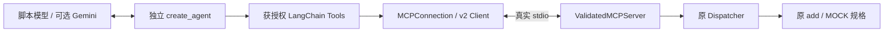

# Phase 7 总结：MCP stdio 工具服务与 Agent 接入

技术实施日期：2026-10-17。阶段当前状态见[路线图](../AGENT_LEARNING_ROADMAP.md)：本地通信及 Agent 实验已完成，统一版本收尾等待本地提交授权；没有推送。详细说明见[技术文档](phase07_mcp.md)。

## 1. 这一阶段做了什么

使用官方 MCP Python SDK 2.3.0，将原 add 和 lookup_product_spec 暴露为独立进程的工具服务。Client 实际协商到 2026-07-28，发现 Schema、校验授权、执行调用、检查结果并释放连接。

另加薄适配层把获授权 MCP 工具变成 LangChain StructuredTool，用 create_agent 实际完成查 MOCK 规格 → 计算总端口 → Pydantic 结构化回答。原 Phase 3 直接 Python 工具保持不变；Phase 6 HTTP RAG 路径保持不变，真实验收仍 BLOCKED。

## 2. 最重要的是什么

**工具发现让 Host 知道服务提供什么，执行授权决定当前任务允许使用什么。**

- MCP 是协议，不是 LLM，也不会自动形成 Agent Loop。
- 相同业务函数可以由同进程 Python 或跨进程 MCP 使用，业务规则仍由原 Dispatcher 校验。
- stdio 的 stdout 是协议管道，日志必须去 stderr；Client 的生命周期同时涉及 Server 进程回收。

## 3. 当前大致框架

关键代码：[Server](../src/agent_demo/mcp/server.py)、[Client](../src/agent_demo/mcp/client.py)、[Tool Adapter](../src/agent_demo/mcp/tool_adapter.py)。三个示例入口演示 Server、Client 和 Agent；一个独立测试文件区分内存、真实进程和 Agent 验证。

## 4. 怎么证明它完成了

Client 与 Agent Demo 均实际退出 0，协议 2026-07-28。Client add(15,27)=42，MOCK 查询保持 source_type=mock；Agent 查询 MOCK-SW-48 后经 MCP add(48,4)=52。模型使用固定响应脚本，不能称为真实 LLM 验证。

测试实际执行真实 SDK 和子进程，覆盖启动、协商、发现、正常与异常调用、参数校验、权限、服务断开、超时、错误回复、日志分流、调用关联和进程回收。最终数量与命令在[路线图学习日志](../AGENT_LEARNING_ROADMAP.md)及[技术文档](phase07_mcp.md)记录。

本阶段50项全部通过；完整回归 **361 passed / 0 failed / 1 skipped（60.19s）**，原311项全部通过。唯一跳过保留Phase6真实RAG/PDF条件。Ruff、格式、依赖一致性、文档链接及Git差异检查通过；旧RAG-DEMO未修改。

运行证据：[Demo JSON](../outputs/phase07/validation-20261017.json)、[完整 pytest XML](../outputs/phase07/pytest-20261017.xml)，都位于 Git 忽略目录。Ruff 和 pip check 通过；没有使用直接函数调用冒充 MCP 通信。

## 5. 问题、限制与容易误解的地方

实际修复了 SDK v2 返回类型声明、进程观测接口、断连错误分类和整体连接超时。SDK read timeout 不一定约束完整自动协商，清理还可能延长返回时间；停止等待不能被解释为远端从未执行。

当前仅本地受信命令，无远程 MCP、OAuth 或操作系统沙箱。图递归限制不是精确工具次数预算。没有模型 Key，因此真实 Agent→LLM→MCP 验证未执行；真实 stdio 本身已验证，不受此条件阻碍。

人工审核、SOC 语义理解、真实 RAG 验收不会因为加了 MCP 自动完成。旧阶段缺口继续保留；不把模拟规格说成真实产品能力。

## 6. 下一阶段怎么接着做

先按统一完成标准形成授权本地版本。之后可进入 Phase 8 汇总，但主业务仍需补齐 Phase 2/3 控制问题、准备独立安全 RAG 服务和固定设备 PDF，完成 Phase 6 真实验收，再推进 Phase 10A。

需要跨机器共享工具时才单独评估 Streamable HTTP 与认证。MCP 是独立学习实验，现有 HTTP 检索无需为此改造。
