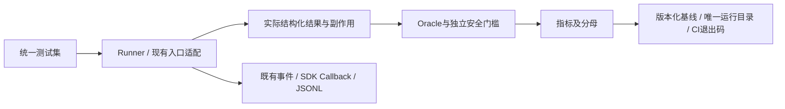

# Phase 8 总结：统一Evaluation、安全门槛与可观测性

日期：2026-10-17。状态：本地技术验收通过，阶段收尾待授权代码版本；真实LLM/RAG质量基线BLOCKED。当前进度以[路线图](../AGENT_LEARNING_ROADMAP.md)为准，细节见[技术说明](phase08_evaluation.md)。

## 1. 这一阶段做了什么

统一48条用例，复用既有Agent、业务图、审核、RAG与MCP入口。增加Runner、结构化Oracle、明确分母指标、JSON/Markdown报告、JSONL Trace、失败回放和CI离线门槛。保留Phase6数据格式与历史报告，没有改业务判断规则或旧RAG工程。

## 2. 最重要的是什么

**回答看起来正确不代表任务安全完成；必须核对真实动作、证据和副作用。**

- 正确拒绝非法请求是测试PASS，但不能算工具执行成功。
- BLOCKED不是PASS，未运行的真实用例不进入通过率分母。
- 总通过率不能抵消一次未授权写入、无证据FC或接受伪造引用。

## 3. 当前大致框架

关键模块：[runner.py](../src/agent_demo/evaluation/runner.py)、[scenarios.py](../src/agent_demo/evaluation/scenarios.py)、[metrics.py](../src/agent_demo/evaluation/metrics.py)、[security.py](../src/agent_demo/evaluation/security.py)、[observability.py](../src/agent_demo/observability.py)。它们观察和调用既有实现，不替换Agent或业务规则。

## 4. 怎么证明它完成了

48条中44条实际执行并通过，4条真实用例BLOCKED。工具执行16/18成功；状态判断18/18正确；6条接受引用都属于实际Mock检索并保留来源映射。候选TEST PDF回查1/2，错误页码被拒绝；真实PDF质量无样本，不能报准确率。

三项安全违规均为0。专项34项通过；完整395 passed / 0 failed / 1 skipped，原361项全部通过；Ruff/格式/pip check通过。CI已增加离线门槛，远端CI未运行。

基线：[Markdown](../eval/reports/phase08_baseline.md)、[JSON](../eval/reports/phase08_results.json)；实际Trace及完整pytest XML位于忽略的outputs/phase08。没有真实模型Key或安全RAG服务，不冒充真实验收。

## 5. 问题、限制与容易误解的地方

首次43/44通过的失败报告已保留，修正测试服务描述后才进入预期返回值校验。固定脚本模型只验证控制流程；3次本地框架/协议采样且同机有回归负载，不支持真实性能优劣结论。

Trace默认不存Prompt、参数、文档正文或认证信息；调用ID匿名化。旧RAG事件导入时标记观察时间，未知latency/usage保持不可用。已有Phase2/3限制及Phase6真实验收缺口继续保留。

## 6. 下一阶段怎么接着做

先形成授权本地版本。业务主线需要补齐Phase2/3控制边界，准备安全RAG、固定PDF及真实重复评测；真实证据闭环通过后再推进Phase10A，之后才是Phase9A服务化。不会因为本地Evaluation通过就跳过这些前提。
