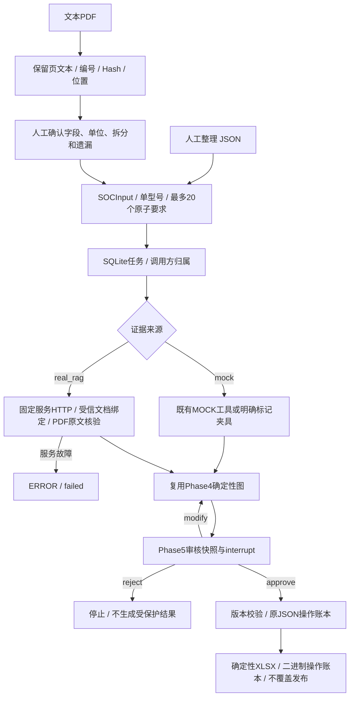

# SOC 应用：JSON、PDF 定位、人工审核与 Excel

本次交付是可运行的本地软件与隔离验证。真实型号、授权版本资料、RAG服务和人工核对答案缺失，**Phase10真实毕业验收BLOCKED**。用户已明确同意先完成软件与隔离测试。所有演示均为MOCK，文件始终标记DRAFT，不发布客户结论。

## 数据流与职责



代码入口：[service.py](../src/agent_demo/soc/service.py)负责应用衔接，[models.py](../src/agent_demo/soc/models.py)复用原业务对象，[excel.py](../src/agent_demo/soc/excel.py)负责工作簿，[rfp.py](../src/agent_demo/soc/rfp.py)保留PDF文本与人工映射。没有重建Agent、向量库或判断规则。

## JSON 到审核与 Excel

[MOCK输入](../data/fixtures/soc_requirements.json)包含14个原子要求与2个父条款，共16行；[人工MOCK预期](../data/fixtures/soc_expected_mock.json)保留逐条结论。包括FC、NC、PC、配置依赖、缺证据、冲突、单位换算和暂不支持的W单位。未知不判NC；工具故障ERROR；PC沿用可选失败和已知满足的既定汇总口径，不将未知当PC。

```powershell
# 各命令独立进程；--root 建议使用新建的隔离目录。
.\.venv\Scripts\python.exe examples\phase10_soc.py --root outputs\my-soc submit --input data\fixtures\soc_requirements.json
.\.venv\Scripts\python.exe examples\phase10_soc.py --root outputs\my-soc run --task-id 实际task_id
.\.venv\Scripts\python.exe examples\phase10_soc.py --root outputs\my-soc status --task-id 实际task_id
# 将实际快照的review_id、review_version、snapshot_digest写入审核JSON，并填action。
.\.venv\Scripts\python.exe examples\phase10_soc.py --root outputs\my-soc review --task-id 实际task_id --input 审核响应.json
.\.venv\Scripts\python.exe examples\phase10_soc.py --root outputs\my-soc export --task-id 实际task_id
```

CLI的owner是受信本地操作员标签，不提供身份认证；HTTP接口才根据Bearer映射身份。输入必须显式`input_confirmed=true`，未确认保持pending，不能自行开始判断。修改要求或配置后重算并产生新审核版本；真实路径重新检索对应资料。HTTP审核不能提交自行伪造的Evidence或认证标记。

Excel包含SOC、Evidence、Review三张表，保留原文与实际结构化比较、条款来源位置、证据ID及内部跳转、摘录、文档/版本、页码语义、chunk、审核人/时间/版本和快照摘要。审核状态与FC/PC/NC业务结论分开，批准PENDING不等于变成FC。所有文件仍为DRAFT；正式客户发布不在本次授权内。

未批准默认不能导出；只有显式`draft=true`且正在等待审核才可获取未审核草稿。拒绝/取消后禁止导出。源文本强制写为字面文本，不能成为Excel公式。不能覆盖既有文件、绕过批准或凭operation_id取得权限。

操作账本新增受限`soc_excel`类型，复用原prepared→原子不覆盖发布→completed机制，不复制一套文件事务逻辑。固定ZIP元数据使同一审核对象重复导出字节相同；操作ID包含审核快照、状态、审核人和时间。文件被删改后拒绝重建。审核人记录先落业务库，再执行受保护操作；进程在Graph完成与任务状态同步之间退出，可通过Checkpoint修复状态并保留真实审核人。

SOC审核快照还包含`export_policy`：Excel草稿类型、`soc-v2`模板、授权输出目录和DRAFT标记均参与摘要。作用范围或模板改变必须重新审核；没有该导出授权的旧Phase5快照不直接转换成新Excel，原Phase5入口及其JSON产物保持原样。

## 真实 Evidence 路径

由部署方配置`AGENT_DEMO_SOC_BINDINGS`指向可信绑定JSON列表，包含实际model/document_id/document_version/sha256/pdf_path/applicability_confirmed及条件；`AGENT_DEMO_PDF_ROOT`限定原文目录。只接受一个明确适用的固定版本绑定。配合原Phase6的RAG URL/Token/KB/页码语义和只读确认变量。

客户端按原子属性进行有界固定检索，复用原RAGClient、map_search_evidence和PDF核验；没有调用旧工程内部模块。这里是确定性业务检索流程；模型自主补充检索仍使用既有Phase6独立Agentic RAG入口，不把固定检索称为新的Agent决策。

真实资料不能由请求体直接传入Evidence；无绑定/服务配置时明确失败，审计记BLOCKED。检索错误传入原判断图及审核图，不能被空列表掩盖成设备NC。当前数值抽取仍只支持Phase6的有限字面规格行；任意网络协议、授权、性能测试和复杂表格不支持自动理解，保守PENDING，不声称具备通用SOC语义能力。

## PDF 到结构化要求

```powershell
.\.venv\Scripts\python.exe examples\phase10_soc.py parse-pdf --input 自有授权RFP.pdf
```

解析保留每页全文、未分配文本、编号候选、物理一基页码、行号和PDF SHA256。`confirm_requirements()`要求人工提供Pydantic字段、明确型号、父子结构；原文必须属于实际候选，来源必须匹配Hash/页码/候选ID。每个候选必须映射或给出排除原因。API `/rfp/parse`及`/rfp/confirm`提供同样流程，确认结果再提交/tasks。

这是文本读取与人工受控结构化，不是LLM理解任意RFP。扫描页、加密文档、超限文件明确报错/警告；跨页条款和复杂表格需人工核对，原文不会静默丢弃。人工确认也不能证明编号算法覆盖了任意布局。当前只有合成TEST PDF验证，公开/脱敏真实RFP及人工标注样本仍待提供。

## 验证与限制

专项测试见[控制层回归](../tests/test_completion_controls.py)与[系统集成测试](../tests/test_completion_soc.py)，包括真实SQLite、两个以上独立Python进程、真实os._exit()崩溃、XLSX字节/mtime、审核版本/归属、实际HTTP Mock+TEST PDF证据核验、PDF→人工映射→Graph→审核→Excel。真实本机HTTP验收入口为`examples/project_acceptance.py`，自动使用隔离目录和临时身份，不调用付费模型或旧RAG。

Excel长文本不静默裁剪；超过单元格或可读行高容量时拒绝导出，需拆分输入。审核JSON保存完整业务对象。软件回归通过不代替真实资料逐条核验；OCR、跨型号、通用LLM抽取、正式SOC发布及公网服务均未验收。
