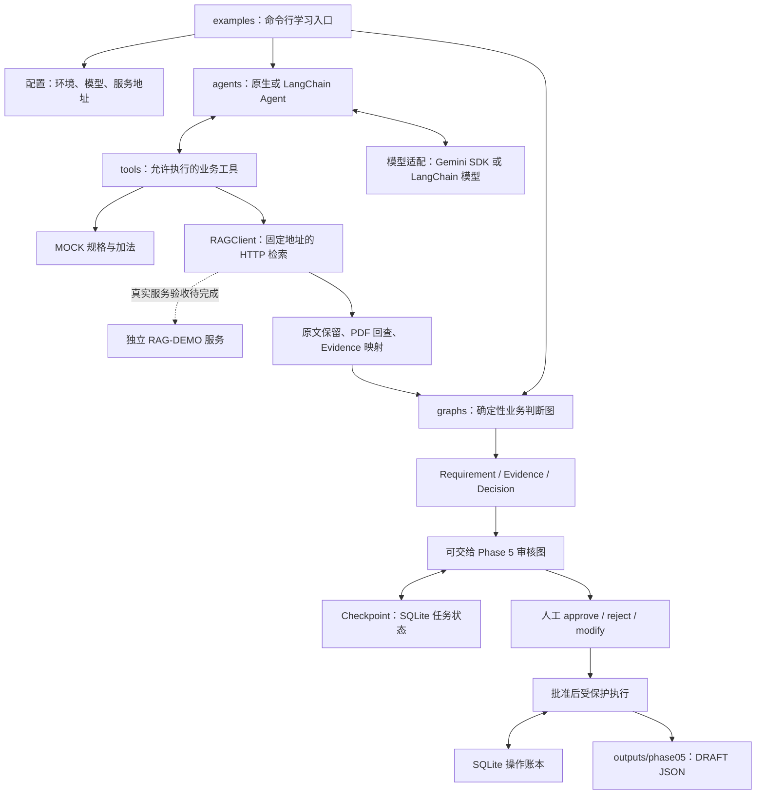
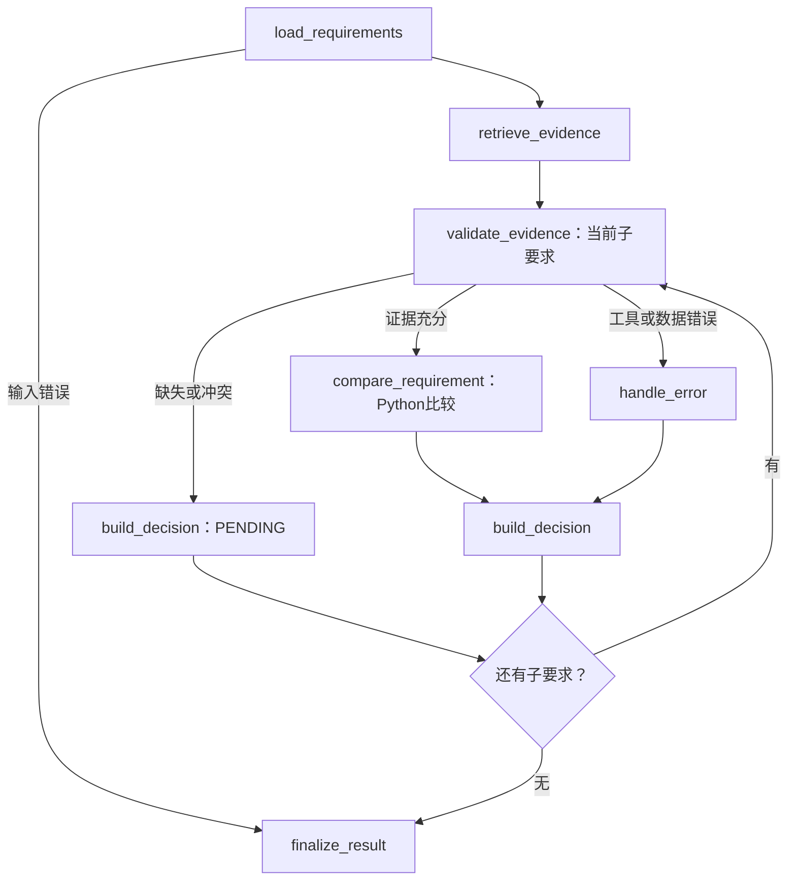

# AGENT-DEMO 工程入门：从 Python 工具到可审核的证据工作流

核查日期：2026-10-16。面向第一次接触 Python Agent 工程的读者。

本文根据当前源码、示例和本次实际运行结果编写。它负责解释“项目为什么这样做、代码放在哪里、应该怎样学习”；实时任务状态仍以 [AGENT_LEARNING_ROADMAP.md](../AGENT_LEARNING_ROADMAP.md) 为准。各阶段总结保留当时的工程快照，旧总结中的状态不一定等于今天的状态。

第一次阅读可以先看第 1～4 节，再按第 10 节运行离线示例；遇到术语时回查第 13 节。

## 1. 这个项目到底要做什么

我们在学习怎样让大模型参与一项可以检查、可以恢复、需要人批准的业务工作。

贯穿案例是网络设备技术要求核查。例如，客户提出：

> 设备至少提供 48 个 GE 电口和 4 个 10GE 上联接口。

最终希望程序能够把这句话整理成具体要求，寻找指定设备和资料版本的证据，核对数量、速率、接口类型、模块配置，形成逐项结论，然后交给人审核，再生成可追溯的符合性响应表。

这里的 RFP 可以理解为客户提出的技术要求，SOC 可以理解为逐条说明“是否符合、根据什么、还有什么限制”的响应表。正式 Excel SOC 是后续目标，目前生成的是受保护的 JSON 草稿。

当前项目可以学习和离线验证：模型怎样请求工具、如何连续执行多步任务、如何用业务规则判断、如何暂停等人审核、如何重启恢复，以及如何接入 RAG 检索。

**当前阶段是 Phase 6 的开发与离线验证已完成，真实验收 BLOCKED。** 用户已确认暂无独立 RAG 服务。当前不能宣称已经用真实设备 PDF 完成端到端合规验收。

## 2. 先认识五个角色

可以把这个工程想成一个资料审核小组，但每个角色的权限都有边界。

| 角色 | 通俗理解 | 在本工程中的作用 |
|---|---|---|
| LLM，大模型 | 会理解问题、提出下一步建议的助手 | 决定是否调用工具、使用什么查询词，组织候选回答 |
| Tool，工具 | 助手可以申请使用的具体能力 | 加法、查询 MOCK 设备规格、检索已配置知识库 |
| Agent Loop | 负责“做一步，再看看是否需要下一步”的调度过程 | 模型请求工具 → Python 执行 → 结果回给模型，直至结束或触及限制 |
| 业务工作流 | 必须按规则走的审核流程 | 加载要求、校验证据、比较数值、形成判断、请求人工审核 |
| Evidence，证据 | 能够回查出处的材料和结构化事实 | 保存型号、属性、数值、单位、原文、文档、版本和位置 |

模型返回 `add(a=15, b=27)`，只是提出调用请求。Python 先核对工具允许列表和参数，才会真正执行。工具结果回给模型，模型才能据此继续回答。

一个重要分工是：**模型可以决定怎样找资料；能否判为符合，必须经过证据校验和确定性规则。**

## 3. 先看工程全景

当前代码有两类主要控制方式：模型驱动的 Agent，以及规则明确的业务图。它们逐步结合，但仍保留各阶段的独立示例入口。



这张图表达模块分工与可复用关系。Phase 6 CLI 默认运行检索或 Agent；传入 `--requirements` 才进入业务判断，真实证据还需要有效的文档绑定。接入 Phase 5 审核要在 Python 中调用 `start_review(..., evidence_mode="real_rag")` 等入口；Phase 5 CLI 目前启动的是预置 MOCK 场景。运行一个示例不会自动走完图中所有步骤。

AGENT-DEMO 负责调度、证据、规则和审核。RAG-DEMO 负责已有的文档检索能力；通过 HTTP 集成，不把它的向量库、Embedding 或重排代码复制进来。HTTP 表示向一个服务地址发送请求，而不是直接导入另一个仓库的 Python 文件。

## 4. 文件夹应该怎样看

下面列出当前已有的重要代码结构和约定的数据目录。路线图中的 `api/`、`mcp/`、`soc/` 等规划目录，不应理解为已交付能力。

```text
AGENT-DEMO/
├── README.md                     快速运行与各阶段入口
├── AGENT_LEARNING_ROADMAP.md      当前进度、验收、学习日志、ADR
├── pyproject.toml                工程身份、依赖和工具配置
├── requirements-lock.txt         实际安装验证过的固定依赖版本
├── .env.example                  配置说明，不放真实密钥
├── .github/workflows/ci.yml       GitHub Actions 检查配置
├── src/agent_demo/               可导入的 Python 包
│   ├── config.py                 基础配置与模型配置
│   ├── tools/                    工具、Schema、Dispatcher、RAG Tool
│   ├── agents/                   单轮调用、多轮循环、LangChain Agent
│   ├── domain/                   要求、证据、判断、审核的数据模型
│   ├── graphs/                   业务图、审核图、Store 实验
│   ├── integrations/             Gemini、HTTP RAG、引用和证据适配
│   ├── persistence/              受保护文件操作的持久化账本
│   └── evaluation/               固定检索与 Agentic RAG 的对比代码
├── examples/                     Phase 00～06 的可运行脚本
├── tests/                        自动化测试，包括 opt-in 真实集成测试
├── eval/                         评测用例和文字报告
├── docs/                         技术说明、阶段总结、模板和本文
├── runtime/                      本机运行数据库和状态，Git 忽略
├── outputs/                      本机草稿、评测产物，Git 忽略
└── data/private/                 私有资料约定目录，按需创建，Git 忽略
```

最实用的区分是：`src` 存放可复用能力，`examples` 演示怎么调用，`tests` 检查是否符合预期，`docs` 解释为什么这样设计。运行数据库和输出文件属于本机数据，不能当成源码提交。

## 5. 重要模块分别负责什么

| 模块与关键位置 | 主要职责 | 阅读时抓住的问题 |
|---|---|---|
| [config.py](../src/agent_demo/config.py) | 读取并检查进程环境配置、模型设置 | 没有 Key 时为什么离线示例仍可运行？ |
| [tools/__init__.py](../src/agent_demo/tools/__init__.py) | `add`、`lookup_product_spec`、工具定义、允许列表、`dispatch()` | 模型提出请求后，谁真正执行函数？ |
| [tool_calling.py](../src/agent_demo/agents/tool_calling.py) | Phase 1 单轮工具闭环与事件 | 工具调用 ID、参数、结果怎样对应？ |
| [gemini.py](../src/agent_demo/integrations/gemini.py) | 翻译官方 SDK 请求与响应，关闭自动函数执行 | 业务代码怎样与供应商协议分开？ |
| [agent_loop.py](../src/agent_demo/agents/agent_loop.py) | 手写多轮执行、历史和终止控制 | 为什么调用一次工具后还能继续？ |
| [langchain_agent.py](../src/agent_demo/agents/langchain_agent.py) | 用 `create_agent` 和 Tool 包装复用原工具 | 框架接管了哪些循环和消息管理？ |
| [domain/](../src/agent_demo/domain/) | 定义业务对象和 MOCK 场景 | 要求、资料、判断、批准有什么不同？ |
| [compliance_graph.py](../src/agent_demo/graphs/compliance_graph.py) | 校验证据、换算单位、比较和复合汇总 | 哪些规则必须由代码强制执行？ |
| [review_graph.py](../src/agent_demo/graphs/review_graph.py) | 审核快照、中断、恢复、修改与受保护执行 | 人批准的是哪一版内容？ |
| [operations.py](../src/agent_demo/persistence/operations.py) | 根据稳定操作 ID 发布并核查唯一草稿 | 崩溃后重复执行，怎样避免多写一份？ |
| [rag_client.py](../src/agent_demo/integrations/rag_client.py) | 调用固定服务的 `/retrieve`，处理超时、重试和响应校验 | 外部系统失败时怎样留下可诊断结果？ |
| [rag_search.py](../src/agent_demo/tools/rag_search.py) | 将检索封装为受限 Tool，累计查询及引用 | 为什么模型不能任意指定 URL 或知识库？ |
| [agentic_rag.py](../src/agent_demo/agents/agentic_rag.py) | 有界模型决策、补充检索、引用检查和结构化候选回答 | 何时继续找资料，何时停止？ |
| [citation_verifier.py](../src/agent_demo/integrations/citation_verifier.py) / [rag_evidence.py](../src/agent_demo/integrations/rag_evidence.py) | PDF 哈希、页码、原文回查及受控数值映射 | 检索到的文字何时才足以用于比较？ |
| [rag_benchmark.py](../src/agent_demo/evaluation/rag_benchmark.py) | 同题比较固定检索与 Agent 检索 | 怎样用结果评价，而不预设 Agent 更好？ |

`agents` 与 `graphs` 不能简单理解为前者已经过时、后者取代前者。Agent 适合有选择空间的任务；显式业务图适合必须检查和审核的步骤。

## 6. 最重要的业务模型：三张表加一份审核单

这里“模型”指 Pydantic 数据模型，也就是带校验规则的数据格式，与大语言模型是两个概念。Pydantic 可以检查字段、类型和部分结构规则，但不能证明填写的产品参数真实。

### 6.1 Requirement：客户要求什么

定义在 [requirements.py](../src/agent_demo/domain/requirements.py)。关键字段包括：

- `id`、`parent_id`：本条要求和父条款是谁。
- `original_text`、`source_location`：原话是什么，来自哪里。
- `model`、`attribute`：针对哪个设备型号、哪个属性。
- `operator`、`expected_value`、`unit`：怎样比较，门槛是多少，单位是什么。
- `mandatory`、`applicable_conditions`：是否必要，以及适用于什么配置。

例如，“至少 48 个下联接口”可以人工整理为下面的输入。它是教学用 MOCK 数据：

```json
{
  "id": "r-downlink-count",
  "original_text": "MOCK：至少提供48个下联接口",
  "source_location": "MOCK教学条款1",
  "model": "MOCK-SW-48",
  "attribute": "downlink_ports",
  "operator": ">=",
  "expected_value": 48,
  "unit": "count",
  "mandatory": true
}
```

当前复合条款由人工整理为结构化子要求；没有交付能可靠解析任意 RFP 自然语言或 PDF 的通用解析器。

### 6.2 Evidence：有什么材料证明

定义在 [evidence.py](../src/agent_demo/domain/evidence.py)。它保存实际值和单位，还保留原文、来源、文档版本、位置与适用条件。真实 RAG 路径另外保存文档 ID、哈希、页码语义、Chunk ID、检索时间和查询词。

`actual_value=48` 只表示一个待核实的值。还必须知道它来自哪份资料、适用哪个型号与配置。缺失字段明确保留未知，不能靠模型补齐。

`source_type=mock` 表示模拟资料；`source_type=real_rag` 表示真实证据路径使用的数据类型。离线测试也会测试后者，因此还要看 `verification_mode`，不能仅凭类型名称判断真实服务已经调用成功。

### 6.3 Decision：按规则得出什么判断

定义在 [decisions.py](../src/agent_demo/domain/decisions.py)。每条结果带要求 ID、建议状态、理由、证据 ID、缺失项和冲突项。

| 状态 | 含义 | 简单例子 |
|---|---|---|
| FC | 适用证据充分，必要条件满足 | 已确认提供 48 个，要求至少 48 个 |
| NC | 适用证据明确证明必要要求不满足 | 已确认只有 24 个，要求至少 48 个 |
| PC | 在已确认的部分满足与限制下，按复合规则汇总为部分符合 | 必要项满足、某个可选项有已确认限制 |
| PENDING | 缺证据、配置未知、来源冲突或无法核实 | 只知道安装模块后可满足，但未确认模块是否安装 |
| ERROR | 工具、数据或流程执行失败 | 检索服务不可用 |

当前复合汇总是保守规则：先处理 ERROR，再处理 PENDING；无未知项后才判断必要项不满足、部分符合或全部符合。它不会用“已满足几项”抵消未知条件。具体分支见 `compliance_graph.py` 中的 `aggregate()`，这套规则还需要在正式业务中确认。

另外有两种容易混淆的状态：`workflow_status=completed` 表示流程算完了，业务结果仍可能是 NC 或 PENDING；人工批准表示同意执行这一版拟议操作，也不会把 PENDING 自动改成 FC。

### 6.4 ReviewSnapshot：人到底批准了什么

定义在 [reviews.py](../src/agent_demo/domain/reviews.py)。快照保留本次任务、Thread、审核 ID、版本、内容摘要、完整业务对象和拟执行动作。

人提交 `approve`、`reject` 或 `modify`。修改要求、证据或配置后，系统重新判断并生成新审核版本，再等待批准。不能直接把最终判断改成 FC 后跳过规则。

## 7. 用一个完整例子串起来

以“48 个 GE 电口、4 个 10GE 上联接口”为例，当前 MOCK 场景位于 [mock_cases.py](../src/agent_demo/domain/mock_cases.py)。

1. **拆要求。** 建一个父条款，再建五个子要求：下联数量至少 48、下联速率为 1 Gbps、下联介质为电口、上联数量至少 4、上联速率为 10 Gbps。
2. **拿证据。** MOCK 工具提供数量和速率；它没有提供电口介质。完整满足场景为介质另外准备了明确标注的 MOCK 假设，不能把它当成真实设备参数。
3. **检查适用性。** 核对型号、属性、单位、来源、配置条件与冲突。需要模块但配置未确认，就停在 PENDING。
4. **执行比较。** Python 先做必要的单位换算，再执行 `>=` 或 `==` 等比较。比如 1000 Mbps 与 1 Gbps 可以按统一维度比较。
5. **逐项判断与汇总。** 处理全部子要求，再形成父条款结果；每条判断保留理由和证据链接关系。
6. **按需进入审核。** Phase 5 在原业务图外包一层审核图，保存快照后暂停。批准才生成受保护草稿，拒绝不写草稿，修改后重新计算和审核。

业务图的实际分支是：



同一条主线换成真实资料时，先增加 HTTP 检索、人工文档绑定与 PDF 回查，再把验证后的 Evidence 交给原有业务图。真实检索验收目前仍受环境阻碍。

## 8. 我们怎样一步步做到现在

| 阶段 | 为什么要做这一步 | 实际增加的能力 | 当前验收边界 |
|---|---|---|---|
| Phase 0：工程底座 | 先保证代码能正确安装、运行和检查 | 独立 `.venv`、src 布局、配置、pytest、Ruff、旧 RAG 契约调查 | 路线图 DONE |
| Phase 1：原生 Tool Calling | 看清模型请求和 Python 执行的分界 | 工具 Schema、允许列表、Dispatcher、一次工具闭环 | DONE；有历史真实 Gemini 验证，规格数据仍为 MOCK |
| Phase 2：原生 Agent Loop | 一次工具不够时，让模型接着做 | 手写多轮循环、消息历史、多工具、计数与终止事件 | 有实现及历史运行记录；路线图 DOING，边界待补齐 |
| Phase 3：LangChain Agent | 理解框架替代了哪些手写循环 | `create_agent`、LangChain Tool、Pydantic 输出 | 有实现；执行限制和测试覆盖仍有缺口，DOING |
| Phase 4：LangGraph 业务图 | 合规判断需要明确的规则和分支 | Requirement/Evidence/Decision、确定性比较、复合汇总 | DONE，MOCK 业务场景离线验证 |
| Phase 5：持久化与人工审核 | 让任务可暂停、恢复、审批与安全重试 | SQLite Checkpoint、审核版本、操作账本、幂等草稿 | DONE，有真实数据库、文件及跨进程恢复验证 |
| Phase 6：Agentic RAG | 将真实资料检索接入上述能力 | HTTP 客户端、检索 Tool、有界 Agent、证据映射、PDF 验证、对比评测入口 | 离线通过；真实 HTTP/PDF/模型评测 BLOCKED |

这条学习顺序的价值是：先理解每一步由谁执行，再让框架接管重复代码，最后把模型的灵活性放进可校验、可恢复的业务流程。

各阶段入口仍保留，便于对照原生实现与框架实现；不能因为后续测试通过，就推断前面所有未验收控制项都已补齐。

## 9. 重要的可复用模板和约定

### 9.1 工具说明书：Schema、允许列表和 Dispatcher

Phase 1 工具定义告诉模型“有哪些工具、各参数是什么”。允许列表则规定 Python “究竟允许执行哪些函数”。Dispatcher 负责查名字、验证参数并调用业务函数。

可以把它当作新增本地工具时的阅读模板：先看 `TOOL_DEFINITIONS`、`TOOL_REGISTRY`、`validate_arguments()` 和 `dispatch()`。Schema 不代替权限校验，模型提供的参数也不能交给 `eval()` 执行。

LangChain Tool 是工具对框架的包装。当前 Phase 3 仍调用原 Dispatcher；Phase 6 的检索 Tool 则调用受控的 SearchSession 和 RAGClient。

### 9.2 业务输入模板：Requirement、Evidence 与 DocumentBinding

Requirement 和 Evidence 规定要求与证据怎样填写。Phase 6 的 `DocumentBinding` 另外要求可信调用方确认：型号、文档 ID、固定版本、PDF SHA-256、授权本地路径、适用配置和确认标记。

真实检索返回的自然语言片段不是可直接采用的数值。当前抽取器只接受明确的规格行，例如 `Downlink ports: 48 count`，并独立核对 PDF 原文、页码和绑定。任意自然语言、复杂表格、否定句等不在当前通用解析能力内。

### 9.3 节点模板：接收 State，返回本节点更新

State 是本次流程共同使用的“工作单”，包含要求、证据、校验结果、判断和错误。节点函数读取它，返回自己需要更新的字段。

例如现有 `compare_requirement()` 返回更新后的 `comparisons` 字段。当前顺序业务图使用按稳定 ID 保存的字典和默认字段替换规则，没有为了形式套用追加 reducer。这样重复执行不需要不断追加同一条判断。

业务模型负责“一个对象是否合法”；State 负责“整个流程现在持有什么”；节点负责“这一步怎样处理”。

### 9.4 配置模板：.env.example

[.env.example](../.env.example) 说明可配置的变量名称。**程序当前直接读取进程环境变量，不会自动加载 `.env` 文件。** 复制文件并填值，并不意味着程序已经读到了它。

模型 Key、Bearer Token 不放进源码、文档或日志。服务地址与文档权限由可信配置决定，模型不能在工具参数中指定任意 URL。

### 9.5 阶段总结模板

[phase_summary_template.md](phase_summary_template.md) 是明确的文档模板。每个阶段收尾时生成 `phaseNN_summary.md`，固定说明：做了什么、最重要的概念、当时架构、验证证据、限制和下一步。

相应的 `phaseNN_主题.md` 记录技术细节与命令；路线图记录当前状态；总结保留阶段快照；本文帮助新读者建立全局认识。

### 9.6 自动检查模板：pytest、Ruff 与 CI

测试验证行为，Ruff 检查代码问题和格式。`.github/workflows/ci.yml` 定义在 GitHub 上执行安装、pytest 和 Ruff 的检查步骤。配置文件存在并不证明远端 CI 已运行通过。

当前测试按阶段组织，新功能也要验证旧功能，不能只运行新阶段的几个测试。

## 10. 小白怎样亲手跑起来

### 10.1 先认识环境，再选择命令

在 PowerShell 中进入项目根目录：

```powershell
Set-Location D:\workspace\AI\AGENT-DEMO
.\.venv\Scripts\python.exe --version
.\.venv\Scripts\python.exe examples\phase00_hello.py
```

这些命令使用现有环境，不需要激活脚本。若 `.venv` 不存在，按 [README 的初始化说明](../README.md#powershell-快速启动) 创建并安装依赖；已有环境时不必重新创建或每次升级。

三个工程概念先记住：

- **`.venv`：本工程的工具箱。** 安装的依赖彼此隔离，不去改旧 RAG 项目的环境。
- **`pyproject.toml` 和 src 布局：工程说明书与源码位置。** 前者定义包名、支持的 Python、依赖和工具配置；后者把可导入包放在 `src/agent_demo`，让示例和测试按安装后的包使用它。
- **editable install：安装后仍指向工作区源码。** `pip install -e .` 使改源码后通常不用重装；新增依赖或修改包元数据后仍需要重新安装。`requirements-lock.txt` 固定的是已验证环境中的外部依赖版本，两者用途不同。

### 10.2 不用 API Key，先按顺序体验

```powershell
# 一次工具闭环：脚本模型请求加法，Python 真正执行 add。
.\.venv\Scripts\python.exe examples\phase01_tool_calling.py --mock

# 多步循环：查 MOCK 规格，再调用加法，最后回答。
.\.venv\Scripts\python.exe examples\phase02_agent_loop.py --mock

# 纯业务规则：一次展示五类 MOCK 证据场景。
.\.venv\Scripts\python.exe examples\phase04_langgraph_workflow.py

# 检索控制实验：问候不检索；补充场景检索两次。
.\.venv\Scripts\python.exe examples\phase06_agentic_rag.py --offline --scenario greeting --chat
.\.venv\Scripts\python.exe examples\phase06_agentic_rag.py --offline --scenario supplement
```

Phase 1/2 的 `--mock` 和 Phase 6 的 `--offline` 使用预设模型响应，验证执行机制。它们不会理解任意新输入；不要把预设轨迹当成真实模型当场做出的决定。Python 工具、图和参数检查仍在实际执行。

Phase 3 的普通 Demo 默认需要真实模型凭据，没有相同的 `--mock` 参数。无凭据时，可以通过测试阅读和验证工具包装，运行方法见 [Phase 3 技术文档](phase03_langchain_agent.md)。

本次 Phase 4 的实际结果为：完全满足 FC、数量不足 NC、可选模块配置未知 PENDING、证据缺失 PENDING、证据冲突 PENDING。

本次 Phase 6 离线问候为 0 次检索、1 次模型调用；补充场景为 2 次检索、3 次模型调用，均标记 `offline_mock`。

### 10.3 单独体验暂停与恢复

下面的 `start` 会在当前 AGENT-DEMO 的 `runtime/phase05/` 保存任务数据。使用新 Thread 名称，不覆盖既有任务：

```powershell
$learnThread = 'intro-' + [guid]::NewGuid().ToString('N')
.\.venv\Scripts\python.exe examples\phase05_checkpoint_hitl.py start --thread-id $learnThread
.\.venv\Scripts\python.exe examples\phase05_checkpoint_hitl.py status --thread-id $learnThread
```

这两条是两个独立 Python 进程，第二条仍能查看第一条保存的待审核快照。重新打开终端后需要继续使用原来的 Thread ID。

先读快照，再按 [README 的审核命令](../README.md#phase-5checkpoint恢复与人工审核) 使用当前审核 ID、版本和摘要提交批准、拒绝或修改。批准会在 `outputs/phase05/` 生成 DRAFT；Thread ID 只是任务标识，不是身份或批准凭据。

### 10.4 检查工程是否正常

```powershell
.\.venv\Scripts\python.exe -m pytest -q
.\.venv\Scripts\python.exe -m ruff check .
.\.venv\Scripts\python.exe -m ruff format --check .
```

本次 2026-10-16 核查实际执行完整 pytest：**311 passed，1 skipped，0 failed，30.40 秒**。跳过项明确是缺安全真实服务及 PDF 的 opt-in 集成验收。上述 Phase 0/1/2/4/6 六个离线入口均实际运行并退出 0；本次不额外创建 Phase 5 学习任务，其恢复和幂等行为由完整回归验证。

Ruff 检查与 65 个 Python 文件的格式检查通过；本文 41 个本地链接可解析，Requirement JSON 示例通过现有 Pydantic 模型校验。

## 11. 想读懂源码，按这个顺序

不要一开始从最大、最复杂的文件读起。每读一层，只回答一个问题。

| 顺序 | 文件 | 这一遍要回答的问题 |
|---|---|---|
| 1 | `examples/phase00_hello.py`、`config.py` | 程序从哪里启动，配置从哪里来？ |
| 2 | `tools/__init__.py` | 工具就是哪些普通函数，输入怎样被拒绝？ |
| 3 | `agents/tool_calling.py`、`integrations/gemini.py` | 一次模型请求怎样变成受控函数调用？ |
| 4 | `agents/agent_loop.py`、`agents/langchain_agent.py` | 手写循环与框架循环分别做了什么？ |
| 5 | `domain/mock_cases.py`、三个业务模型 | 一句要求怎样变成多条可检查的数据？ |
| 6 | `graphs/compliance_graph.py` | 缺证据、冲突、数值不满足各走哪条分支？ |
| 7 | `graphs/review_graph.py`、`persistence/operations.py` | 暂停、恢复、审核版本和重复执行怎样衔接？ |
| 8 | `integrations/rag_client.py`、`tools/rag_search.py` | 如何限制 HTTP 检索参数与权限？上游可能写缓存或日志，为什么还要确认服务安全？ |
| 9 | `integrations/rag_evidence.py`、`citation_verifier.py`、`agents/agentic_rag.py` | 模型检索出来的内容如何进入可信业务路径？ |
| 10 | 对应的 `tests/test_phaseNN*.py` | 什么输入应成功，什么输入必须拒绝或待确认？ |

一个适合动手的练习：在临时脚本里把 MOCK 场景的期望数量从 48 改成 49，调用现有 `run_workflow()`，观察判断与理由；不要为练习修改全局 MOCK 规格或历史测试。

## 12. 当前已经做到哪里，还有什么要补

目前是一个本地 Python 学习和业务原型工程。CLI、工具、数据模型、业务图、恢复、审核和检索适配已经建立；Web UI、FastAPI 服务、MCP、正式 Excel SOC 等仍是后续计划。

需要保留的边界包括：

1. **真实 RAG 尚未验收。** 没有独立安全服务，旧项目启动和调用可能写缓存或日志，因此不擅自启动。后续需要服务配置、授权资料、固定版本 PDF、型号/配置绑定及标准答案。
2. **离线比较不证明真实效果。** 六类脚本评测验证控制分支，没有真实任务成功率或 PDF 引用准确率，不能得出 Agentic RAG 更优的结论。见 [对比报告](../eval/reports/phase06_baseline.md)。
3. **Phase 2/3 仍需收尾。** Phase 2 的配置到 SDK 传递、超时返回和协议历史处理，Phase 3 的严格预算、实际超时与测试覆盖，不能按完整验收描述。源码中 Phase 3 的 `timeout` 未使用，递归步数也不等于工具次数；Phase 2 的线程池退出可能继续等待，原生适配器历史拼接还存在重复回传最近工具结果的风险，需要专项修复和验证。
4. **真实数值提取范围有限。** 不支持的表格或自然语言保持 PENDING。PDF 哈希和原文匹配证明引用位置，不自动认证厂商身份或型号配置适用性。
5. **本地审核不等于多用户权限系统。** Thread 隔离、审核摘要和受保护目录已经建立，但尚未建设服务端身份认证。文件幂等保证针对当前本地受控目录和账本，不宣称任意外部 API 的 Exactly-once。

本次介绍文档任务没有修改这些业务代码，也没有把发现的缺口标记为已修复。

## 13. 常见疑问与术语速查

**“LangChain 和 LangGraph 是什么关系？”** LangChain 的 `create_agent` 封装常见模型与工具循环；LangGraph 提供状态图执行机制，`create_agent` 也建立在 LangGraph 上。Phase 4/5 直接写图，是为了把每一步业务规则、分支和审核位置明确表达出来。

**“为什么都用框架了，还要自己写限制？”** 框架帮助调度，不替我们定义工具权限、服务地址、业务证据要求或批准范围。递归保护、工具次数、HTTP 重试和任务期限还需要分别核实。

**“Checkpoint、Store 和操作数据库有什么区别？”** Checkpoint 保存某个 Thread 的流程进度；Store 实验演示显式授权 namespace 的跨 Thread 数据；操作账本记录某个副作用到底准备过、完成过没有。SQLite 是它们可以采用的存储技术，不代表这些业务职责相同。

**“为什么修改后还要审核一次？”** 批准与当时的内容、版本和拟执行动作绑定。内容变了，就不能继续使用旧批准。

**“为什么每次重试不会多生成文件？”** `operation_id` 对应稳定目标和内容摘要，账本有唯一约束。再次执行会先核查记录和文件；崩溃造成的中间状态需要核实恢复，不能盲目再写。

**“模型说有依据，为什么还不能 FC？”** 结构化输出只证明格式符合要求。来源、文档版本、页码、型号、配置和数值比较都要通过实际校验；检索分数高也不等于事实已经被证明。

| 术语 | 在这里怎样理解 |
|---|---|
| SDK | 供应商提供的 Python 调用工具包，例如官方 Gemini SDK |
| Schema | 字段及类型规则，说明输入和输出应该长什么样 |
| Dispatcher | 根据允许的工具名分发调用，并检查参数的执行入口 |
| State / Node / Edge | 流程工作单 / 一步处理 / 下一步连接或条件分支 |
| Checkpoint / Thread | 可恢复的流程存档 / 一条独立任务执行上下文 |
| Interrupt / Resume | 暂停等待人工输入 / 带审核回复继续流程 |
| Idempotency | 同一操作安全重试，得到既有结果，不重复产生业务产物 |
| RAG / Agentic RAG | 检索资料辅助回答 / 由模型在预算内决定是否及如何补充检索 |
| Chunk / Citation | 检索返回的原文片段 / 指向具体证据的引用 |
| Token / Usage | 模型处理文本的计量单位 / 服务实际报告的使用量 |
| ADR | 记录某项架构选择、原因和适用边界的决策记录 |
| Mock | 明确标记的模拟模型、接口或资料，分别说明模拟的是哪一层 |

## 14. 后续怎样推进，以及去哪里找细节

业务主线的下一步是解除 Phase 6 真实验收阻碍，执行真实 HTTP、PDF 引用回查和同题评测；通过后再进入 Phase 10A 的“人工要求 → 有证据的 SOC”小闭环。Phase 7 MCP 是独立可选实验，不是当前 HTTP 集成的必需依赖。Phase 2/3 的既有控制缺口也需要按路线图单独收尾。

可以按问题查文档：

- 想知道今天该做什么：读 [路线图](../AGENT_LEARNING_ROADMAP.md)。
- 想安装或运行：读 [README](../README.md)。
- 想快速回忆某阶段：读 [Phase 0](phase00_summary.md)、[Phase 1](phase01_summary.md)、[Phase 2](phase02_summary.md)、[Phase 3](phase03_summary.md)、[Phase 4](phase04_summary.md)、[Phase 5](phase05_summary.md)、[Phase 6](phase06_summary.md) 总结。
- 想理解业务规则：读 [Phase 4 技术文档](phase04_langgraph_workflow.md)。
- 想理解暂停、恢复、审核：读 [Phase 5 技术文档](phase05_checkpoint_hitl.md)。
- 想理解真实检索接入：读 [RAG 契约](rag_contract.md) 和 [Phase 6 技术文档](phase06_agentic_rag.md)。
- 想知道当初为什么这样选：读路线图第 17 节 ADR。
