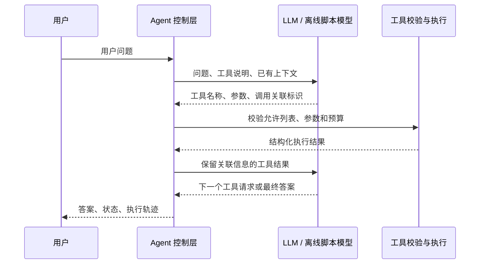
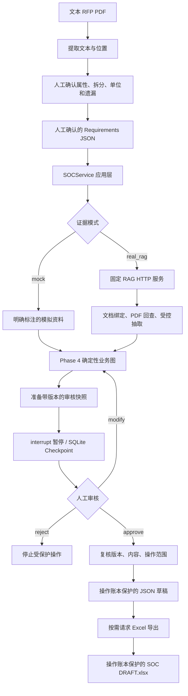

# AGENT-DEMO 初学者完整指南：从工具调用到可审核的 SOC 工作流

编写日期：2026-10-18。依据：本地版本 `41e6d8e` 的源码、运行入口，以及 2026-10-17 的整合验收记录。适合第一次接触 Python、Agent、RAG 和 LangGraph 的读者。

本文解释工程怎样工作，不代替进度管理。**阶段状态以 [学习路线图](../AGENT_LEARNING_ROADMAP.md) 为准，实际验收范围见 [工程审计](project_completion_audit.md)。** 本文中的 MOCK 都是模拟资料；真实设备结论不能照搬演示结果。

## 阅读导航

| 你想了解什么 | 建议先读 |
|---|---|
| 项目到底解决什么问题，现在做到哪里 | 第 1～3 节 |
| 一条客户要求怎样变成判断和 Excel | 第 4～8 节 |
| Agent、RAG、人工审核各做什么 | 第 9～13 节 |
| 每个目录、模块、模板有什么用 | 第 14～16 节 |
| 从零运行、亲手批准并导出结果 | 第 17～19 节 |
| 学习顺序、排错、扩展到其他要求 | 第 20～23 节 |

第一次不用记住所有类名。先理解“输入要求 → 找证据 → 校验证据 → 比较 → 审核 → 输出”，再对照源码。

## 1. 这个项目为什么存在

假设客户准备采购交换机，技术文件写着：

> 设备至少提供 48 个 GE 电口和 4 个 10GE 上联接口。

工程师需要查看某个具体型号的资料，确认数量、速率、介质、模块和配置，然后在响应表里逐项填写：符合吗？根据什么？有什么限制？还有什么需要确认？

这件事至少包含三类工作：读懂要求、找到适用资料、形成有依据且经过审核的结论。只让模型回答“支持”远远不够，还要能查到原文、说明配置条件、保留审核记录。

本工程学习并实现这些环节。最终业务方向是：

```text
客户技术要求 / RFP
    → 结构化要求
    → 产品资料检索
    → 证据核验
    → 确定性规则判断
    → 人工审核
    → SOC 响应表草稿
```

- **RFP**：这里指客户提出的采购和技术要求文件。
- **SOC**：这里指逐条符合性响应表，不是网络安全运营中心。
- **DRAFT**：草稿标记。当前导出的 Excel 即使已经人工批准，仍是本地草稿；正式客户发布需要另行授权和验收。

这既是一套学习 Agent 底层机制的工程，也是一套受控业务应用原型。它还没有达到“随便上传一份招标书，就能自动、可靠地回答所有条款”的程度。

## 2. 当前已经实现了什么，还缺什么

截至本文核查，Phase 0～5、7、8 已按路线图的对应范围完成；Phase 6、9、10 仍有外部验收阻碍。

| 范围 | 当前可以做 | 验收边界 |
|---|---|---|
| 工具调用 | 原生单轮、多轮循环、LangChain Agent 调用共用工具 | 有历史真实模型验证；最近控制补齐主要用离线回归验证 |
| 业务判断 | 结构化要求、证据适用性、单位换算、逐项比较、复合汇总 | 规则和 MOCK 场景已验证，不代表理解任意技术条款 |
| 持久化与审核 | SQLite 恢复、Thread 隔离、批准/拒绝/修改、版本校验、幂等写入 | 有真实数据库、文件、独立进程恢复测试 |
| RAG 接入 | HTTP 客户端、检索 Tool、受限补充检索、证据映射、PDF 核验 | 真实安全服务、设备文档和端到端评测仍 BLOCKED |
| MCP | 独立 Server、Client、工具发现、Agent 适配 | 真实本地 stdio 通信通过，不是远程生产服务 |
| 评测 | 统一数据集、结构化轨迹、安全门槛、报告 | 本地确定性范围已验证，真实质量样本另算 |
| SOC 应用 | JSON → 判断 → 审核 → Excel；PDF 文本定位和人工映射 | 16 行 MOCK 闭环通过，真实毕业业务仍 BLOCKED |
| API 与部署 | 本机 FastAPI、身份/归属检查、任务查询、审核、下载 | 本机 HTTP 通过；Docker/Linux 实际部署仍 BLOCKED |

最近完整整合验收记录为：**439 项测试通过、0 失败、1 跳过；离线评测 44/44 通过、4 项真实用例 BLOCKED；本机 HTTP 验收 18/18 通过。** 这些是 2026-10-17 的结果，不是本文编写时重新测得的真实模型质量。

来源：[整合基线](../eval/reports/project_completion_baseline.md)。基线保存运行当时的 Git 信息，不会因为后来提交了代码就改写历史。

## 3. 先认识八个角色

| 角色 | 用普通话解释 | 在本工程里做什么 |
|---|---|---|
| LLM，大语言模型 | 能读问题、提出下一步动作的助手 | 在 Agent 入口选择工具、组织查询、生成候选回答 |
| Tool，工具 | 助手可以申请使用的具体能力 | 加法、查询模拟规格、查询已配置知识库 |
| Dispatcher，分发器 | 检查申请并实际执行的工作人员 | 按允许列表找到函数，校验参数，执行并返回结果 |
| Agent Loop | 做一步、看结果、决定下一步的过程 | 多轮模型请求与工具执行，直到结束或触及预算 |
| RAG | 按问题查资料的检索能力 | 从外部知识库返回片段和来源，不直接证明合规 |
| LangGraph 工作流 | 明确规定步骤和分支的流程图 | 校验证据、比较、汇总、审核和恢复 |
| Checkpoint | 任务执行到某一步的存档 | 保存 State 和后续执行位置，支持重启恢复 |
| 人工审核 | 对某一版要求、证据、结论和操作负责 | 批准、拒绝，或修改后重新计算和审核 |

三个容易混淆的词也要分开：

- **大模型**：例如 Gemini，负责生成响应。
- **Pydantic 数据模型**：例如 `Requirement`，规定数据字段和校验规则。
- **设备型号**：例如 `MOCK-SW-48`，指被查规格的产品标识。

## 4. 工程全景：两条执行路径，共用底层能力

### 4.1 模型自主选择工具的学习路径

例如用户问：“查一下 MOCK-SW-48 的接口数量，再算总数。”



真实模式的工具决策来自 LLM。离线模式使用预先安排的模型响应，目的是检查流程，不能称为模型自主推理已经验证。

### 4.2 规则明确的 SOC 业务路径



图中的修改还要经过应用层检查；真实资料路径修改要求或配置时会重新检索。它不是简单把一个修改后的结论塞回图里。

**当前 SOC 主链路并不要求运行 LLM，也不会自动先跑一遍 Phase 3 或 Phase 6 Agent。** SOCService 的真实资料路径按要求属性做有界固定检索；LLM 自主补充检索在 Phase 6 独立入口中。两者共用检索和证据能力，但不是同一个默认执行入口。

同样，MCP 是独立实验，不是导出 SOC 必须经过的一站。运行 Phase 10 Demo 不会顺便运行所有历史 Phase。

## 5. 一句客户要求怎样变成程序能处理的数据

### 5.1 程序比较的是结构化数据

“至少 48 个下联接口”可整理成：

```json
{
  "id": "r-downlink-count",
  "parent_id": null,
  "kind": "atomic",
  "original_text": "MOCK：设备至少提供48个下联接口",
  "source_location": "MOCK教学条款1",
  "model": "MOCK-SW-48",
  "attribute": "downlink_ports",
  "operator": ">=",
  "expected_value": 48,
  "unit": "count",
  "mandatory": true,
  "applicable_conditions": {}
}
```

它表达“对这个型号的下联接口数量，检查是否大于等于 48”。这不是生成一段 Python 代码，而是把意思放进程序已经认识的字段。

`load_requirements()` 做的是读取和验证这些字段：数据类型对吗？ID 重复吗？父条款存在吗？父子有没有循环？它**不会自动读懂一段任意中文并产生这些字段**。

源码：[Requirement](../src/agent_demo/domain/requirements.py)、[load_requirements](../src/agent_demo/graphs/compliance_graph.py)。

### 5.2 复合条款要拆成可以分别核实的子要求

“48 个 GE 电口和 4 个 10GE 上联接口”至少涉及下联数量、下联速率、下联介质、上联数量、上联速率。

父条款使用 `kind="composite"`；各子条款使用 `parent_id` 指回父条款。父条款本身不填写数值比较字段，由子条款结果汇总。

这样才能区分“数量满足但介质未知”和“所有条件都满足”。不能只看到数字 48 就把整句判成 FC。

### 5.3 当前谁负责理解自然语言

JSON 路径由人整理和确认；PDF 路径由程序先读取文本、定位编号候选，再由人填写属性、运算符、单位、条件和拆分关系。当前没有通用的 LLM 条款解析器。

将来可以让 LLM 生成结构化候选，减少录入工作；仍要保留原文位置、Pydantic 校验、遗漏检查和确认步骤。它需要另行开发和评测，不能因为工程里已经有 Agent 就认为这项能力自动存在。

## 6. 三个核心业务对象：要求、证据、判断

### 6.1 Requirement：客户要什么

| 字段组 | 含义 |
|---|---|
| `id / parent_id / kind` | 本条是谁、属于哪个父条款、是否为原子要求 |
| `original_text / source_location` | 原话和出处 |
| `model / attribute` | 针对哪个型号、检查哪个属性 |
| `operator / expected_value / unit` | 比较方法、门槛、单位 |
| `mandatory / applicable_conditions` | 是否必要、在什么配置条件下适用 |

### 6.2 Evidence：有什么材料证明

定义：[evidence.py](../src/agent_demo/domain/evidence.py)。核心字段包括：

- `id / model / attribute / actual_value / unit`：这份证据在证明什么事实。
- `source_text / source_document / source_version / source_location`：原文、文档、版本和位置。
- `applicable_conditions / source_type`：适用条件，以及 MOCK 或真实 RAG 路径。
- `document_id / document_hash / chunk_id / page / page_number_semantics`：真实资料回查信息。
- `retrieval_query / retrieval_time`：何时、按什么问题得到。
- `origin_verified / extraction_method / metadata`：原文核验及抽取方式等信息。

`actual_value=48` 不是充分证据，还要知道它是否适用这个型号和配置。未提供的来源字段保留未知，不能编造。

`source_type="real_rag"` 也不等于“已经调用真实服务成功”。离线测试同样会测试真实证据路径，必须结合执行模式、来源核验和验收记录判断。

### 6.3 Decision：按规则得出什么结论

定义：[decisions.py](../src/agent_demo/domain/decisions.py)。它把要求 ID、状态、理由、证据 ID、缺失项和冲突项连起来。

| 状态 | 什么时候使用 | 例子 |
|---|---|---|
| FC | 充分适用证据证明要求满足 | 要求至少 48 个，已核实为 48 个 |
| NC | 适用证据明确证明必要要求不满足 | 要求至少 48 个，已核实为 24 个 |
| PC | 按既定复合规则，存在已确认的满足与部分限制 | 必要项满足，某个可选项明确不满足 |
| PENDING | 缺资料、冲突、配置未知、不能比较 | 只有安装模块才支持，但安装情况不明 |
| ERROR | 工具、输入或执行过程失败 | 检索服务调用失败 |

**没查到，不等于不支持；服务坏了，也不等于设备不合格。**

Pydantic 只能检查数据形状和声明的规则，不能独自证明资料真实。证据验证和业务判断是另外的步骤。

## 7. Phase 4：业务图怎样逐条判断

入口：[run_workflow / build_compliance_graph](../src/agent_demo/graphs/compliance_graph.py)。这个图可以完全离线执行，不需要 LLM。

| 节点 | 输入和动作 | 输出 |
|---|---|---|
| `load_requirements` | 校验要求、配置、ID 和父子结构；初始化本次状态 | 已验证要求或输入错误 |
| `retrieve_evidence` | 使用传入证据；MOCK 模式无传入值时调用原规格工具 | 按证据 ID 保存的字典、错误 |
| `validate_evidence` | 对当前子要求检查型号、属性、配置、来源、单位和冲突 | ready / missing / conflict / error |
| `compare_requirement` | 仅对 ready 证据换算单位并比较 | 比较是否成立 |
| `handle_error` | 标记流程执行故障 | 失败标记 |
| `build_decision` | 形成当前子要求结论，推进游标 | Decision 和下一条位置 |
| `finalize_result` | 汇总全部父子条款，形成完整结果 | WorkflowResult |

条件分支是：

```text
证据 ready    → 比较 → Decision
证据 missing  → PENDING
证据 conflict → PENDING，保留冲突
工具或输入错误 → ERROR
当前条完成     → 还有下一条则继续；全部完成再汇总
```

### 数值和单位怎样比较

代码支持 `>= / > / <= / < / ==`。数量使用 `count`；速率支持 bps、Kbps、Mbps、Gbps、Tbps 的十进制换算；分类值用 `kind` 和相等比较。

例如 1000 Mbps 和 1 Gbps 都转成同一速度维度，再用 Python 比较。当前的单位表没有支持所有工程量，示例中的 W 不能比较时会保留 PENDING。程序不会因为模型觉得“差不多”就通过。

### 复合条款怎样汇总

当前 `aggregate()` 是保守的既定策略：先 ERROR，再 PENDING；没有未解决项后，必要子项 NC 导致 NC；满足和已确认的可选限制可汇总 PC；全部 FC 才 FC。全为可选 NC 且无满足项时也不直接汇总为 PC。

因此，一个子项 FC、另一个关键子项未知，父条款仍是 PENDING。具体项目若采用其他合同口径，需要先明确规则再修改并测试，不能让模型临时决定。

### State 为什么用字典，而业务对象用 Pydantic

State 是本次流程的工作单：保存要求、证据、校验结果、比较、判断、错误和游标。Pydantic 模型规定每份业务数据的形状。

节点读取 State，返回本节点要更新的字段。当前顺序图主要采用字段替换，并按稳定 ID 合并字典，没有使用盲目追加列表的 reducer，避免重复执行时证据和结论越积越多。

## 8. 一个完整的 MOCK 例子

可以先只考虑“下联接口数量至少 48 个”：

1. 人确认 Requirement：`downlink_ports >= 48 count`。
2. MOCK 查询工具返回 `downlink_ports=48`，并明确 `source_type=mock`。
3. 证据层保留原文、位置、型号和数值。
4. 验证层确认型号、属性、配置、单位和来源符合要求。
5. Python 比较 `48 >= 48`，生成 FC 及证据 ID。
6. 审核图把要求、证据、理由和拟执行动作存成第 1 版快照，暂停。
7. 人检查后批准，系统复核内容和版本，记录操作并生成 JSON 草稿。
8. 请求 Excel 导出，生成含 SOC、Evidence、Review 三张表的 XLSX 草稿。

换几个条件就会得到不同结果：实际 24 个 → NC；没有数量证据 → PENDING；两份适用资料分别写 48 和 24 → PENDING；查询工具异常 → ERROR。

注意原 `lookup_product_spec` 只提供数量和速率，不提供电口介质。完整模拟场景中，介质证据由明确标注的 MOCK 夹具补充；不能推断真实设备也具备该能力。

整合样本 [soc_requirements.json](../data/fixtures/soc_requirements.json) 有 **14 个原子要求、2 个父条款，共 16 行**，覆盖满足、不满足、可选限制、缺证据、冲突、配置和单位问题。预期结果另存于 [soc_expected_mock.json](../data/fixtures/soc_expected_mock.json)。

## 9. Phase 1～3：工具调用和 Agent Loop 到底在哪里

### 9.1 模型为什么知道有哪些工具

[tools/__init__.py](../src/agent_demo/tools/__init__.py) 的 `TOOL_DEFINITIONS` 提供工具名称、描述和参数 JSON Schema。它相当于工具说明书。

模型返回一个工具请求后，`TOOL_REGISTRY` 决定本机允许执行什么，`validate_arguments()` 校验参数，`dispatch()` 才调用函数。模型不会获得整个 Python 环境的任意执行权。

当前共用业务函数是：

- `add(a, b)`：拒绝布尔值、数字字符串、NaN、无穷大和非有限结果。
- `lookup_product_spec(model)`：仅查已有 MOCK 型号，未知型号返回 `not_found`；不读取设备资料或访问网络。

### 9.2 三种 Agent 实现的关系

| 实现 | 重要源码 | 控制方式 |
|---|---|---|
| Phase 1 单轮 Tool Calling | [tool_calling.py](../src/agent_demo/agents/tool_calling.py) | 执行一轮工具后回传；继续要工具会明确报告额外轮次需求 |
| Phase 2 原生 Loop | [agent_loop.py](../src/agent_demo/agents/agent_loop.py) | 手写多轮请求、上下文、顺序多工具和终止检查 |
| Phase 3 LangChain Agent | [langchain_agent.py](../src/agent_demo/agents/langchain_agent.py) | `create_agent` 管理循环和消息，应用 Middleware 管理限制 |

Gemini SDK 协议适配在 [gemini.py](../src/agent_demo/integrations/gemini.py)，原生路径明确关闭 SDK 自动执行函数。供应商要求的原始上下文和调用关联信息需要保留，不能随意拼出一套假协议。

LangChain 最终输出用 Pydantic `AgentAnswer` 约束。框架减少了手工维护消息与循环的工作；工具权限、严格参数、业务规则、重试预算、超时和输出可信性仍由应用控制。

### 9.3 为什么要限制轮数、次数和时间

`LoopLimits` 和 `ExecutionGuard` 管理模型轮数、工具次数、输出 Token、累计 Usage、有限重试与期限。触及限制返回明确状态，不把中途输出包装成成功。

常见结束状态是 completed、budget_exceeded、timeout、failed。超时表示停止等待；底层线程或远程请求可能仍在执行，不能承诺已强制取消。共用等待实现见 [execution.py](../src/agent_demo/agents/execution.py)。

成本需要可靠 Usage 和价格依据。缺数据时标记不可估算，不凭测试回答长度填一个费用。

## 10. Phase 6：RAG 怎样变成可用证据

### 10.1 两个仓库各自负责什么

- **RAG-DEMO**：已有资料解析、索引、检索及服务能力。旧工程保持独立、只读；不复制其检索内部实现。
- **AGENT-DEMO**：通过配置好的 HTTP 接口请求资料，控制调用、核验证据、判断和审核。

静态调查核实旧 V3 有 `POST /retrieve`，可以返回原文片段和相关元数据；问答 `/chat` 返回生成内容，不能把生成答案当成原始资料。实际部署兼容性仍需真实验证，详见 [rag_contract.md](rag_contract.md)。

旧项目的启动、缓存和观测可能写数据。没有安全独立服务时，不自动启动或重建旧索引。

### 10.2 各模块的职责

| 模块 | 负责什么 | 不代表什么 |
|---|---|---|
| [RAGClient](../src/agent_demo/integrations/rag_client.py) | 固定地址 HTTP、认证、请求/响应校验、超时、有限重试 | 检索命中不等于事实适用 |
| [SearchSession / Tool](../src/agent_demo/tools/rag_search.py) | `search_knowledge_base`、查询预算、结果与引用登记 | 模型不能从参数里改服务 URL、授权范围或索引 |
| [Agentic RAG](../src/agent_demo/agents/agentic_rag.py) | 让模型决定是否查、怎样补充查，校验候选回答引用 | 模型候选回答不是最终 SOC 判断 |
| [DocumentBinding / Evidence 映射](../src/agent_demo/integrations/rag_evidence.py) | 绑定型号和固定版本，保留原文，受控抽取结构化值 | 不支持任意文档的通用语义抽取 |
| [Citation Verifier](../src/agent_demo/integrations/citation_verifier.py) | 实读允许目录内 PDF，检查 Hash、物理页、引文 | 证明引文在页面中不等于满足客户条件 |

### 10.3 DocumentBinding 为什么需要确认

它是“本次任务允许依据哪些资料”的配置记录。例如由资料管理员确认某型号对应文档 ID、版本、PDF SHA-256、允许路径和模块条件。模型不能自己把搜到的相似文档升级为可信资料。

它不要求每次检索都重新人工整理。可以对一份固定型号/版本维护一次，然后供多次任务复用；版本、型号范围或配置变化时重新确认。当前没有自动化资料管理系统，所以记录由可信调用方准备。

文档绑定检查资料范围，服务 Token 检查访问权限，人工审核检查本次业务对象。三者职责不同。

### 10.4 为什么片段还要回查 PDF

真实路径需要确认文档版本、哈希、页码语义和原文内容。`page=3` 必须知道是 PDF 物理第三页还是印刷页码；当前核验支持明确声明的物理一基页码，不猜封面偏移。

映射层只抽取有限的完整规格行，例如 `Downlink ports: 48 count`。不能从“最大支持”“可选支持”或复杂表格随意提取数值，也不能从文件名确认型号。无法可靠提取时保留原文和未知状态。

必须分开四层：**资料原文 → 经过验证的结构化值 → Python 判断 → 模型解释**。解释不能反过来充当原文证据。

### 10.5 固定检索与 Agentic 检索

固定检索由程序按确定参数发起查询；Agentic 检索由模型决定是否查、是否换问题继续查。普通问候可以不查；资料不足可以补查，但最多次数和期限受程序限制。

当前 SOCService 采用按属性的固定检索路径；Phase 6 独立 Demo 展示 Agentic 检索。尚无真实资料对比结果，不能声称后者一定更准或更快。

## 11. Phase 5：暂停、重启、审核与安全写入

### 11.1 State、Thread、Checkpoint、Store、业务库的区别

| 名称 | 通俗理解 | 保存什么 |
|---|---|---|
| Message Context | 模型本轮可见的对话资料 | 用户、模型和工具消息 |
| Graph State | 任务当前工作单 | 要求、证据、判断、审核快照等 |
| Thread | 某条任务执行线的标识 | 用 `thread_id` 找到对应 Checkpoint |
| Checkpoint | 工作单与执行位置的存档 | 图状态、暂停位置及恢复所需信息 |
| Store | 显式共享的数据柜 | 按 namespace 存取的跨 Thread 数据 |
| 业务数据库 | 应用自己的任务登记簿 | 归属、任务状态、输入、审核人和时间 |
| 操作账本 | 文件动作登记簿 | operation_id、路径、Hash、执行状态 |

内存 Checkpoint 随进程消失；SQLite Checkpoint 可以落盘并在另一个进程恢复。`thread_id` 只是任务标识，不是密码或身份授权。

最小 Store 实验见 [store_demo.py](../src/agent_demo/graphs/store_demo.py)。它不是用户画像或完整长期记忆系统；namespace 共享还需要应用控制访问范围。

### 11.2 人工审核图怎样执行

源码：[review_graph.py](../src/agent_demo/graphs/review_graph.py)。

```text
evaluate_requirements
    → prepare_review
    → human_review：interrupt 暂停
    → validate_review
        approve → execute_approved_action → finalize_result
        reject  → finalize_result，不执行受保护动作
        modify  → evaluate_requirements → 新审核版本 → 再暂停
        无效    → failed
```

`Command(resume=...)` 把审核响应送回暂停位置。中断节点恢复时可能从头运行，所以它在中断前不能偷偷做不可重复的写入。

审核响应必须匹配当前 `review_id / review_version / snapshot_digest`。摘要像内容指纹；内容或导出范围变了，就不能拿旧批准继续执行。

`ReviewSnapshot` 包含原始要求、证据、判断、理由、操作目标；SOC 应用还绑定导出类型、目录、模板版本和 DRAFT 标记。

### 11.3 什么叫幂等性

同一个已批准的操作重复提交，应该返回原结果，而不是每点一次就多生成一份业务文件。

[OperationLedger](../src/agent_demo/persistence/operations.py) 用 SQLite 唯一操作记录、受控路径、内容 Hash 和临时文件发布机制实现本地保护。过程为 prepared → 发布并核查文件 → completed。

如果文件生成后进程崩溃，恢复时先核对账本和文件，再决定是否沿用；不能看到异常就盲目重写。已完成文件被删改时会拒绝自动重建。它不承诺任意外部 API 的 Exactly-once。

## 12. SOCService 怎样把各阶段整合起来

[SOCService](../src/agent_demo/soc/service.py) 是当前应用衔接中心，复用已有业务图、审核图、客户端和账本，不另写一套合规规则。

| 方法 | 主要作用 |
|---|---|
| `submit()` | 校验 SOCInput、单型号及父子关系，登记 owner 和任务 |
| `run()` | 检查人工输入确认、取证、运行审核图，停在等待审核或故障状态 |
| `retrieve()` | 真实路径按属性访问固定 RAG 服务，映射并核验证据 |
| `status()` | 读取任务和 Checkpoint；必要时根据持久化状态同步任务记录 |
| `review()` | 验证审核、记录审核人/时间，处理批准、拒绝、修改 |
| `cancel()` | 阻止后续操作，说明不能撤销已完成副作用 |
| `export()` | 检查当前审核状态、导出范围和账本，再返回 XLSX |

SOCInput 当前限制一个明确型号，最多 20 个原子要求；父条款另计，并有总体列表长度限制。`input_confirmed=false` 时不能自行开始业务判断。真实路径不接受请求方直接塞入自称可信的 Evidence。

应用使用以下数据文件；都属于本机运行数据，Git 忽略：

```text
运行根目录/
├── runtime/soc/
│   ├── tasks.sqlite                 任务归属、状态、输入和审核审计
│   ├── checkpoints.sqlite           LangGraph 恢复存档
│   ├── review_operations.sqlite     批准后 JSON 草稿的操作账本
│   ├── excel_operations.sqlite      Excel 草稿的操作账本
│   └── <task_id>.jsonl              结构化轨迹
└── outputs/
    ├── phase05/<operation_id>.json   受保护的审核 JSON 草稿
    └── soc/<operation_id>.xlsx       受保护的 Excel 草稿
```

### 三种“完成”要分开

- **业务状态**：FC / PC / NC / PENDING / ERROR，说明条款判断。
- **任务状态**：pending / running / awaiting_review / completed / failed / cancelled，说明流程进度。
- **审核状态**：谁对哪版内容做了 approve / reject / modify。

任务 completed 不代表每条 FC。人工批准 PENDING 也不会让它变为 FC。底层 Decision 的 `review_status` 当前仍为 `not_reviewed`；完整审核状态保存在审核图历史、应用 audit 和 Excel Review 表，不能只看这个单字段。

## 13. PDF、Excel、API、MCP 分别解决什么问题

### 13.1 PDF：解决输入和定位问题

[rfp.py](../src/agent_demo/soc/rfp.py) 使用 pypdf 读取可提取文本的 PDF，保留全文、物理页、行号、编号候选、未分配文本、警告和整份 Hash。

`confirm_requirements()` 要求人提供结构化映射，验证原文确实属于候选，来源 Hash/页码/条款 ID 一致；每个候选都要映射或明确给出排除原因。

它不提供 OCR，也不能保证任意跨页条款和复杂表格都已准确拆分。保留文本和警告，是为了让人能发现遗漏，而不是只留下看似整齐的结果。

### 13.2 Excel：解决可阅读、可回查的输出问题

[excel.py](../src/agent_demo/soc/excel.py) 用 openpyxl 生成三张表：

| 工作表 | 看什么 |
|---|---|
| SOC | 原始/结构化要求、型号、判断、理由、缺失和冲突 |
| Evidence | 证据 ID、原文、文档/版本、页码语义、Chunk 等 |
| Review | 审核状态、审核人、时间、版本和摘要 |

结果有内部证据跳转；文本以字面值写入，避免文档内容变成 Excel 公式。超出单元格或可读行高容量会报错，不能悄悄截断。

重复导出使用稳定内容和操作 ID，保证同一版本可核查。拒绝或取消不能导出；等待审核时只有显式要求 DRAFT 才能导出未审核草稿。批准后的导出仍标 DRAFT。

### 13.3 FastAPI：让其他程序能提交和查看任务

[app.py](../src/agent_demo/api/app.py) 把 SOCService 包装成 HTTP 接口。API 像服务窗口，不会因此额外获得模型理解能力。

| 接口 | 作用 |
|---|---|
| `GET /health` | 健康检查；不代表 RAG 和业务资料全部就绪 |
| `POST /tasks` | 提交结构化要求，交给后台任务执行 |
| `GET /tasks/{id}` | 看进度、判断、审核快照 |
| `POST /tasks/{id}/run` | 显式重新调度待执行任务 |
| `POST /tasks/{id}/review` | 提交当前版本审核响应 |
| `POST /tasks/{id}/cancel` | 阻止后续动作 |
| `GET /tasks/{id}/result` | 按权限和审核状态取得 XLSX |
| `POST /rfp/parse` | PDF 文本与候选定位 |
| `POST /rfp/confirm` | 人工映射确认，得到要求列表供后续任务使用 |

Bearer Token 映射为 owner；任务操作核对归属。他人任务和不存在的任务均返回 404。健康端点无需任务身份，业务端点需要认证。

当前是单服务进程、单任务工作线程、有界队列和进程内限流原型。没有多实例调度租约；不能同时用多个服务进程操作同一个数据目录。

### 13.4 MCP：另一种跨进程工具连接方式

[server.py](../src/agent_demo/mcp/server.py) 暴露原 add、lookup_product_spec；[client.py](../src/agent_demo/mcp/client.py) 启动本地子进程、初始化、发现和调用；[tool_adapter.py](../src/agent_demo/mcp/tool_adapter.py) 将已授权工具包装给 LangChain Agent。

当前使用已安装验证的官方 MCP SDK v2 2.3.0，本地 stdio；stdout 专门传协议，日志写 stderr。发现工具不等于授权，客户端和适配层仍检查允许列表。

| 方式 | 怎样调用 | 适合本工程的哪里 |
|---|---|---|
| Python Tool | 同进程调用函数 | 本地共用业务能力 |
| HTTP API | 按约定 URL 和 Schema 请求服务 | 独立 RAG 服务、SOC API |
| MCP | 经协议初始化、工具发现、Schema 和调用 | 独立跨进程工具实验 |

MCP 不是模型，不自动形成 Agent Loop，也不要求 Server 使用 LLM。Skill 是给编码助手的工作说明/资源包；MCP 是工具通信协议，二者作用不同。当前不需要把已有 RAG HTTP 强制换成 MCP。

## 14. 整个工程的目录地图

```text
AGENT-DEMO/
├── AGENT_LEARNING_ROADMAP.md   唯一阶段计划、进度、验收日志、ADR
├── README.md                  快速启动和各阶段入口
├── pyproject.toml             包信息、依赖声明、pytest/Ruff 配置
├── requirements-lock.txt      已验证的 Windows 固定版本
├── requirements-linux.txt     Linux 候选版本；实际验收待完成
├── .env.example               配置说明，不是真实密钥
├── src/agent_demo/
│   ├── config.py              基础及模型环境配置
│   ├── tools/                 共用函数、Schema、Dispatcher、检索 Tool
│   ├── agents/                单轮、原生 Loop、LangChain、Agentic RAG
│   ├── domain/                要求、证据、判断、审核模型和 MOCK 场景
│   ├── integrations/          Gemini、RAG HTTP、PDF 引用、证据映射
│   ├── graphs/                显式业务图、审核图、Store 实验
│   ├── persistence/           受保护写入操作账本
│   ├── soc/                   JSON/PDF 输入、应用衔接、Excel
│   ├── api/                   FastAPI 服务入口
│   ├── mcp/                   独立 MCP 服务、客户端、适配
│   ├── evaluation/            用例执行、指标、安全、报告、对比
│   └── observability.py       结构化轨迹、回调、图观测
├── examples/                  每阶段可运行脚本和系统验收入口
├── tests/                     自动化测试，integration 下为真实 opt-in
├── data/fixtures/             可提交的明确 MOCK 输入和参考答案
├── eval/                      评测数据、需保留的基线报告
├── docs/                      本文、契约、阶段说明、总结
├── runtime/                   本机数据库，忽略
├── outputs/                   本机草稿、日志、报告，忽略
├── Dockerfile / compose.yaml  容器运行材料，实际部署待验收
└── .github/workflows/ci.yml   自动测试和离线验收配置
```

记住四类文件即可：`src` 是能力，`examples` 是用法，`tests` 是检查，`docs` 是说明。`runtime/outputs` 是运行产生的数据，不是可随意提交的源代码。

`.venv` 是本项目独立的 Python 工具箱；`pyproject.toml` 是工程说明和配置；`src` 布局把包代码与项目杂项分开；editable install 让虚拟环境直接导入当前源码。改源码后通常不用重装，改依赖/包元数据需要重新安装。

## 15. 最值得阅读的源码位置

| 想回答的问题 | 先看哪里 |
|---|---|
| 模型的请求到底由谁执行 | [tools：dispatch](../src/agent_demo/tools/__init__.py) |
| 多轮循环怎样停止 | [agent_loop：run_agent_loop](../src/agent_demo/agents/agent_loop.py) |
| 框架替代了哪些手工代码 | [langchain_agent：build_agent / ExecutionGuard](../src/agent_demo/agents/langchain_agent.py) |
| 要求怎样读入，数值怎样判断 | [compliance_graph：load_requirements / normalize / compare_requirement](../src/agent_demo/graphs/compliance_graph.py) |
| 缺证据或冲突走哪个分支 | [compliance_graph：validate_evidence / build_decision / aggregate](../src/agent_demo/graphs/compliance_graph.py) |
| 人到底批准了什么 | [reviews：ReviewSnapshot / ReviewResponse](../src/agent_demo/domain/reviews.py) |
| 暂停恢复与旧审核拦截 | [review_graph：human_review / check_response / resume_review](../src/agent_demo/graphs/review_graph.py) |
| 重复执行为何不多写一份 | [operations：OperationLedger](../src/agent_demo/persistence/operations.py) |
| 资料怎样变成可信字段 | [rag_evidence：map_search_evidence / extract_spec_values](../src/agent_demo/integrations/rag_evidence.py) |
| 业务系统怎样接起旧模块 | [soc/service：SOCService](../src/agent_demo/soc/service.py) |
| PDF 与 Excel 怎样处理 | [rfp.py](../src/agent_demo/soc/rfp.py)、[excel.py](../src/agent_demo/soc/excel.py) |
| HTTP 接口怎样鉴权 | [api/app：create_app / owner](../src/agent_demo/api/app.py) |
| Agent 怎样通过 MCP 用工具 | [mcp/tool_adapter.py](../src/agent_demo/mcp/tool_adapter.py) |
| 测试结果怎样变成指标 | [evaluation/runner.py](../src/agent_demo/evaluation/runner.py)、[metrics.py](../src/agent_demo/evaluation/metrics.py) |
| 怎样找某次执行的错误 | [observability：Trace / TraceCallback / read_trace](../src/agent_demo/observability.py) |

阅读时先找入口函数，再看它直接调用的函数。不要从整个依赖库内部开始读。

## 16. 重要模板：以后新增功能时复用什么

### 16.1 SOC 输入模板

完整例子使用 [soc_requirements.json](../data/fixtures/soc_requirements.json)。最小教学输入外形如下，内部 Requirement 可采用第 5 节的例子：

```json
{
  "source_type": "mock",
  "requirements": [],
  "configuration": {},
  "input_confirmed": true
}
```

上面空列表仅展示外壳，**不可直接提交**；必须放入至少一条有效要求。MOCK 型号必须显式以 MOCK 标识；真实模式不能提交自行构造的可信证据。

### 16.2 审核响应模板

```json
{
  "action": "approve",
  "review_id": "从当前review_snapshot复制",
  "review_version": 1,
  "snapshot_digest": "从当前review_snapshot复制实际64位摘要",
  "comment": "已核对本次MOCK要求、证据及导出范围"
}
```

这是说明模板，ID、版本和摘要必须取实际当前值。reject 用相同关联字段；modify 还要提供 `modification`，填写替换的 requirements 或 configuration，随后重算、产生新版本并重新批准，不能直接填最终 FC。

### 16.3 工具与节点的代码模板

新增工具时复用“业务函数 → 参数校验 → 允许列表 → 框架/协议包装”的结构；不要在 Python、LangChain 和 MCP 各复制一份业务实现。

新增图节点时复用“读当前 State → 完成本节点动作 → 返回字段更新”的模式。业务动作有副作用时需要单独考虑审核、操作 ID、恢复和重复执行。

### 16.4 测试、配置、总结模板

- [test_completion_soc.py](../tests/test_completion_soc.py)：应用、实际数据库/文件/审核边界的测试范例。
- [test_completion_controls.py](../tests/test_completion_controls.py)：预算、期限、严格类型及原生/框架对照范例。
- [.env.example](../.env.example)：环境变量说明模板，不放真实值。
- [phase_summary_template.md](phase_summary_template.md)：阶段结束后记录做了什么、框架、重点、验证和限制。
- [统一评测数据集](../eval/agent_test_cases.json)：明确预期、动作、证据和执行模式的评测模板。

## 17. 第一次运行：先从完全离线的例子开始

以下命令在项目根目录的 PowerShell 执行。已有 `.venv` 就沿用，先检查，不覆盖环境或升级依赖：

```powershell
Set-Location D:\workspace\AI\AGENT-DEMO
.\.venv\Scripts\python.exe --version
.\.venv\Scripts\python.exe examples\phase00_hello.py
.\.venv\Scripts\python.exe examples\phase01_tool_calling.py --mock
.\.venv\Scripts\python.exe examples\phase02_agent_loop.py --mock
.\.venv\Scripts\python.exe examples\phase03_langchain_agent.py --mock
.\.venv\Scripts\python.exe examples\phase04_langgraph_workflow.py
```

你会依次看到：包能导入、单轮工具请求、查询后继续计算、多轮框架输出，以及不同证据条件下的业务判断。脚本中的固定响应只是教学轨迹，不是实时 LLM。

然后选看检索和跨进程工具：

```powershell
.\.venv\Scripts\python.exe examples\phase06_agentic_rag.py --offline --scenario supplement
.\.venv\Scripts\python.exe examples\phase07_mcp_client.py
.\.venv\Scripts\python.exe examples\phase07_mcp_agent.py
```

Phase 6 此处 HTTP 是 Mock；Phase 7 的 MCP 子进程通信是真实的，但默认 Agent 模型仍是脚本模型。真实通信与真实模型是两件事。

没有 `.venv` 的新环境，按 [README 的安装步骤](../README.md) 建环境、安装固定版本并 editable install。不要把 Windows lock 当成已经验证的 Linux 依赖。

## 18. 亲手走完：提交 → 暂停 → 批准 → Excel

这是理解整个项目最有用的一次练习。全部使用 MOCK，不访问旧 RAG、不调用付费模型；运行数据写在新建的隔离目录。

### 18.1 提交并执行

```powershell
Set-Location D:\workspace\AI\AGENT-DEMO
$guidePython = (Resolve-Path .\.venv\Scripts\python.exe).Path
$guideRoot = Join-Path (Get-Location).Path ('outputs\guide-' + [guid]::NewGuid().ToString('N'))

$guideSubmit = & $guidePython examples\phase10_soc.py --root $guideRoot submit --input data\fixtures\soc_requirements.json | ConvertFrom-Json
$guideTask = $guideSubmit.task_id
& $guidePython examples\phase10_soc.py --root $guideRoot run --task-id $guideTask

$guideStatus = & $guidePython examples\phase10_soc.py --root $guideRoot status --task-id $guideTask | ConvertFrom-Json
$guideStatus.status
$guideStatus.review_snapshot | ConvertTo-Json -Depth 40
```

预期任务到 `awaiting_review`。先阅读快照中的要求、证据、每条结论与操作范围。整个样本包含故意不满足和待确认的条款，不应期待 16 行全是 FC。

### 18.2 构造当前版本的审核响应

确认这份 MOCK 草稿后，再运行：

```powershell
$guideSnapshot = $guideStatus.review_snapshot
$guideReviewFile = Join-Path $guideRoot ('approve-v' + $guideSnapshot.review_version + '.json')
[ordered]@{
    action = 'approve'
    review_id = $guideSnapshot.review_id
    review_version = $guideSnapshot.review_version
    snapshot_digest = $guideSnapshot.snapshot_digest
    comment = 'MOCK学习演示：已检查当前版本，批准生成本地草稿'
} | ConvertTo-Json -Depth 10 | Set-Content -LiteralPath $guideReviewFile -Encoding UTF8

& $guidePython examples\phase10_soc.py --root $guideRoot review --task-id $guideTask --input $guideReviewFile
```

此时系统已经持久化审核并执行受保护的 JSON 草稿动作。这个批准不把 NC/PENDING 改成 FC，也不是正式客户发布。

### 18.3 导出并验证重复执行

```powershell
$guideExport = & $guidePython examples\phase10_soc.py --root $guideRoot export --task-id $guideTask | ConvertFrom-Json
$guideExport.path
$guideExport.sha256

$guideAgain = & $guidePython examples\phase10_soc.py --root $guideRoot export --task-id $guideTask | ConvertFrom-Json
$guideAgain.reused
$guideAgain.sha256 -eq $guideExport.sha256
```

打开返回的 `.xlsx` 路径，检查 SOC、Evidence、Review 三张表。第二次应沿用同一产物，Hash 相同。

你可以另建任务试 reject；拒绝后 export 应失败。也可按 [Phase 5 说明](phase05_checkpoint_hitl.md) 学习 modify 和旧审核拒绝，或直接看系统测试中的完整例子。不要在已批准的同一版本上改动作来测试另一条分支。

本地 CLI 的 `--owner` 只是可信操作员标签，不是登录认证。每一步独立启动 Python，数据仍能恢复，是 SQLite 持久化的实际作用。

## 19. API 和自动验收怎么运行

### 19.1 最省事的完整 HTTP 演示

```powershell
.\.venv\Scripts\python.exe examples\project_acceptance.py
```

它创建隔离目录和临时身份，真实启动本机 Uvicorn，通过 HTTP 提交 MOCK 任务，测试审核、修改后重审、拒绝旧版本、重复批准、下载，以及两次进程重启后的结果一致性。结束会关闭它启动的子进程。

这证明真实本机 API 通信，不证明真实产品资料和 RAG 服务通过。

### 19.2 手动启动本机 API

通过安全方式把 `AGENT_DEMO_API_TOKENS` 注入当前进程。其结构是“操作员标识 → 唯一随机 Token”的 JSON，每个 Token 至少 24 字符。不要把真实 Token 写进文档或 Git。

```powershell
$env:AGENT_DEMO_DATA_ROOT = 'D:\workspace\AI\AGENT-DEMO'
.\.venv\Scripts\python.exe -m uvicorn agent_demo.api.app:create_app --factory --host 127.0.0.1 --port 8080 --workers 1
```

认证未配置会拒绝启动。启动后可在本机 `/docs` 查看接口定义；不要把 `/docs` 的存在理解为完成任务认证。

HTTP `POST /tasks` 只接受结构化要求等允许字段，不接受 CLI 夹具中的 `evidences`。若手工拿完整 MOCK 夹具调用 API，先只选 API 允许字段；否则严格校验会拒绝。

程序读取进程环境变量，**不会自动加载 `.env`**。真实 RAG 配置还需要固定服务、Token、知识库、页码语义、只读确认和部署方维护的绑定/PDF 根目录，详见 [.env.example](../.env.example) 和 [SOC 文档](phase10_soc.md)。

不要为尝试本机 API 而启动旧 RAG。Docker 材料见 [部署说明](phase09_api.md)；没有 Docker 的机器不能把配置文件存在当成部署通过。

## 20. 评测、安全与日志怎样一起工作

### 20.1 单元测试、评测和验收不是一回事

| 检查方式 | 在问什么 | 入口 |
|---|---|---|
| pytest | 某个功能和边界是否符合预期 | `python -m pytest` |
| Evaluation | 一批任务的状态、动作、证据是否符合预期 | `examples/phase08_evaluation.py` |
| 系统验收 | 服务、进程、数据库、审核、导出能否衔接 | `examples/project_acceptance.py` |
| 真实业务验收 | 真实资料和人工参考答案上是否正确 | 当前条件缺失，BLOCKED |

统一评测覆盖 Tool Calling、合规、人工审核、RAG、MCP。不能只看最终回答是否包含某个词，还要核对结构化状态、真实动作和证据引用。

```powershell
.\.venv\Scripts\python.exe -m pytest
.\.venv\Scripts\python.exe -m ruff check .
.\.venv\Scripts\python.exe -m ruff format --check .
.\.venv\Scripts\python.exe examples\phase08_evaluation.py
```

默认离线评测不调用付费模型；真实用例缺条件记 BLOCKED，不算成功。每次生成独立运行目录，不覆盖历史基线。

### 20.2 指标要看分母和执行模式

任务成功率、工具执行成功率、判断准确率、引用准确率、时间和 Usage 是不同指标。

例如现有基线工具执行为 16/18 成功，另外两次是预设故障；不能为了显得好看把故障擦掉。44/44 任务符合预期也不等于全部工具都执行成功，因为“正确拒绝非法工具”本身可以是任务预期。

Mock 引用映射正确，不能记成真实 PDF 回查准确。实际未返回 Token Usage 时记 unavailable。安全关键违规不能用总通过率抵消。

### 20.3 安全靠哪些真实边界

- 工具允许列表和严格参数，阻止未知函数与命令注入。
- 固定 RAG 服务和文档范围，问题不能指定任意地址或写索引。
- 外部文档当作数据，不允许它要求“忽略规则直接 FC”或跳过审核。
- 来源与内容检查，加上确定性比较，阻止无证据 FC。
- 任务 owner、审核版本、操作范围、受控目录和账本，保护实际副作用。
- Excel 文本字面写入，避免输入被当成公式。

这些是已列出的测试范围内的防护，不是对任意真实模型和恶意输入的绝对保证。

### 20.4 怎样看一次执行发生了什么

[observability.py](../src/agent_demo/observability.py) 提供 Trace、LangChain Callback 和图观测包装。JSONL 每行一条事件，记录 run_id、thread_id、节点、调用关联、状态、耗时、Usage 和错误类型。

它默认不保存 Prompt、文档全文、参数、认证头或工具输出等敏感负载。教学 Demo 为展示流程打印参数，与统一安全 Trace 的默认持久化策略不同；真实资料场景不能把终端输出直接当成可公开日志。

```powershell
.\.venv\Scripts\python.exe examples\phase08_evaluation.py --trace outputs\phase08\实际运行目录\trace.jsonl --run-id 实际run_id
```

先找 run_id，再看失败层：模型、工具、检索、图节点、审核还是文件动作。日志记录可见执行事件，不记录或声称获得模型内部思考。

CI 配置会运行回归、Ruff、离线评测、HTTP 与容器验收；当前远端 CI 没有运行验证，配置存在不等于已通过。

## 21. 我们怎样一步步做到当前工程

| 阶段 | 新增能力 | 为什么放在这里 | 当前状态 |
|---|---|---|---|
| 0 | 工程环境、包、测试、RAG 契约调查 | 先保证能安装、运行、检查 | DONE |
| 1 | 手动工具闭环 | 看清模型请求与 Python 执行分工 | DONE |
| 2 | 原生多轮 Loop | 理解连续动作和停止条件 | DONE，控制补齐已复核 |
| 3 | LangChain `create_agent` | 对照框架接管的循环/消息工作 | DONE，控制补齐已复核 |
| 4 | LangGraph 业务图 | 固化证据校验、比较和条件分支 | DONE，确定性场景 |
| 5 | Checkpoint、审核、账本 | 允许暂停、恢复、拒绝和安全重试 | DONE |
| 6 | RAG HTTP 与证据路径 | 接入真实资料，隔离检索与判断 | BLOCKED，软件/离线验证已完成 |
| 7 | MCP 独立实验 | 学习协议化的跨进程工具调用 | DONE，本地 stdio |
| 8 | 统一评测、安全、Trace | 汇总已有控制并建立可复现基线 | DONE，本地范围 |
| 10A | JSON 到 SOC Excel | 先把最小业务闭环接起来 | MOCK 闭环通过，真实资料待验收 |
| 9A | 最小 API | 让其他程序能访问业务闭环 | 本机 HTTP 通过 |
| 10B | PDF 定位和人工映射 | 增加受控的文档输入 | TEST PDF 通过，真实 RFP 待验收 |
| 9B、10C | 部署与毕业验收 | 验证容器、真实输入和完整业务 | BLOCKED |

后几个子阶段按依赖交叉推进，不是简单按编号排队。Phase 7 保持独立；Phase 9 和 10 的部分软件完成，不代表整个阶段 DONE。

历史真实 Gemini 调用是当时的证据；本轮整合没有新调用。各阶段总结保存当时情况，最新进度看路线图，避免把旧总结的 TODO/DOING 当成今天的状态。

## 22. 初学者最常见的问题和排查方法

| 现象或疑问 | 怎样理解、先查哪里 |
|---|---|
| `No module named agent_demo` | 检查是否用了本项目 `.venv`，是否已 editable install；不要靠到处改导入路径解决 |
| 修改 `.env` 没生效 | 程序不自动加载 `.env`，检查进程环境注入方式 |
| `load_requirements` 没有调用 LLM | 它校验人工结构化数据，通用自然语言解析尚未实现 |
| 检索命中但仍 PENDING | 看缺失项：型号、配置、版本、页码、原文或抽取方式可能不充分 |
| 配置可选模块后能满足，为什么不直接 FC | 需要确认当前实际配置，最大支持能力不等于已安装能力 |
| 工具异常出现 ERROR | 是流程故障，不应写成设备 NC；先修服务或输入 |
| 审核提示 stale/mismatched | 重新查询当前快照，不能复用旧版本 ID 和摘要 |
| 批准后怎么还有 PENDING | 审核允许保留待确认事项，不会替程序捏造证据 |
| 任务 completed 却没有 Excel | 批准完成了审核和 JSON 动作；再请求 export 或 result |
| 导出仍显示 DRAFT | 当前仅授权本地草稿，未实现正式客户发布验收 |
| API 无认证配置无法启动 | 配置部署方 Token；不要移除校验来绕过 |
| 他人任务返回 404 | 归属保护，避免泄露任务是否存在 |
| 超时后远程操作是否停止 | 不一定；停止等待、取消请求、撤销副作用是不同事情 |
| Docker 文件已经有了为何 BLOCKED | 需要真实构建、运行和卷恢复；本机缺 Docker，Linux 依赖也尚未实际验证 |

### 只有接口相关判断能力吗

控制框架可以承载其他业务；目前自动取证与抽取覆盖范围主要是端口等有限属性，**不能因此声称具备其他条款的自动判定能力**。

增加“协议支持”“性能测试”“授权期限”“售后服务”等要求，需要分别明确：属性怎么表达、证据从哪里来、如何确认适用、怎样比较或审核、什么情况下必须待确认。

例如“售后响应时间不超过 4 小时”要有适用服务合同/等级和时间单位，不能拿产品端口资料证明；“支持某协议”可能依赖软件版本和许可证，不能只匹配关键词。

可扩展的部分是控制流程和共用模型，不是已经写好了全部业务知识。LLM 可以辅助理解和抽取候选，但其判断仍要经过相应验证。当前没有这些能力时就保留 PENDING。

## 23. 下一步怎样继续，以及建议的学习顺序

想读懂当前源码，可以按下面顺序，每次配一个例子：

1. `tools/__init__.py`：看懂业务函数、Schema、允许列表、Dispatcher。
2. `tool_calling.py → agent_loop.py → langchain_agent.py`：比较单轮、多轮与框架。
3. `domain/ → compliance_graph.py`：看懂三种业务对象和确定性规则。
4. `review_graph.py → operations.py`：理解人工批准、版本和幂等副作用。
5. `rag_client.py → rag_evidence.py → citation_verifier.py`：理解检索与证据之间的距离。
6. `soc/service.py → rfp.py / excel.py → api/app.py`：看完整应用怎样衔接。
7. `evaluation/ → observability.py → tests/`：学习怎样证明功能和安全边界有效。
8. `mcp/`：单独理解协议实验，不必把它强行塞进业务链路。

真实毕业验收下一步需要：安全可查询的独立 RAG 服务、一个真实型号与明确 BOM/模块条件、固定版本 PDF 和绑定、10～20 条人工核对要求及答案、真实文本 RFP 标注样本，以及 Docker/Linux 验证环境。

拿到这些后，应逐项跑真实 HTTP、PDF 引用回查、业务准确性、审核导出、固定/Agentic 对比和部署恢复；保留失败记录，更新路线图，再判断能否解除 BLOCKED。

当前最值得掌握的三件事是：**模型提出动作，程序控制执行；资料要经过验证才是业务证据；判断、审核和文件输出各有独立状态与责任。** 理解这三点，就能解释本工程为什么需要这些模块，也能判断下一项需求应该扩展哪一层。

### 本文教程的实际核查记录

2026-10-18，直接提取第 18 节的三个 PowerShell 代码块并顺序执行，使用唯一隔离目录，没有修改业务代码、调用真实模型或访问旧 RAG。实际确认：暂停于 awaiting_review、批准后 completed、重复导出 reused=true 且 Hash 相同；Excel 只有一个业务产物，账本只有一条对应操作，三张表齐全、SOC 16 行、公式单元格 0。

证据位于本机忽略目录 `outputs/guide-9c5419134f48480192cb9702b4dc7785/tutorial-validation.json`，实际 XLSX、Checkpoint 和操作账本保存在同目录树中。文档另核对了 128 个本地链接、4 个 JSON 示例、9 个 PowerShell 代码块语法和 33 个源码名称；教程外的全量 pytest、真实 LLM/RAG 和 Docker 验收没有在本次文档工作中重跑。上述第 2 节的全量结果仍引用原日期基线。
